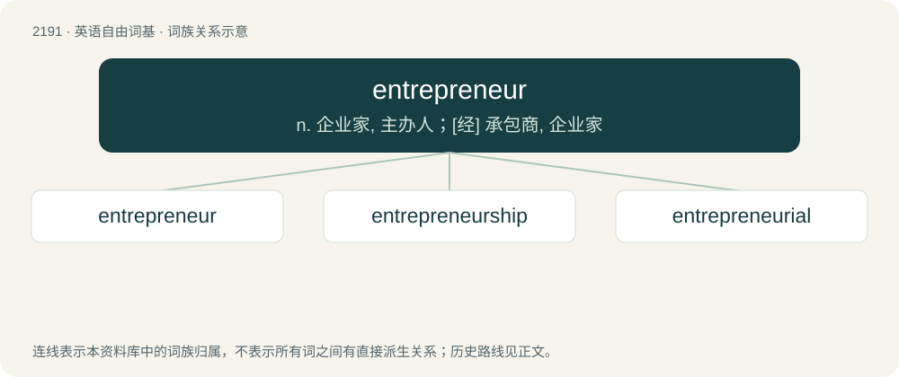

# 2294 · entrepreneur — n. 企业家, 主办人；\[经\] 承包商, 企业家

[总目录](../00_总目录_按常用程度.md)

**类型**：英语自由词基　｜　**来源语言**：见词源记录

## 核心含义与来源

- 核心含义：n. 企业家, 主办人；\[经\] 承包商, 企业家
- 英文含义：A person who sets up a business; generally, a person who owns and manages a business and assumes its financial risks.
- 词形：entrepreneur

**来源记录 1**（名词；A person who sets up a business; generally, a person who owns and manages a business and assumes its financial risks.）

Borrowed from French entrepreneur (“one who undertakes or manages”), from Middle French entrepreneur, from entreprendre (“to undertake”) + -eur.

## 词族图

## 单词速览（常用到不常用）

| 单词 | 音标 | 释义 |
|---|---|---|
| [entrepreneur](#w-1) | 英 /ˌɒn.tɹə.pɹəˈnɜː/；美 /ˌɑn.tɹə.pɹəˈnɝ/ | n. 企业家, 主办人；\[经\] 承包商, 企业家 |
| [entrepreneurship](#w-2) | 英 /ˌɒn.tɹə.pɹəˈnɜːʃɪp/；美 /ˌɑn.tɹə.pɹəˈnɝ.ʃɪp/ | 企业家能力/职能; 企业家\[主办人等\]的身份\[地位、职权、能力\] |
| [entrepreneurial](#w-3) | 英 /ˌɒn.tɹə.pɹəˈnɜː.ɹi.əl/；美 /ˌɑn.tɹə.pɹəˈnɝ.i.əl/ | a. 创业的, 具有企业精神的; 企业性质的 |

## 逐词详解

### 1. entrepreneur

**词性**：名词　｜　**音标**：英 /ˌɒn.tɹə.pɹəˈnɜː/；美 /ˌɑn.tɹə.pɹəˈnɝ/

**中文释义**：n. 企业家, 主办人；\[经\] 承包商, 企业家

**英文义项**：A person who sets up a business; generally, a person who owns and manages a business and assumes its financial risks. / A person who serves as an intermediary; a middleman; a go-between.

**词源与演化**：

Borrowed from French entrepreneur (“one who undertakes or manages”), from Middle French entrepreneur, from entreprendre (“to undertake”) + -eur.

**例句**：

> He's an Algerian entrepreneur who made his fortune in the fashion industry.

### 2. entrepreneurship

**词性**：名词　｜　**音标**：英 /ˌɒn.tɹə.pɹəˈnɜːʃɪp/；美 /ˌɑn.tɹə.pɹəˈnɝ.ʃɪp/

**中文释义**：企业家能力/职能; 企业家\[主办人等\]的身份\[地位、职权、能力\]

**英文义项**：The art or science of innovation and risk-taking for profit in business. / The quality of being an entrepreneur.

**构词拆分**：entrepreneur + -ship

**词源与演化**：

From entrepreneur + -ship.

**例句**：

> His experience lies in the field of entrepreneurship and social responsibility services.

### 3. entrepreneurial

**词性**：形容词　｜　**音标**：英 /ˌɒn.tɹə.pɹəˈnɜː.ɹi.əl/；美 /ˌɑn.tɹə.pɹəˈnɝ.i.əl/

**中文释义**：a. 创业的, 具有企业精神的; 企业性质的

**英文义项**：Having the spirit, attitude or qualities of an entrepreneur; enterprising.

**构词拆分**：entrepreneur + -ial

**词源与演化**：

From entrepreneur + -ial.

**例句**：

> Dependability is part of our entrepreneurial culture.
