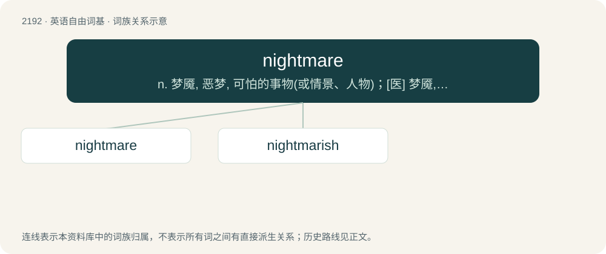

# 2295 · nightmare — n. 梦魇, 恶梦, 可怕的事物(或情景、人物)；\[医\] 梦魇, 恶梦

[总目录](../00_总目录_按常用程度.md)

**类型**：英语自由词基　｜　**来源语言**：见词源记录

## 核心含义与来源

- 核心含义：n. 梦魇, 恶梦, 可怕的事物(或情景、人物)；\[医\] 梦魇, 恶梦
- 英文含义：A very unpleasant or frightening dream.
- 词形：nightmare

**来源记录 1**（名词；A very unpleasant or frightening dream.）

From Middle English nyghtmare, from Old English \*nihtmare, equivalent to night + mare (“evil spirit believed to afflict a sleeping person”). Cognate with Scots nichtmare and nichtmeer, Dutch nachtmerrie, Middle Low German nachtmār, German Nachtmahr.

## 词族图

## 单词速览（常用到不常用）

| 单词 | 音标 | 释义 |
|---|---|---|
| [nightmare](#w-1) | 英 /ˈnaɪt.mɛə/；美 /ˈnaɪt.mɛɚ/ | n. 梦魇, 恶梦, 可怕的事物(或情景、人物)；\[医\] 梦魇, 恶梦 |
| [nightmarish](#w-2) | /ˈnait,meəriʃ/ | a. 梦魇似的, 可怕的, 经常使人恐惧的 |

## 逐词详解

### 1. nightmare

**词性**：名词　｜　**音标**：英 /ˈnaɪt.mɛə/；美 /ˈnaɪt.mɛɚ/

**中文释义**：n. 梦魇, 恶梦, 可怕的事物(或情景、人物)；\[医\] 梦魇, 恶梦

**英文义项**：A very unpleasant or frightening dream. / Any bad, miserable, difficult or terrifying situation or experience that arouses anxiety, terror, agony or great displeasure.

**构词拆分**：night + mare (“evil spirit believed to afflict a sleeping person”)

**词源与演化**：

From Middle English nyghtmare, from Old English \*nihtmare, equivalent to night + mare (“evil spirit believed to afflict a sleeping person”). Cognate with Scots nichtmare and nichtmeer, Dutch nachtmerrie, Middle Low German nachtmār, German Nachtmahr.

**例句**：

> Cleaning up after identity theft can be a nightmare of phone calls and letters.

该用例对应义项：Any bad, miserable, difficult or terrifying situation or experience that arouses anxiety, terror, agony or great displeasure.

### 2. nightmarish

**词性**：形容词　｜　**音标**：/ˈnait,meəriʃ/

**中文释义**：a. 梦魇似的, 可怕的, 经常使人恐惧的

**英文义项**：Resembling a nightmare.

**构词拆分**：nightmare + -ish

**词源与演化**：

From nightmare + -ish.

**例句**：

> Bruno had a nightmarish story to tell.
