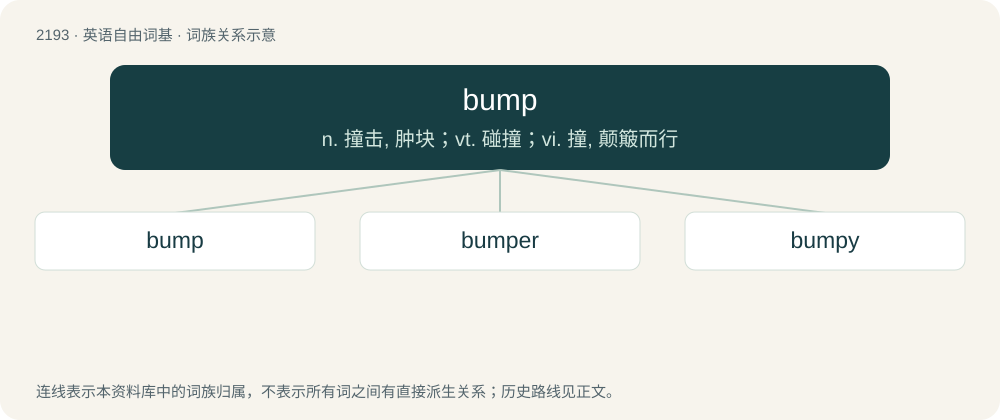

# 2296 · bump — n. 撞击, 肿块；vt. 碰撞；vi. 撞, 颠簸而行

[总目录](../00_总目录_按常用程度.md)

**类型**：英语自由词基　｜　**来源语言**：见词源记录

## 核心含义与来源

- 核心含义：n. 撞击, 肿块；vt. 碰撞；vi. 撞, 颠簸而行
- 英文含义：A light blow or jolting collision.
- 词形：bump

**多个词源／构词路径**：同一拼写可能有不同来源；以下按词性和含义分别列出。

**来源记录 1**（名词；A light blow or jolting collision.）

From Early Modern English bump (“a shock, blow from a collision”), probably of North Germanic origin; compare Danish bump (“a thump”), Danish bumpe (“to thump”), Old Danish bumpe (“to strike with a clenched fist”), all probably of imitative origin. Apparently related to Middle English bumben, bummen (“to make a hollow noise”), Dutch bommen (“to hum, buzz”), German Low German bumsen (“to bump, push”), German bummen (“to hum, buzz”), Icelandic bumba (“drum”). More at bum, bumble. Compare also bomb.

**来源记录 2**（名词；The breeding call made by the bittern; a boom.）

From Early Modern English; onomatopoeic.

## 词族图

## 单词速览（常用到不常用）

| 单词 | 音标 | 释义 |
|---|---|---|
| [bump](#w-1) | 美 /bʌmp/；/bʌmp/ | n. 撞击, 肿块；vt. 碰撞；vi. 撞, 颠簸而行 |
| [bumper](#w-2) | 英 /ˈbʌmpə/；美 /ˈbʌmpəɹ/ | n. 缓冲器, 满杯；a. 大胜利的 |
| [bumpy](#w-3) | /ˈbʌmpi/ | a. 颠簸的, 崎岖不平的 |

## 逐词详解

### 1. bump

**词性**：名词　｜　**音标**：美 /bʌmp/；/bʌmp/

**中文释义**：n. 撞击, 肿块；vt. 碰撞；vi. 撞, 颠簸而行

**英文义项**：A light blow or jolting collision. / The sound of such a collision.

**词源与演化**：

From Early Modern English bump (“a shock, blow from a collision”), probably of North Germanic origin; compare Danish bump (“a thump”), Danish bumpe (“to thump”), Old Danish bumpe (“to strike with a clenched fist”), all probably of imitative origin. Apparently related to Middle English bumben, bummen (“to make a hollow noise”), Dutch bommen (“to hum, buzz”), German Low German bumsen (“to bump, push”), German bummen (“to hum, buzz”), Icelandic bumba (“drum”). More at bum, bumble. Compare also bomb.

**例句**：

> The addition of the fight scenes gave the story a little bump near the end, but overall, it bored me.

该用例对应义项：A small increase in excitement or interest.

### 2. bumper

**词性**：名词　｜　**音标**：英 /ˈbʌmpə/；美 /ˈbʌmpəɹ/

**中文释义**：n. 缓冲器, 满杯；a. 大胜利的

**英文义项**：Someone or something that bumps. / A drinking vessel filled to the brim.

**构词拆分**：bump + -er

**词源与演化**：

From bump + -er.

**例句**：

> The company sells screw-on rubber bumpers and feet.

该用例对应义项：Any mechanical device used to absorb an impact, soften a collision, or protect against impact.

### 3. bumpy

**词性**：形容词　｜　**音标**：/ˈbʌmpi/

**中文释义**：a. 颠簸的, 崎岖不平的

**英文义项**：Rough; jumpy; causing or characterized by jolts and irregular movements. / Covered with or full of bumps.

**构词拆分**：bump + -y

**词源与演化**：

From bump + -y.

**用法示例／搭配（非完整句）**：

> a bumpy flight

该用例对应义项：Rough; jumpy; causing or characterized by jolts and irregular movements.
