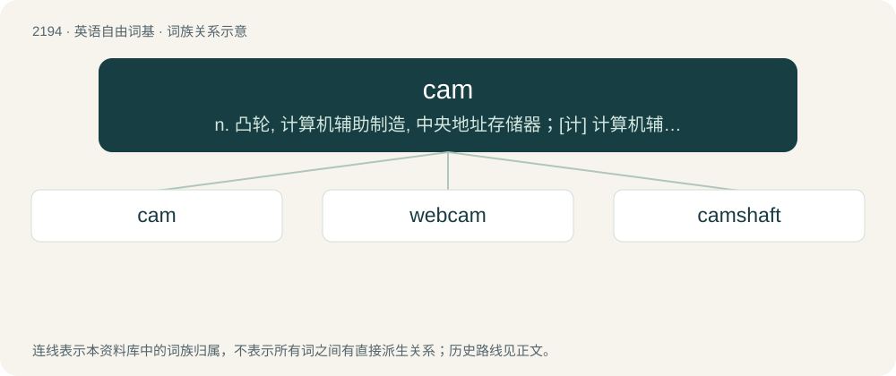

# 2297 · cam — n. 凸轮, 计算机辅助制造, 中央地址存储器；\[计\] 计算机辅助制造; 计算机辅助生产

[总目录](../00_总目录_按常用程度.md)

**类型**：英语自由词基　｜　**来源语言**：见词源记录

## 核心含义与来源

- 核心含义：n. 凸轮, 计算机辅助制造, 中央地址存储器；\[计\] 计算机辅助制造; 计算机辅助生产
- 英文含义：A turning or sliding piece which imparts motion to a rod, lever or block brought into sliding or rolling contact with it.
- 词形：cam

**来源记录 1**（名词；Camera.）

Clipping of camera.

## 词族图

## 单词速览（常用到不常用）

| 单词 | 音标 | 释义 |
|---|---|---|
| [cam](#w-1) | 美 /ˈkeə̯m/；/ˈkæm/ | n. 凸轮, 计算机辅助制造, 中央地址存储器；\[计\] 计算机辅助制造; 计算机辅助生产 |
| [webcam](#w-2) | 美 /ˈwɛbˌkæm/ | n. 网络摄像头 |
| [camshaft](#w-3) | /ˈkæmʃæft/ | n. 凸轮轴 |

## 逐词详解

### 1. cam

**词性**：名词　｜　**音标**：美 /ˈkeə̯m/；/ˈkæm/

**中文释义**：n. 凸轮, 计算机辅助制造, 中央地址存储器；\[计\] 计算机辅助制造; 计算机辅助生产

**英文义项**：Camera. / A bootleg recording of a film recorded in a movie theater.

**词源与演化**：

Clipping of camera.

**例句**：

> Luiz Vaz de Camões will be remembered as long as humanity exists on earth.

### 2. webcam

**词性**：名词　｜　**音标**：美 /ˈwɛbˌkæm/

**中文释义**：n. 网络摄像头

**英文义项**：A video camera whose output may be viewed in real time over a computer network, originally the World Wide Web.

**构词拆分**：Web + cam

**词源与演化**：

From Web + cam, shortened from camera.

**例句**：

> This tap made from brushed steel has an integrated 1.3 megapixel webcam and a hygrometer.

### 3. camshaft

**词性**：名词　｜　**音标**：/ˈkæmʃæft/

**中文释义**：n. 凸轮轴

**英文义项**：A shaft fitted with cams; especially one in a piston engine that activates the valves.

**构词拆分**：cam + shaft

**词源与演化**：

From cam + shaft.
