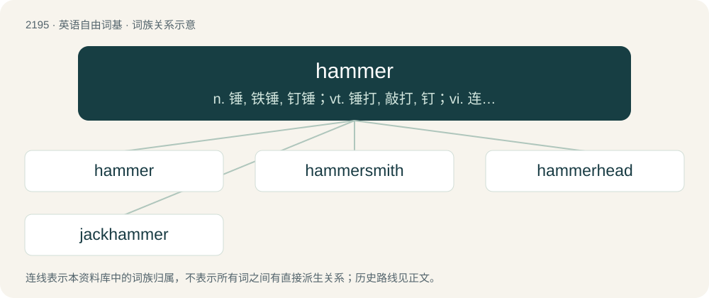

# 2299 · hammer — n. 锤, 铁锤, 钉锤；vt. 锤打, 敲打, 钉；vi. 连续锤打

[总目录](../00_总目录_按常用程度.md)

**类型**：英语自由词基　｜　**来源语言**：见词源记录

## 核心含义与来源

- 核心含义：n. 锤, 铁锤, 钉锤；vt. 锤打, 敲打, 钉；vi. 连续锤打
- 英文含义：A tool with a heavy head and a handle used for pounding.
- 词形：hammer

**来源记录 1**（名词；A tool with a heavy head and a handle used for pounding.）

From Middle English hamer, from Old English hamor, from Proto-West Germanic \*hamar, from Proto-Germanic \*hamaraz (“tool with a stone head”) (compare West Frisian hammer, Low German Hamer, Dutch hamer, German Hammer, Danish hammer, Swedish hammare). This is traditionally ascribed to Proto-Indo-European \*h₂eḱmoros, from \*h₂éḱmō (“stone”), but see \*hamaraz for further discussion. (declare a defaulter on the stock exchange): Originally signalled by knocking with a wooden mallet.

## 词族图

## 单词速览（常用到不常用）

| 单词 | 音标 | 释义 |
|---|---|---|
| [hammer](#w-1) | 英 /ˈhæmə/；美 /ˈhæmɚ/ | n. 锤, 铁锤, 钉锤；vt. 锤打, 敲打, 钉；vi. 连续锤打 |
| [hammersmith](#w-2) | /ˈhæməsmiθ/ | n. 锻工 |
| [hammerhead](#w-3) | /ˈhæməhed/ | n. 锤头, 笨人 |
| [jackhammer](#w-4) | 美 /ˈd͡ʒækˌhæmɚ/ | n. 手提钻 |

## 逐词详解

### 1. hammer

**词性**：名词　｜　**音标**：英 /ˈhæmə/；美 /ˈhæmɚ/

**中文释义**：n. 锤, 铁锤, 钉锤；vt. 锤打, 敲打, 钉；vi. 连续锤打

**英文义项**：A tool with a heavy head and a handle used for pounding. / The act of using a hammer to hit something.

**词源与演化**：

From Middle English hamer, from Old English hamor, from Proto-West Germanic \*hamar, from Proto-Germanic \*hamaraz (“tool with a stone head”) (compare West Frisian hammer, Low German Hamer, Dutch hamer, German Hammer, Danish hammer, Swedish hammare). This is traditionally ascribed to Proto-Indo-European \*h₂eḱmoros, from \*h₂éḱmō (“stone”), but see \*hamaraz for further discussion. (declare a defaulter on the stock exchange): Originally signalled by knocking with a wooden mallet.

**例句**：

> Bobby used a hammer and nails to fix the two planks together.

该用例对应义项：A tool with a heavy head and a handle used for pounding.

### 2. hammersmith

**词性**：名词　｜　**音标**：/ˈhæməsmiθ/

**中文释义**：n. 锻工

**英文义项**：A maker of hammers.

**构词拆分**：hammer + smith

**词源与演化**：

From hammer + smith.

### 3. hammerhead

**词性**：名词　｜　**音标**：/ˈhæməhed/

**中文释义**：n. 锤头, 笨人

**英文义项**：The portion of a hammer containing the metal striking face (also including the claw or peen if so equipped). / Any shark of the family Sphyrnidae, which only includes the genera Sphyrna and Zygaena, with eyes set on projections from the sides of the head.

**构词拆分**：hammer + head

**词源与演化**：

From hammer + head.

**例句**：

> The great hammerhead is a type of shark.

### 4. jackhammer

**词性**：名词　｜　**音标**：美 /ˈd͡ʒækˌhæmɚ/

**中文释义**：n. 手提钻

**英文义项**：A portable percussive power tool that combines a hammer and chisel used to drill or break hard matter, for instance rock or concrete. / Something that is very strong but also very rigid.

**构词拆分**：jack + hammer

**词源与演化**：

From jack + hammer.

**例句**：

> I could hear a jackhammer hammering in the distance.
