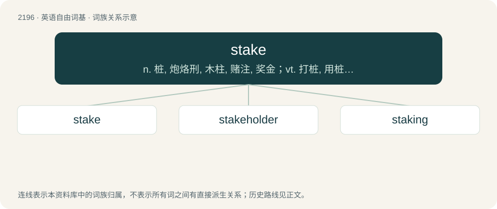

# 2301 · stake — n. 桩, 炮烙刑, 木柱, 赌注, 奖金；vt. 打桩, 用桩撑, 下赌注, 资助；vi. 打赌

[总目录](../00_总目录_按常用程度.md)

**类型**：英语自由词基　｜　**来源语言**：见词源记录

## 核心含义与来源

- 核心含义：n. 桩, 炮烙刑, 木柱, 赌注, 奖金；vt. 打桩, 用桩撑, 下赌注, 资助；vi. 打赌
- 英文含义：A piece of wood or other material, usually long and slender, pointed at one end so as to be easily driven into the ground as a marker or a support or stay.
- 词形：stake

**来源记录 1**（名词；A piece of wood or other material, usually long and slender, pointed at one end so as to be easily driven into the ground as a marker or a support or stay.）

From Middle English stake, from Old English staca (“pin, tack, stake”), from Proto-West Germanic \*stakō, from Proto-Germanic \*stakô (“stake”), from Proto-Indo-European \*stog-, \*steg- (“stake”). Cognate with Scots stak, staik, Saterland Frisian Stak, West Frisian staak, Dutch staak, Low German Stake, Norwegian stake, Spanish estaca.

## 词族图

## 单词速览（常用到不常用）

| 单词 | 音标 | 释义 |
|---|---|---|
| [stake](#w-1) | /steɪk/ | n. 桩, 炮烙刑, 木柱, 赌注, 奖金；vt. 打桩, 用桩撑, 下赌注, 资助；vi. 打赌 |
| [stakeholder](#w-2) | 英 /ˈsteɪkˌhəʊl.də/；美 /ˈsteɪkˌhoʊl.dɚ/ | n. 赌金保管者；\[法\] 赌款保存人, 保存保证金的人 |
| [staking](#w-3) | /ˈsteikiŋ/ | \[化\] 刮软 |

## 逐词详解

### 1. stake

**词性**：名词　｜　**音标**：/steɪk/

**中文释义**：n. 桩, 炮烙刑, 木柱, 赌注, 奖金；vt. 打桩, 用桩撑, 下赌注, 资助；vi. 打赌

**英文义项**：A piece of wood or other material, usually long and slender, pointed at one end so as to be easily driven into the ground as a marker or a support or stay. / A piece of wood driven in the ground, placed in the middle of the court, that is used as the finishing point after scoring 12 hoops in croquet.

**词源与演化**：

From Middle English stake, from Old English staca (“pin, tack, stake”), from Proto-West Germanic \*stakō, from Proto-Germanic \*stakô (“stake”), from Proto-Indo-European \*stog-, \*steg- (“stake”). Cognate with Scots stak, staik, Saterland Frisian Stak, West Frisian staak, Dutch staak, Low German Stake, Norwegian stake, Spanish estaca.

**例句**：

> We have surveyor's stakes at all four corners of this field, to mark exactly its borders.

该用例对应义项：A piece of wood or other material, usually long and slender, pointed at one end so as to be easily driven into the ground as a marker or a support or stay.

### 2. stakeholder

**词性**：名词　｜　**音标**：英 /ˈsteɪkˌhəʊl.də/；美 /ˈsteɪkˌhoʊl.dɚ/

**中文释义**：n. 赌金保管者；\[法\] 赌款保存人, 保存保证金的人

**英文义项**：A person holding the stakes of bettors, with the responsibility of delivering the pot to the winner of the bet. / A person such as a trustee, escrow agent or garnishee, who holds money or assets under trust for another party in a contractual agreement or as part of a claim.

**构词拆分**：stake + holder

**词源与演化**：

From stake + holder.

**例句**：

> The stakeholder most deeply affected by this decision is the chief executive officer.

### 3. staking

**词性**：名词　｜　**音标**：/ˈsteikiŋ/

**中文释义**：\[化\] 刮软

**英文义项**：An act of stabbing with a stake.

**构词拆分**：stake + -ing

**词源与演化**：

From Middle English stakyng, staking, from Old English stacung (“staking”), from Old English \*stacian (“to drive stakes”), equivalent to stake + -ing.

**例句**：

> The world is staking its future on the months to come.
