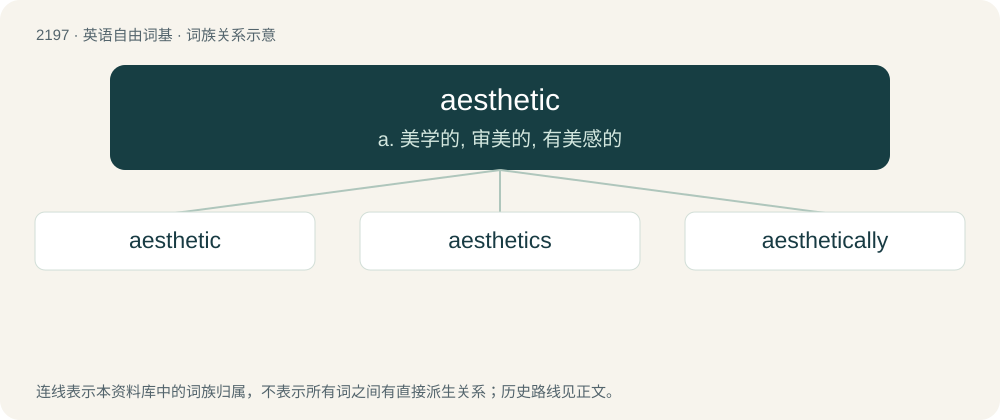

# 2302 · aesthetic — a. 美学的, 审美的, 有美感的

[总目录](../00_总目录_按常用程度.md)

**类型**：英语自由词基　｜　**来源语言**：见词源记录

## 核心含义与来源

- 核心含义：a. 美学的, 审美的, 有美感的
- 英文含义：Concerned with beauty, artistic effect, or appearance.
- 词形：aesthetic

**来源记录 1**（形容词；Concerned with beauty, artistic effect, or appearance.）

From German Ästhetik or French esthétique, both from New Latin aesthēticus, itself borrowed from Ancient Greek αἰσθητικός (aisthētikós, “of sense perception”), from αἰσθάνομαι (aisthánomai, “to feel”); analysable as aesthe(sis) + -tic. Cognates include Proto-Germanic \*awiz (“obvious”), Sanskrit आविस् (āvís, “manifestly, evidently”) and Latin audiō.

## 词族图

## 单词速览（常用到不常用）

| 单词 | 音标 | 释义 |
|---|---|---|
| [aesthetic](#w-1) | 英 /iːsˈθɛ.tɪk/；美 /ɛsˈθɛ.tɪk/ | a. 美学的, 审美的, 有美感的 |
| [aesthetics](#w-2) | /ɛsˈθɛt.ɪks/ | n. 美学 |
| [aesthetically](#w-3) | /iːsˈθetikəli/ | adv. 美学观点上地；审美地 |

## 逐词详解

### 1. aesthetic

**词性**：形容词　｜　**音标**：英 /iːsˈθɛ.tɪk/；美 /ɛsˈθɛ.tɪk/

**中文释义**：a. 美学的, 审美的, 有美感的

**英文义项**：Concerned with beauty, artistic effect, or appearance. / Beautiful or appealing to one's sense of beauty or art.

**构词拆分**：aesthe(sis) + -tic

**词源与演化**：

From German Ästhetik or French esthétique, both from New Latin aesthēticus, itself borrowed from Ancient Greek αἰσθητικός (aisthētikós, “of sense perception”), from αἰσθάνομαι (aisthánomai, “to feel”); analysable as aesthe(sis) + -tic. Cognates include Proto-Germanic \*awiz (“obvious”), Sanskrit आविस् (āvís, “manifestly, evidently”) and Latin audiō.

**例句**：

> It works well enough, but the shabby exterior offends his aesthetic sensibilities.

该用例对应义项：Concerned with beauty, artistic effect, or appearance.

### 2. aesthetics

**词性**：名词　｜　**音标**：/ɛsˈθɛt.ɪks/

**中文释义**：n. 美学

**英文义项**：The study or philosophy of beauty. / An artist's principles, preferences, and/or his agenda

**构词拆分**：aesthetic + -ics

**词源与演化**：

From aesthetic + -ics.

**例句**：

> Traditional aesthetics assumed the existence of universal and timeless criteria of artistic value.

该用例对应义项：(art) the branch of philosophy dealing with beauty and taste (emphasizing the evaluative criteria that are applied to art)

### 3. aesthetically

**词性**：副词　｜　**音标**：/iːsˈθetikəli/

**中文释义**：adv. 美学观点上地；审美地

**英文义项**：In an aesthetic manner; with a pleasing sensory effect.

**构词拆分**：aesthetic + -ally

**词源与演化**：

From aesthetic + -ally.

**例句**：

> These diacritics are unnecessary and aesthetically displeasing.
