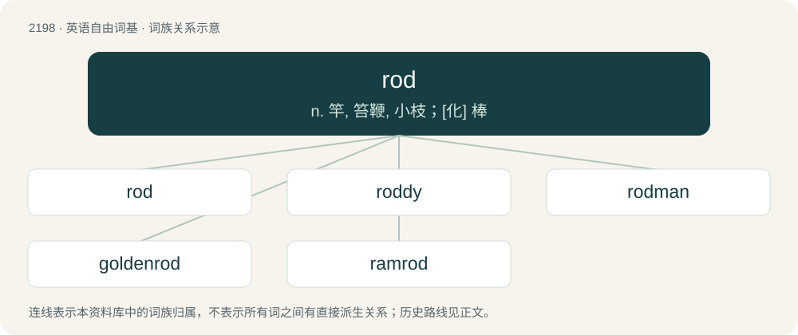

# 2304 · rod — n. 竿, 笞鞭, 小枝；\[化\] 棒

[总目录](../00_总目录_按常用程度.md)

**类型**：英语自由词基　｜　**来源语言**：见词源记录

## 核心含义与来源

- 核心含义：n. 竿, 笞鞭, 小枝；\[化\] 棒
- 英文含义：A straight, round stick, shaft, bar, cane, or staff.
- 词形：rod

**来源记录 1**（名词；A straight, round stick, shaft, bar, cane, or staff.）

From Middle English rodde, from Old English \*rodd or \*rodde (attested in dative plural roddum (“rod, pole”)), of uncertain origin, but probably from Proto-Germanic \*rudd- (“stick, club”), from Proto-Indo-European \*rewdʰ- (“to clear land”). Compare Old Norse rudda (“club”). For the root, compare English rid. Presumably unrelated to Proto-Germanic \*rōdō (“rod, pole”).

## 词族图

## 单词速览（常用到不常用）

| 单词 | 音标 | 释义 |
|---|---|---|
| [rod](#w-1) | 英 /ɹɒd/；美 /ɹɑd/ | n. 竿, 笞鞭, 小枝；\[化\] 棒 |
| [roddy](#w-2) |  | 【英文】Full of rods or twigs. |
| [rodman](#w-3) | /ˈrɔdmən,-mæn/ | n. 钓鱼人, 司尺员, 标杆员 |
| [goldenrod](#w-4) | 美 /ˈɡoʊldənˌɹɑd/ | n. 一种黄花属植物 |
| [ramrod](#w-5) | 英 /ˈɹæmɹɒd/；美 /ˈɹæmɹɑd/ | n. 输弹机, 死板的人；a. 笔直的, 生硬的 |

## 逐词详解

### 1. rod

**词性**：名词　｜　**音标**：英 /ɹɒd/；美 /ɹɑd/

**中文释义**：n. 竿, 笞鞭, 小枝；\[化\] 棒

**英文义项**：A straight, round stick, shaft, bar, cane, or staff. / A longitudinal pole used for forming part of a framework such as an awning or tent.

**词源与演化**：

From Middle English rodde, from Old English \*rodd or \*rodde (attested in dative plural roddum (“rod, pole”)), of uncertain origin, but probably from Proto-Germanic \*rudd- (“stick, club”), from Proto-Indo-European \*rewdʰ- (“to clear land”). Compare Old Norse rudda (“club”). For the root, compare English rid. Presumably unrelated to Proto-Germanic \*rōdō (“rod, pole”).

**例句**：

> The circus strong man proved his strength by bending an iron rod, and then straightening it.

该用例对应义项：A straight, round stick, shaft, bar, cane, or staff.

### 2. roddy

**词性**：形容词

**英文义项**：Full of rods or twigs.

**构词拆分**：rod + -y

**词源与演化**：

From rod + -y.

### 3. rodman

**词性**：名词　｜　**音标**：/ˈrɔdmən,-mæn/

**中文释义**：n. 钓鱼人, 司尺员, 标杆员

**英文义项**：Synonym of rodsman.

**构词拆分**：rod + -man

**词源与演化**：

From rod + -man.

### 4. goldenrod

**词性**：名词　｜　**音标**：美 /ˈɡoʊldənˌɹɑd/

**中文释义**：n. 一种黄花属植物

**英文义项**：Any tall-stemmed plant principally from genus Solidago (also Oligoneuron), usually with clusters of small yellow flowers. / A golden-yellow colour, like that of the goldenrod plant.

**构词拆分**：golden + rod

**词源与演化**：

From golden + rod.

### 5. ramrod

**词性**：动词　｜　**音标**：英 /ˈɹæmɹɒd/；美 /ˈɹæmɹɑd/

**中文释义**：n. 输弹机, 死板的人；a. 笔直的, 生硬的

**英文义项**：To force; to coerce. / To force to remain upright.

**构词拆分**：ram + rod

**词源与演化**：

From ram + rod.

**例句**：

> That new project manager is just the one to ramrod this through to completion.

该用例对应义项：To force; to coerce.
