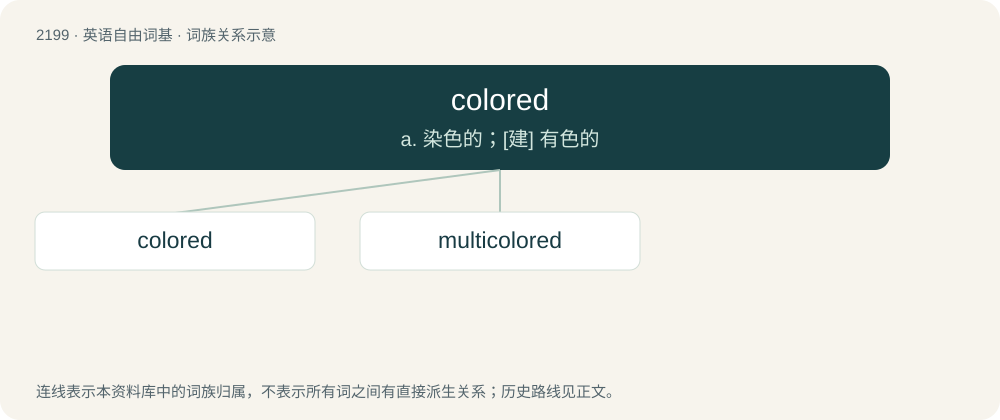

# 2305 · colored — a. 染色的；\[建\] 有色的

[总目录](../00_总目录_按常用程度.md)

**类型**：英语自由词基　｜　**来源语言**：见词源记录

## 核心含义与来源

- 核心含义：a. 染色的；\[建\] 有色的
- 英文含义：Having a color.
- 词形：colored

**来源记录 1**（形容词；Having a color.）

From color + -ed.

## 词族图

## 单词速览（常用到不常用）

| 单词 | 音标 | 释义 |
|---|---|---|
| [colored](#w-1) | 英 /ˈkʌləd/；美 /ˈkʌləɹd/ | a. 染色的；\[建\] 有色的 |
| [multicolored](#w-2) | 英 /ˈmʌltɪˌkʌləd/；美 /ˈmʌltɪˌkʌlɚd/ | a. 多种色彩的, 五彩缤纷的 |

## 逐词详解

### 1. colored

**词性**：形容词　｜　**音标**：英 /ˈkʌləd/；美 /ˈkʌləɹd/

**中文释义**：a. 染色的；\[建\] 有色的

**英文义项**：Having a color. / Having a particular color or kind of color.

**构词拆分**：color + -ed

**词源与演化**：

From color + -ed.

**例句**：

> Wash colored items separately from whites and darks to prevent the colors from bleeding.

该用例对应义项：Having a color.

### 2. multicolored

**词性**：形容词　｜　**音标**：英 /ˈmʌltɪˌkʌləd/；美 /ˈmʌltɪˌkʌlɚd/

**中文释义**：a. 多种色彩的, 五彩缤纷的

**英文义项**：Having multiple colors.

**构词拆分**：multi- + colored

**词源与演化**：

From multi- + colored.

**例句**：

> The slogan for the day against extremism was, "multicolored instead of brown".
