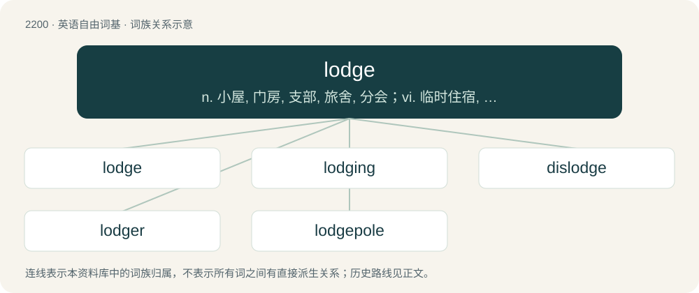

# 2306 · lodge — n. 小屋, 门房, 支部, 旅舍, 分会；vi. 临时住宿, 倒伏, 寄宿, 投宿；vt. 安顿, 容纳, 提出, 把...射入, 存放

[总目录](../00_总目录_按常用程度.md)

**类型**：英语自由词基　｜　**来源语言**：见词源记录

## 核心含义与来源

- 核心含义：n. 小屋, 门房, 支部, 旅舍, 分会；vi. 临时住宿, 倒伏, 寄宿, 投宿；vt. 安顿, 容纳, 提出, 把...射入, 存放
- 英文含义：A building for recreational use such as a hunting lodge or a summer cabin.
- 词形：lodge

**来源记录 1**（名词；A building for recreational use such as a hunting lodge or a summer cabin.）

From Middle English logge, from Old French loge (“an arbour, a covered walk-way”). See also Medieval Latin lobia, laubia; also Old High German louba (“a porch, a gallery”) (German Laube (“bower, arbor”)), Old High German loub (“leaf, foliage”), Old English lēaf (“leaf, foliage”). Doublet of loggia and lobby.

## 词族图

## 单词速览（常用到不常用）

| 单词 | 音标 | 释义 |
|---|---|---|
| [lodge](#w-1) | 英 /lɒd͡ʒ/；美 /lɑd͡ʒ/ | n. 小屋, 门房, 支部, 旅舍, 分会；vi. 临时住宿, 倒伏, 寄宿, 投宿；vt. 安顿, 容纳, 提出, 把...射入, 存放 |
| [lodging](#w-2) | 英 /ˈlɒd͡ʒɪŋ/；美 /ˈlɑd͡ʒɪŋ/ | n. 寄宿处, 寄宿；\[法\] 提起, 住所 |
| [dislodge](#w-3) | 英 /dɪsˈlɒdʒ/ | vt. 逐出, 使移动, 驱逐；vi. 离开原位 |
| [lodger](#w-4) | 英 /ˈlɒd͡ʒə/；美 /ˈlɑd͡ʒɚ/ | n. 寄宿者, 房客；\[法\] 寄宿人 |
| [lodgepole](#w-5) | /ˈlɔdʒpəul/ | \[地名\] \[美国\] 洛奇波尔 |

## 逐词详解

### 1. lodge

**词性**：动词　｜　**音标**：英 /lɒd͡ʒ/；美 /lɑd͡ʒ/

**中文释义**：n. 小屋, 门房, 支部, 旅舍, 分会；vi. 临时住宿, 倒伏, 寄宿, 投宿；vt. 安顿, 容纳, 提出, 把...射入, 存放

**英文义项**：To be firmly fixed in a specified position. / To firmly fix in a specified position.

**词源与演化**：

From Middle English logge, from Old French loge (“an arbour, a covered walk-way”). See also Medieval Latin lobia, laubia; also Old High German louba (“a porch, a gallery”) (German Laube (“bower, arbor”)), Old High German loub (“leaf, foliage”), Old English lēaf (“leaf, foliage”). Doublet of loggia and lobby.

**例句**：

> The heavy rain caused the wheat to lodge.

该用例对应义项：To become flattened, as grass or grain, when overgrown or beaten down by the wind.

### 2. lodging

**词性**：名词　｜　**音标**：英 /ˈlɒd͡ʒɪŋ/；美 /ˈlɑd͡ʒɪŋ/

**中文释义**：n. 寄宿处, 寄宿；\[法\] 提起, 住所

**英文义项**：A place to live or lodge. / Sleeping accommodation.

**构词拆分**：lodge + -ing

**词源与演化**：

From lodge + -ing.

**例句**：

> The people whose houses were demolished received lodging in the square.

### 3. dislodge

**词性**：动词　｜　**音标**：英 /dɪsˈlɒdʒ/

**中文释义**：vt. 逐出, 使移动, 驱逐；vi. 离开原位

**英文义项**：To remove or force out from a position or dwelling previously occupied. / To move or go from a dwelling or former position.

**构词拆分**：dis- + lodge

**词源与演化**：

From Middle English disloggen, from Old French deslogier. Compare French déloger. Equivalent to dis- + lodge.

**例句**：

> The blow of the hammer was enough to dislodge the loose brick.

### 4. lodger

**词性**：名词　｜　**音标**：英 /ˈlɒd͡ʒə/；美 /ˈlɑd͡ʒɚ/

**中文释义**：n. 寄宿者, 房客；\[法\] 寄宿人

**英文义项**：A person who lodges in another's house (compare tenant).

**构词拆分**：lodge + -er

**词源与演化**：

From lodge + -er.

**例句**：

> The police questioned the lodger after the incident.

该用例对应义项：A person who lodges in another's house (compare tenant).

### 5. lodgepole

**词性**：名词　｜　**音标**：/ˈlɔdʒpəul/

**中文释义**：\[地名\] \[美国\] 洛奇波尔

**英文义项**：A lodgepole pine or its wood.

**构词拆分**：lodge + pole

**词源与演化**：

From lodge + pole.
