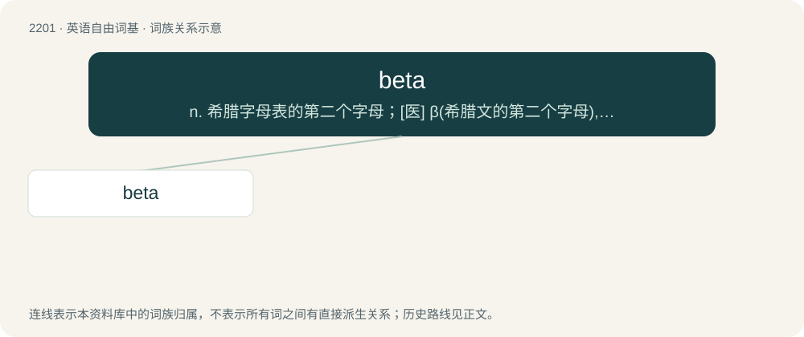

# 2307 · beta — n. 希腊字母表的第二个字母；\[医\] β(希腊文的第二个字母), 乙种

[总目录](../00_总目录_按常用程度.md)

**类型**：英语自由词基　｜　**来源语言**：见词源记录

## 核心含义与来源

- 核心含义：n. 希腊字母表的第二个字母；\[医\] β(希腊文的第二个字母), 乙种
- 英文含义：The second letter of the Greek alphabet (Β, β), preceded by alpha (Α, α) and followed by gamma, (Γ, γ). In modern Greek it represents the voiced labiodental fricative sound of v found in the English words have and vase.
- 词形：beta

**多个词源／构词路径**：同一拼写可能有不同来源；以下按词性和含义分别列出。

**来源记录 1**（名词；The second letter of the Greek alphabet (Β, β), preceded by alpha (Α, α) and followed by gamma, (Γ, γ). In modern Greek it represents the voiced labiodental fricative sound of v found in the English words have and vase.）

Borrowed from Ancient Greek βῆτᾰ (bêtă). Doublet of beth.

**来源记录 2**（名词；a term of endearment, used towards someone of equal or lower standing such as a friend or child, similar to brother or son）

Borrowed from Hindi बेटा (beṭā).

## 词族图

## 单词速览（常用到不常用）

| 单词 | 音标 | 释义 |
|---|---|---|
| [beta](#w-1) | 英 /ˈbiːtə/；美 /ˈbeɪtə/ | n. 希腊字母表的第二个字母；\[医\] β(希腊文的第二个字母), 乙种 |

## 逐词详解

### 1. beta

**词性**：名词　｜　**音标**：英 /ˈbiːtə/；美 /ˈbeɪtə/

**中文释义**：n. 希腊字母表的第二个字母；\[医\] β(希腊文的第二个字母), 乙种

**英文义项**：The second letter of the Greek alphabet (Β, β), preceded by alpha (Α, α) and followed by gamma, (Γ, γ). In modern Greek it represents the voiced labiodental fricative sound of v found in the English words have and vase. / An academic grade better than a gamma and worse than an alpha.

**词源与演化**：

Borrowed from Ancient Greek βῆτᾰ (bêtă). Doublet of beth.

**例句**：

> The company is offering a public beta program to test the software.

该用例对应义项：The phase of development after alpha testing and before launch, in which software, while not complete, has been released to potential users for testing.
