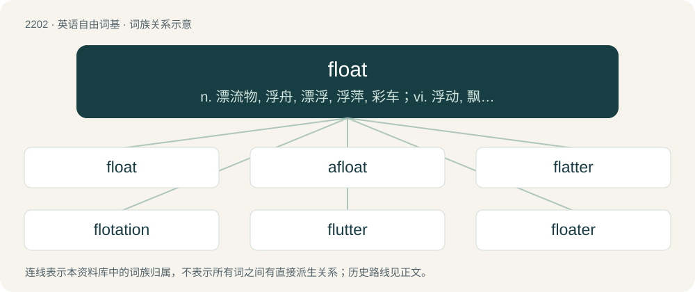

# 2308 · float — n. 漂流物, 浮舟, 漂浮, 浮萍, 彩车；vi. 浮动, 飘动, 散播, 摇摆, 动摇, 浮动；vt. 使漂浮, 容纳, 淹没, 发行, 实行

[总目录](../00_总目录_按常用程度.md)

**类型**：英语自由词基　｜　**来源语言**：见词源记录

## 核心含义与来源

- 核心含义：n. 漂流物, 浮舟, 漂浮, 浮萍, 彩车；vi. 浮动, 飘动, 散播, 摇摆, 动摇, 浮动；vt. 使漂浮, 容纳, 淹没, 发行, 实行
- 英文含义：To be supported by a fluid of greater density (than the object).
- 词形：float

**多个词源／构词路径**：同一拼写可能有不同来源；以下按词性和含义分别列出。

**来源记录 1**（动词；To be supported by a fluid of greater density (than the object).）

From Middle English floten, from Old English flotian (“to float”), from Proto-West Germanic \*flotōn, from Proto-Germanic \*flutōną (“to float”), from Proto-Indo-European \*plewd-, \*plew- (“to float, swim, fly”). Compare flow, fleet.

**来源记录 2**（名词；A buoyant device used to support something in water or another liquid.）

From Middle English flote, from Old English flota (“sailor, boat”), from Proto-West Germanic \*flotō, from Proto-Germanic \*flutô, from Proto-Indo-European \*plewd-.

## 词族图

## 单词速览（常用到不常用）

| 单词 | 音标 | 释义 |
|---|---|---|
| [float](#w-1) | 英 /fləʊt/；美 /floʊt/ | n. 漂流物, 浮舟, 漂浮, 浮萍, 彩车；vi. 浮动, 飘动, 散播, 摇摆, 动摇, 浮动；vt. 使漂浮, 容纳, 淹没, 发行, 实行 |
| [afloat](#w-2) | 英 /əˈfləʊt/；美 /əˈfloʊt/ | a. 飘浮着的, 在海上的, 浸满水的, 在进行中的；adv. 飘浮着, 在海上, 浸满水, 在进行中 |
| [flatter](#w-3) | 英 /ˈflætə/；美 /ˈflætɚ/ | vt. 奉承, 阿谀, 使高兴；\[机\] 平面锤 |
| [flotation](#w-4) | 英 /fləʊˈteɪʃən/；美 /floʊˈteɪʃən/ | \[化\] 浮; 浮游选矿；\[医\] 浮集(法), 浮选(法) |
| [flutter](#w-5) | 英 /ˈflʌtə/；美 /ˈflʌtɚ/ | n. 摆动, 鼓翼, 烦扰；vi. 摆动, 鼓翼, 烦扰；vt. 拍(翅), 使焦急 |
| [floater](#w-6) | 英 /ˈfləʊtə/；美 /ˈfloʊtəɹ/ | n. 漂浮者, 漂浮物, (企业等的)筹资开办者；\[法\] 发行人, 发起人, 流动证券 |
| [floaty](#w-7) | 英 /ˈfləʊti/；美 /ˈfloʊti/ | a. 能浮起的, 吃水浅的 |

## 逐词详解

### 1. float

**词性**：动词　｜　**音标**：英 /fləʊt/；美 /floʊt/

**中文释义**：n. 漂流物, 浮舟, 漂浮, 浮萍, 彩车；vi. 浮动, 飘动, 散播, 摇摆, 动摇, 浮动；vt. 使漂浮, 容纳, 淹没, 发行, 实行

**英文义项**：To be supported by a fluid of greater density (than the object). / To be supported by a liquid of greater density, such that part (of the object or substance) remains above the surface.

**词源与演化**：

From Middle English floten, from Old English flotian (“to float”), from Proto-West Germanic \*flotōn, from Proto-Germanic \*flutōną (“to float”), from Proto-Indo-European \*plewd-, \*plew- (“to float, swim, fly”). Compare flow, fleet.

**例句**：

> I floated the idea of free ice cream on Fridays, but no one was interested.

该用例对应义项：To propose (an idea) for consideration.

### 2. afloat

**词性**：形容词　｜　**音标**：英 /əˈfləʊt/；美 /əˈfloʊt/

**中文释义**：a. 飘浮着的, 在海上的, 浸满水的, 在进行中的；adv. 飘浮着, 在海上, 浸满水, 在进行中

**英文义项**：Floating. / In, or found while in, a vessel at sea or on another body of water.

**构词拆分**：a- + float

**词源与演化**：

From a- + float.

**例句**：

> The supervisor was never fired, though countless accusations of dishonesty were afloat.

该用例对应义项：Believed or talked about by many people; being passed from person to person.

### 3. flatter

**词性**：动词　｜　**音标**：英 /ˈflætə/；美 /ˈflætɚ/

**中文释义**：vt. 奉承, 阿谀, 使高兴；\[机\] 平面锤

**英文义项**：To compliment someone, often (but not necessarily) insincerely and sometimes to win favour. / To enhance or gratify someone's vanity by praising them.

**构词拆分**：float + -er

**词源与演化**：

\*From Middle English flatteren, flateren (“to flutter, float, fawn over”), probably a conflation of Old English floterian, flotorian (“to flutter, float, be disquieted”), from Proto-West Germanic \*flotrōn, from Proto-Germanic \*flutrōną (“to be floating”), from Proto-Indo-European \*plewd- (“to flow, swim”), equivalent to float + -er; and Old Norse flaðra (“to fawn on someone, flatter”), from Proto-Germanic \*flaþrōną (“to fawn over, flutter”), from Proto-Indo-European \*peled- (“moisture, wetness”), \*pel- (“to gush, pour out, fill, flow, swim, fly”). Cognate with Scots flatter, flotter (“to float; splash; cover with liquid”), Middle Dutch flatteren (“to embellish, flatter, caress”), German flattern (“to flutter”). \*The word was also falsely associated with Middle French flatter (“to flatter, to caress with the flat of the hand”), from Old French flater (“to deceive by concealing the truth, to stroke with the palm of the hand”), from Frankish \*flat (“palm, flat of the hand”), from Proto-Germanic \*flatą, \*flatō (“palm, sole”), from \*flataz (“flat”), probably from Proto-Indo-European \*pleth₂-, \*pleh₂- (“flat, broad, plain”); related to Old High German flazza (“palm, flat of the hand”), Old High German flaȥ (“level, flat”), Old Saxon flat (“flat”), Old Norse flatr (“flat”) (whence English flat), Old Frisian flet, flette (“dwelling, house”), Old English flet, flett (“ground floor, dwelling”). More at flat.

**例句**：

> Before the results came out, I flattered myself that I had done well on the test. It turned out I was the worst in the class!

该用例对应义项：To cheer or please (with the idea that); congratulate oneself, especially when the perception is false.

### 4. flotation

**词性**：名词　｜　**音标**：英 /fləʊˈteɪʃən/；美 /floʊˈteɪʃən/

**中文释义**：\[化\] 浮; 浮游选矿；\[医\] 浮集(法), 浮选(法)

**英文义项**：A state of floating, or being afloat. / The ability (as of a tire or snowshoes) to stay on the surface of soft ground or snow.

**构词拆分**：float + -ation

**词源与演化**：

From float + -ation.

**例句**：

> A life jacket is one type of flotation device.

### 5. flutter

**词性**：动词　｜　**音标**：英 /ˈflʌtə/；美 /ˈflʌtɚ/

**中文释义**：n. 摆动, 鼓翼, 烦扰；vi. 摆动, 鼓翼, 烦扰；vt. 拍(翅), 使焦急

**英文义项**：To flap or wave quickly but irregularly. / Of a winged animal: to flap the wings without flying; to fly with a light flapping of the wings.

**构词拆分**：float + -er (frequentative suffix)

**词源与演化**：

From Middle English floteren, from Old English floterian, flotorian (“to float about, flutter”), from Proto-Germanic \*flutrōną, frequentative of Proto-Germanic \*flutōną (“to float”), equivalent to float + -er (frequentative suffix). Cognate with West Frisian flodderje (“to flutter, beat”), Dutch flodderen (“to flutter, wave”), Low German fluttern, fluddern (“to flutter”), German flittern (“to sparkle, glitter”). More at float.

**例句**：

> A bird flutters its wings.

该用例对应义项：To cause something to flap.

### 6. floater

**词性**：名词　｜　**音标**：英 /ˈfləʊtə/；美 /ˈfloʊtəɹ/

**中文释义**：n. 漂浮者, 漂浮物, (企业等的)筹资开办者；\[法\] 发行人, 发起人, 流动证券

**英文义项**：A person who physically floats in a gas or liquid. / A corpse floating in a body of water.

**构词拆分**：float + -er (suffix forming agent nouns)

**词源与演化**：

From float + -er (suffix forming agent nouns). Compare Old English flota (“boat, ship", also "sailor, pirate”, literally “floater”), whence Middle English flote (“a fleet of ships", also, "a float, flotation device”).

**例句**：

> He left a floater in the toilet.

该用例对应义项：A piece of faeces which floats.

### 7. floaty

**词性**：形容词　｜　**音标**：英 /ˈfləʊti/；美 /ˈfloʊti/

**中文释义**：a. 能浮起的, 吃水浅的

**英文义项**：Tending to float on a liquid or to rise in air or a gas; buoyant. / Of music: light and relaxing.

**构词拆分**：float (noun or verb) + -y (suffix meaning ‘inclined to’ forming adjectives)

**词源与演化**：

From float (noun or verb) + -y (suffix meaning ‘inclined to’ forming adjectives). Compare Middle English floti, floty (“of a place: well supplied with water”).

**例句**：

> How do you deflate this floaty?
