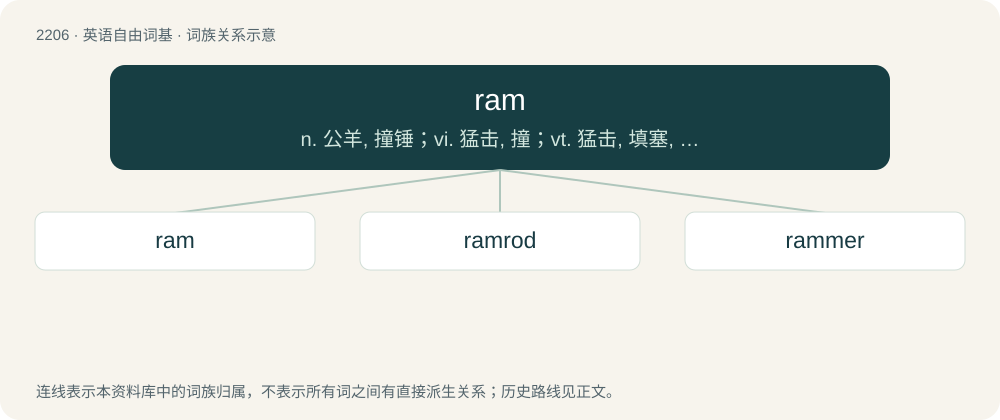

# 2311 · ram — n. 公羊, 撞锤；vi. 猛击, 撞；vt. 猛击, 填塞, 反复灌输

[总目录](../00_总目录_按常用程度.md)

**类型**：英语自由词基　｜　**来源语言**：见词源记录

## 核心含义与来源

- 核心含义：n. 公羊, 撞锤；vi. 猛击, 撞；vt. 猛击, 填塞, 反复灌输
- 英文含义：A male sheep, typically uncastrated.
- 词形：ram

**多个词源／构词路径**：同一拼写可能有不同来源；以下按词性和含义分别列出。

**来源记录 1**（名词；A male sheep, typically uncastrated.）

From Middle English ram, rom, ramme, from Old English ramm (“ram”), from Proto-Germanic \*rammaz (“ram”), possibly from \*rammaz (“strong”). Cognate with Saterland Frisian Rom (“ram”), Dutch ram (“a male sheep”), German Ramm, Ramme (“ram”). Possibly akin also to Danish ram (“sharp; acrid; rank”), Swedish ram (“strong; perfect”), Faroese ramur (“strong; competent”), Icelandic rammur (“strong; sturdy”).

**来源记录 2**（动词；To collide with (an object), usually with the intention of damaging it or disabling its function.）

From Middle English rammen, from the noun (see above). Compare Old High German rammen.

**来源记录 3**（形容词；Rancid; offensive in smell or taste.）

Likely from Old Norse ramr, rammr (“strong, rank, bitter”), from Proto-Germanic \*rammaz (“strong, overbearing; acrid, rank”), perhaps ultimately related to Etymology 1 above. Compare Scots ram (“a rank odour”). Compare also Middle English rammish (“rank, offensive in smell”).

## 词族图

## 单词速览（常用到不常用）

| 单词 | 音标 | 释义 |
|---|---|---|
| [ram](#w-1) | 英 /ɹæm/；美 /ɹæm/ | n. 公羊, 撞锤；vi. 猛击, 撞；vt. 猛击, 填塞, 反复灌输 |
| [ramrod](#w-2) | 英 /ˈɹæmɹɒd/；美 /ˈɹæmɹɑd/ | n. 输弹机, 死板的人；a. 笔直的, 生硬的 |
| [rammer](#w-3) | /ˈɹæ.mə(ɹ)/ | n. 撞槌, 推弹器；\[机\] 捣砂锤 |

## 逐词详解

### 1. ram

**词性**：名词　｜　**音标**：英 /ɹæm/；美 /ɹæm/

**中文释义**：n. 公羊, 撞锤；vi. 猛击, 撞；vt. 猛击, 填塞, 反复灌输

**英文义项**：A male sheep, typically uncastrated. / A battering ram; a heavy object used for breaking through doors.

**词源与演化**：

From Middle English ram, rom, ramme, from Old English ramm (“ram”), from Proto-Germanic \*rammaz (“ram”), possibly from \*rammaz (“strong”). Cognate with Saterland Frisian Rom (“ram”), Dutch ram (“a male sheep”), German Ramm, Ramme (“ram”). Possibly akin also to Danish ram (“sharp; acrid; rank”), Swedish ram (“strong; perfect”), Faroese ramur (“strong; competent”), Icelandic rammur (“strong; sturdy”).

**例句**：

> The SWAT team broke down the front door with a battering ram.

### 2. ramrod

**词性**：动词　｜　**音标**：英 /ˈɹæmɹɒd/；美 /ˈɹæmɹɑd/

**中文释义**：n. 输弹机, 死板的人；a. 笔直的, 生硬的

**英文义项**：To force; to coerce. / To force to remain upright.

**构词拆分**：ram + rod

**词源与演化**：

From ram + rod.

**例句**：

> That new project manager is just the one to ramrod this through to completion.

该用例对应义项：To force; to coerce.

### 3. rammer

**词性**：名词　｜　**音标**：/ˈɹæ.mə(ɹ)/

**中文释义**：n. 撞槌, 推弹器；\[机\] 捣砂锤

**英文义项**：A device used to ram; a ramrod. / One who, or that, rams.

**构词拆分**：From ram + -er.

**词源与演化**：

From ram + -er.

**例句**：

> Now use your rammer to pack it tightly into the barrel.

该用例对应义项：A device used to ram; a ramrod.
