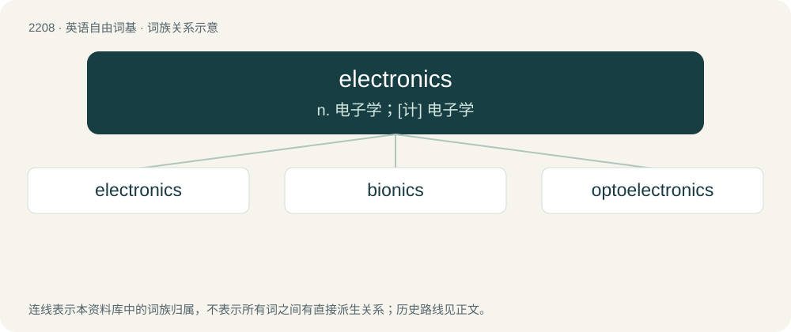

# 2313 · electronics — n. 电子学；\[计\] 电子学

[总目录](../00_总目录_按常用程度.md)

**类型**：英语自由词基　｜　**来源语言**：见词源记录

## 核心含义与来源

- 核心含义：n. 电子学；\[计\] 电子学
- 英文含义：The study and use of electrical devices that operate by controlling the flow of electrons or other electrically charged particles or by converting the flow of charged particles to or from other forms of energy.
- 词形：electronics

**来源记录 1**（名词；The study and use of electrical devices that operate by controlling the flow of electrons or other electrically charged particles or by converting the flow of charged particles to or from other forms of energy.）

From electron + -ics.

## 词族图

## 单词速览（常用到不常用）

| 单词 | 音标 | 释义 |
|---|---|---|
| [electronics](#w-1) | 英 /ˌɛl.ɛkˈtɹɒn.ɪks/；美 /ɪˌlɛkˈtɹɑ.nɪks/ | n. 电子学；\[计\] 电子学 |
| [bionics](#w-2) | 英 /ˈbaɪˌɒnɪks/ | n. 仿生学；\[计\] 仿生学 |
| [optoelectronics](#w-3) | 英 /ˌɒptəʊ.iːlɛkˈtɹɒnɪks/；美 /ˌɑptoʊ.ɪlɛkˈtɹɑnɪks/ | \[计\] 光电子学 |

## 逐词详解

### 1. electronics

**词性**：名词　｜　**音标**：英 /ˌɛl.ɛkˈtɹɒn.ɪks/；美 /ɪˌlɛkˈtɹɑ.nɪks/

**中文释义**：n. 电子学；\[计\] 电子学

**英文义项**：The study and use of electrical devices that operate by controlling the flow of electrons or other electrically charged particles or by converting the flow of charged particles to or from other forms of energy. / Devices which require the flow of electrons through conductors and semiconductors in order to perform their function; devices that operate on electrical power (battery or outlet)

**构词拆分**：electron + -ics

**词源与演化**：

From electron + -ics.

**例句**：

> The electronics is the difference between a modern and an old-fashioned thermostat.

该用例对应义项：Electronic circuitry.

### 2. bionics

**词性**：名词　｜　**音标**：英 /ˈbaɪˌɒnɪks/

**中文释义**：n. 仿生学；\[计\] 仿生学

**英文义项**：The design of engineering systems, especially electronic ones, based on that of biological systems. / biomimetics

**构词拆分**：bio- + electronics

**词源与演化**：

From bio- + electronics. Coined by US Air Force medical doctor Jack E. Steele in 1958 to refer to the "flow of concepts from biology to engineering and vice versa".

### 3. optoelectronics

**词性**：名词　｜　**音标**：英 /ˌɒptəʊ.iːlɛkˈtɹɒnɪks/；美 /ˌɑptoʊ.ɪlɛkˈtɹɑnɪks/

**中文释义**：\[计\] 光电子学

**英文义项**：The branch of physics that deals with the interaction of light with electronic devices, or the production of light from such devices

**构词拆分**：opto- + electronics

**词源与演化**：

From opto- + electronics.
