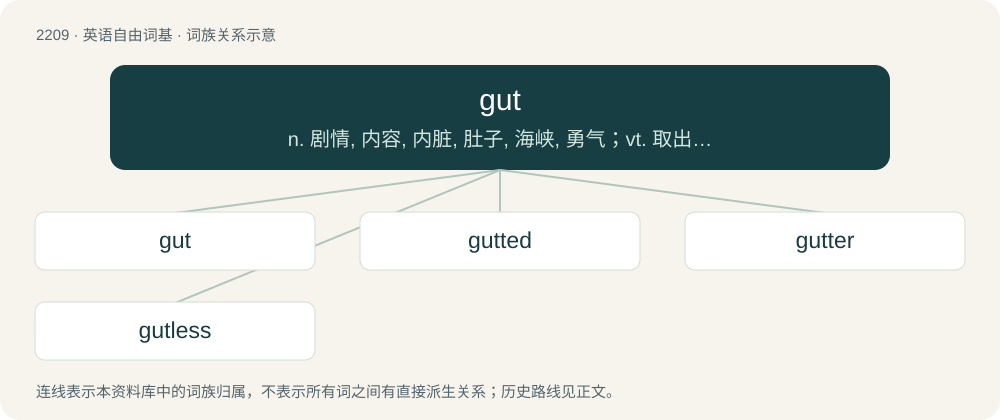

# 2314 · gut — n. 剧情, 内容, 内脏, 肚子, 海峡, 勇气；vt. 取出内脏, 毁坏...的内部

[总目录](../00_总目录_按常用程度.md)

**类型**：英语自由词基　｜　**来源语言**：见词源记录

## 核心含义与来源

- 核心含义：n. 剧情, 内容, 内脏, 肚子, 海峡, 勇气；vt. 取出内脏, 毁坏...的内部
- 英文含义：The alimentary canal, especially the intestine.
- 词形：gut

**来源记录 1**（名词；The alimentary canal, especially the intestine.）

From Middle English gut, gutte, gotte, from Old English gutt (usually in plural guttas (“guts, entrails”)), from Proto-Germanic \*gut-, from Proto-Indo-European \*ǵʰewd- (“to pour”). Related to English gote (“drain”), Old English ġēotan (“to pour”). More at gote, yote. The verb is from Middle English gutten, gotten (“to gut”).

## 词族图

## 单词速览（常用到不常用）

| 单词 | 音标 | 释义 |
|---|---|---|
| [gut](#w-1) | /ɡʌt/ | n. 剧情, 内容, 内脏, 肚子, 海峡, 勇气；vt. 取出内脏, 毁坏...的内部 |
| [gutted](#w-2) | /ˈɡʌtɪd/ | a. 容易消化的；v. 毁坏（建筑物等）的内部( gut的过去式和过去分词 ); 取出…的内脏 |
| [gutter](#w-3) | 英 /ˈɡʌt.ə/；美 /ˈɡʌt.ɚ/ | 【英文】One who or that which guts. |
| [gutless](#w-4) | /ˈgʌtlis/ | a. 无胆量的 |

## 逐词详解

### 1. gut

**词性**：名词　｜　**音标**：/ɡʌt/

**中文释义**：n. 剧情, 内容, 内脏, 肚子, 海峡, 勇气；vt. 取出内脏, 毁坏...的内部

**英文义项**：The alimentary canal, especially the intestine. / The abdomen of a person, especially one that is enlarged.

**词源与演化**：

From Middle English gut, gutte, gotte, from Old English gutt (usually in plural guttas (“guts, entrails”)), from Proto-Germanic \*gut-, from Proto-Indo-European \*ǵʰewd- (“to pour”). Related to English gote (“drain”), Old English ġēotan (“to pour”). More at gote, yote. The verb is from Middle English gutten, gotten (“to gut”).

**例句**：

> You've developed quite a beer gut since I last met you.

该用例对应义项：The abdomen of a person, especially one that is enlarged.

### 2. gutted

**词性**：形容词　｜　**音标**：/ˈɡʌtɪd/

**中文释义**：a. 容易消化的；v. 毁坏（建筑物等）的内部( gut的过去式和过去分词 ); 取出…的内脏

**英文义项**：Eviscerated. / With the most important parts destroyed (often by fire), removed or rendered useless.

**构词拆分**：gut + -ed

**词源与演化**：

From Middle English gutted, gotted, equivalent to gut + -ed.

**例句**：

> Tom was gutted by the death of his best friend.

### 3. gutter

**词性**：名词　｜　**音标**：英 /ˈɡʌt.ə/；美 /ˈɡʌt.ɚ/

**英文义项**：One who or that which guts.

**构词拆分**：gut + -er

**词源与演化**：

From gut + -er.

### 4. gutless

**词性**：形容词　｜　**音标**：/ˈgʌtlis/

**中文释义**：a. 无胆量的

**英文义项**：Without a gut. / Cowardly; lacking courage or morals.

**构词拆分**：gut + -less

**词源与演化**：

From gut + -less.

**例句**：

> He was a yellow gutless worm.

该用例对应义项：lacking courage or vitality
