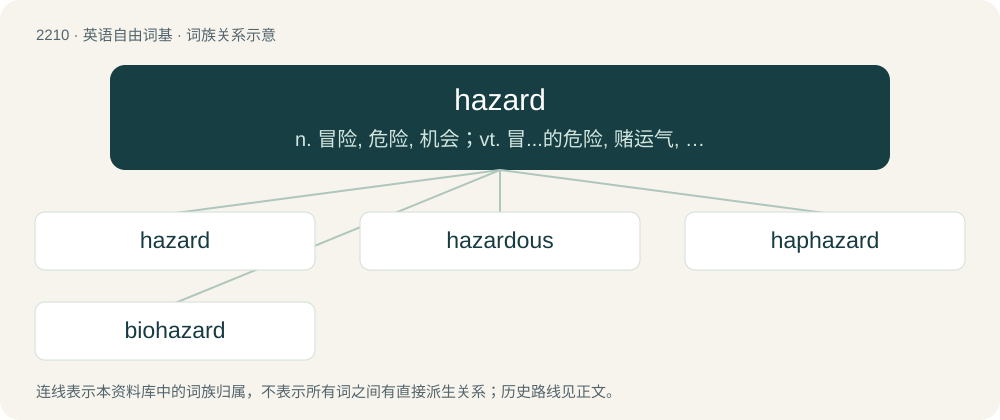

# 2315 · hazard — n. 冒险, 危险, 机会；vt. 冒...的危险, 赌运气, 使冒危险；\[计\] 相关危险; 冒险

[总目录](../00_总目录_按常用程度.md)

**类型**：英语自由词基　｜　**来源语言**：见词源记录

## 核心含义与来源

- 核心含义：n. 冒险, 危险, 机会；vt. 冒...的危险, 赌运气, 使冒危险；\[计\] 相关危险; 冒险
- 英文含义：Chance; accident, unpredictability.
- 词形：hazard

**来源记录 1**（名词；Chance; accident, unpredictability.）

From Middle English hasard, from Old French hasart (“a game of dice”) (noun), hasarder (verb), from Arabic اَلزَّهْر (az-zahr, “the dice”). Compare Spanish azar, Portuguese azar.

## 词族图

## 单词速览（常用到不常用）

| 单词 | 音标 | 释义 |
|---|---|---|
| [hazard](#w-1) | 英 /ˈhæzəd/；美 /ˈhæzɚd/ | n. 冒险, 危险, 机会；vt. 冒...的危险, 赌运气, 使冒危险；\[计\] 相关危险; 冒险 |
| [hazardous](#w-2) | 美 /ˈhæ.zɚ.dɪs/ | a. 危险的, 冒险的, 碰运气的；\[法\] 危险的, 冒险的, 碰运气的 |
| [haphazard](#w-3) | 英 /(ˌ)hæpˈhæz.əd/；美 /(ˌ)hæpˈhæz.ɚd/ | n. 偶然性, 偶然事件；a. 无计划的, 偶然的, 随便的；adv. 偶然地 |
| [biohazard](#w-4) | 英 /ˈbaɪəʊˌhæzəd/；美 /ˈbaɪoʊˌhæzɚd/ | n. 生物危害 |

## 逐词详解

### 1. hazard

**词性**：名词　｜　**音标**：英 /ˈhæzəd/；美 /ˈhæzɚd/

**中文释义**：n. 冒险, 危险, 机会；vt. 冒...的危险, 赌运气, 使冒危险；\[计\] 相关危险; 冒险

**英文义项**：Chance; accident, unpredictability. / The risk of some loss or harm; danger, peril, the chance of an adverse outcome.

**词源与演化**：

From Middle English hasard, from Old French hasart (“a game of dice”) (noun), hasarder (verb), from Arabic اَلزَّهْر (az-zahr, “the dice”). Compare Spanish azar, Portuguese azar.

**例句**：

> The video game involves guiding a character on a skateboard past all kinds of hazards.

该用例对应义项：A situation involving such a risk of harm or loss; (later also) a person or object which poses such a risk, something seen as a source of danger or difficulty.

### 2. hazardous

**词性**：形容词　｜　**音标**：美 /ˈhæ.zɚ.dɪs/

**中文释义**：a. 危险的, 冒险的, 碰运气的；\[法\] 危险的, 冒险的, 碰运气的

**英文义项**：Risky; dangerous; with the nature of a hazard. / Of or involving chance.

**构词拆分**：hazard + -ous

**词源与演化**：

From Middle French hasardeux, equivalent to hazard + -ous.

**例句**：

> Skydiving is a hazardous sport.

该用例对应义项：involving risk or danger

### 3. haphazard

**词性**：形容词　｜　**音标**：英 /(ˌ)hæpˈhæz.əd/；美 /(ˌ)hæpˈhæz.ɚd/

**中文释义**：n. 偶然性, 偶然事件；a. 无计划的, 偶然的, 随便的；adv. 偶然地

**英文义项**：Random; chaotic; incomplete; not thorough, constant, or consistent.

**构词拆分**：hap (“chance, luck”) + hazard

**词源与演化**：

From archaic hap (“chance, luck”) + hazard.

**例句**：

> Do not make such haphazard changes to the settings; instead, adjust the knobs carefully, a bit at a time.

该用例对应义项：Random; chaotic; incomplete; not thorough, constant, or consistent.

### 4. biohazard

**词性**：名词　｜　**音标**：英 /ˈbaɪəʊˌhæzəd/；美 /ˈbaɪoʊˌhæzɚd/

**中文释义**：n. 生物危害

**英文义项**：A biological hazard: a source of risk due to some biological factor such as bacteria or human waste.

**构词拆分**：bio- + hazard

**词源与演化**：

From bio- + hazard.

**例句**：

> Tom is wearing a biohazard suit.
