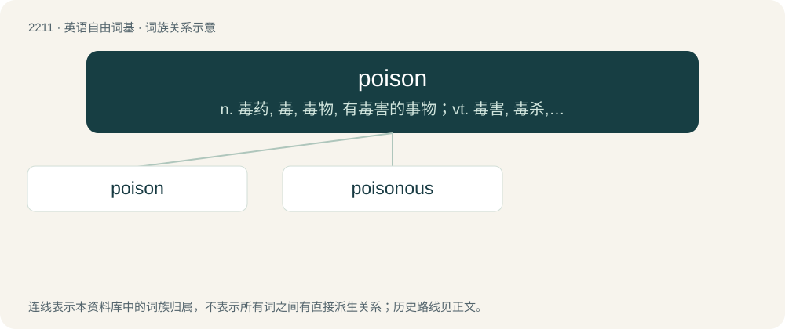

# 2316 · poison — n. 毒药, 毒, 毒物, 有毒害的事物；vt. 毒害, 毒杀, 使中毒；vi. 放毒, 下毒

[总目录](../00_总目录_按常用程度.md)

**类型**：英语自由词基　｜　**来源语言**：见词源记录

## 核心含义与来源

- 核心含义：n. 毒药, 毒, 毒物, 有毒害的事物；vt. 毒害, 毒杀, 使中毒；vi. 放毒, 下毒
- 英文含义：A substance that is harmful or lethal to a living organism when ingested.
- 词形：poison

**来源记录 1**（名词；A substance that is harmful or lethal to a living organism when ingested.）

From Middle English poysoun, poyson, pusoun, from Old French poison, poisun, from Latin pōtiōnem (“drink, a draught, a poisonous draught, a potion”), from pōtō (“to drink”). See also potion and potable (from the same root). Mostly displaced native Old English ātor and lybb. See more at atter.

## 词族图

## 单词速览（常用到不常用）

| 单词 | 音标 | 释义 |
|---|---|---|
| [poison](#w-1) | 英 /ˈpɔɪ.zən/ | n. 毒药, 毒, 毒物, 有毒害的事物；vt. 毒害, 毒杀, 使中毒；vi. 放毒, 下毒 |
| [poisonous](#w-2) | /ˈpɔɪzənəs/ | a. 有毒的, 恶毒的, 讨厌的；\[医\] 有毒的 |

## 逐词详解

### 1. poison

**词性**：名词　｜　**音标**：英 /ˈpɔɪ.zən/

**中文释义**：n. 毒药, 毒, 毒物, 有毒害的事物；vt. 毒害, 毒杀, 使中毒；vi. 放毒, 下毒

**英文义项**：A substance that is harmful or lethal to a living organism when ingested. / Anything harmful to a person or thing.

**词源与演化**：

From Middle English poysoun, poyson, pusoun, from Old French poison, poisun, from Latin pōtiōnem (“drink, a draught, a poisonous draught, a potion”), from pōtō (“to drink”). See also potion and potable (from the same root). Mostly displaced native Old English ātor and lybb. See more at atter.

**例句**：

> — What's your poison? — I'll have a glass of whiskey.

该用例对应义项：An alcoholic drink. (Mainly in the phrases "name your poison" and "what's your poison?")

### 2. poisonous

**词性**：形容词　｜　**音标**：/ˈpɔɪzənəs/

**中文释义**：a. 有毒的, 恶毒的, 讨厌的；\[医\] 有毒的

**英文义项**：Containing sufficient poison to be dangerous to touch or ingest. / Of an animal such as a snake or spider, or parts of its body: producing a toxin intended for defensive or offensive use which is usually injected into an enemy or prey by biting or stinging; hence, of a bite or sting: injecting poison.

**构词拆分**：By surface analysis, poison + -ous

**词源与演化**：

From Middle English poisounous, poysonouse. By surface analysis, poison + -ous.

**例句**：

> While highly poisonous to dogs, this substance is completely harmless if ingested by humans.

该用例对应义项：Containing sufficient poison to be dangerous to touch or ingest.
