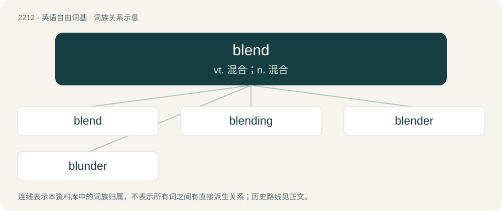

# 2317 · blend — vt. 混合；n. 混合

[总目录](../00_总目录_按常用程度.md)

**类型**：英语自由词基　｜　**来源语言**：见词源记录

## 核心含义与来源

- 核心含义：vt. 混合；n. 混合
- 英文含义：A mixture of two or more things.
- 词形：blend

**来源记录 1**（名词；A mixture of two or more things.）

From Middle English blenden, either from Old English blandan, blondan, ġeblandan, ġeblendan or from Old Norse blanda (“to blend, mix”) (which was originally a strong verb with the present-tense stem blend; compare blendingr (“a blending, a mixture; a half-breed”)), whence also Danish blande, or from a blend of the Old English and Old Norse terms; both ultimately from Proto-Germanic \*blandaną (“to blend; mix; combine”). Compare Middle Dutch blanden (“to mix”), Gothic 𐌱𐌻𐌰𐌽𐌳𐌰𐌽 (blandan), Old Church Slavonic блєсти (blesti, “to go astray”).

## 词族图

## 单词速览（常用到不常用）

| 单词 | 音标 | 释义 |
|---|---|---|
| [blend](#w-1) | /blɛnd/ | vt. 混合；n. 混合 |
| [blending](#w-2) | /ˈblɛndɪŋ/ | n. 混合, 混合物, 混成；\[化\] 掺合; 倒圆 |
| [blender](#w-3) | 英 /ˈblɛn.də/；美 /ˈblɛn.dɚ/ | n. 混合者, 混合器, 搅拌器；\[化\] 掺合机; 捏和机; 混合机; 搅拌机; 搅切器; 捣碎器 |
| [blunder](#w-4) | 英 /ˈblʌn.dəː/；美 /ˈblʌn.dɚ/ | n. 大错, 大失策；vi. 失策, 跌跌撞撞地走, 犯错；vt. 做错 |

## 逐词详解

### 1. blend

**词性**：名词　｜　**音标**：/blɛnd/

**中文释义**：vt. 混合；n. 混合

**英文义项**：A mixture of two or more things. / A word formed by combining two other words; a portmanteau word.

**词源与演化**：

From Middle English blenden, either from Old English blandan, blondan, ġeblandan, ġeblendan or from Old Norse blanda (“to blend, mix”) (which was originally a strong verb with the present-tense stem blend; compare blendingr (“a blending, a mixture; a half-breed”)), whence also Danish blande, or from a blend of the Old English and Old Norse terms; both ultimately from Proto-Germanic \*blandaną (“to blend; mix; combine”). Compare Middle Dutch blanden (“to mix”), Gothic 𐌱𐌻𐌰𐌽𐌳𐌰𐌽 (blandan), Old Church Slavonic блєсти (blesti, “to go astray”).

**例句**：

> Our department has a good blend of experienced workers and young promise.

该用例对应义项：A mixture of two or more things.

### 2. blending

**词性**：名词　｜　**音标**：/ˈblɛndɪŋ/

**中文释义**：n. 混合, 混合物, 混成；\[化\] 掺合; 倒圆

**英文义项**：The act or result of something being blended.

**构词拆分**：blend + -ing

**词源与演化**：

From blend + -ing. Cognate with Faroese blending (“mixture, crossing”).

**用法示例／搭配（非完整句）**：

> blendings of old and new

该用例对应义项：The act or result of something being blended.

### 3. blender

**词性**：名词　｜　**音标**：英 /ˈblɛn.də/；美 /ˈblɛn.dɚ/

**中文释义**：n. 混合者, 混合器, 搅拌器；\[化\] 掺合机; 捏和机; 混合机; 搅拌机; 搅切器; 捣碎器

**英文义项**：A machine with sharp rotating blades in a bowl, for mashing, crushing, or liquefying food ingredients. / A piece of fabric sewn into the front of a theatrical wig to make it blend in with the performer's natural hair.

**构词拆分**：blend + -er

**词源与演化**：

From blend + -er.

**例句**：

> Instead of eating vegetables, he puts them in a blender and drinks them.

### 4. blunder

**词性**：动词　｜　**音标**：英 /ˈblʌn.dəː/；美 /ˈblʌn.dɚ/

**中文释义**：n. 大错, 大失策；vi. 失策, 跌跌撞撞地走, 犯错；vt. 做错

**英文义项**：To make a big mistake, especially when it is careless or stupid. / To make a bad move, especially caused by tactical oversight.

**构词拆分**：blend + -er

**词源与演化**：

Inherited from Middle English blundren, blondren (verb) and blunder, blonder (“disturbance, strife”), from the verb; partly from Middle English blondren, a frequentative form of Middle English blonden, blanden ("to mix; mix up"; corresponding to blend + -er); and partly from Middle English blundren, a frequentative form of Middle English blunden (“to stagger; stumble”), from Old Norse blunda (“to shut the eyes; doze”). Cognates include Norwegian blunda (“to shut the eyes; doze”), dialectal Swedish blundra (“to act blindly or rashly”), Danish blunde (“to blink”) or blunde (“to take a nap”), Icelandic blunda (“to nap; doze”). Related to English blind.

**用法示例／搭配（非完整句）**：

> to blunder in preparing a medical prescription

该用例对应义项：To make a big mistake, especially when it is careless or stupid.
