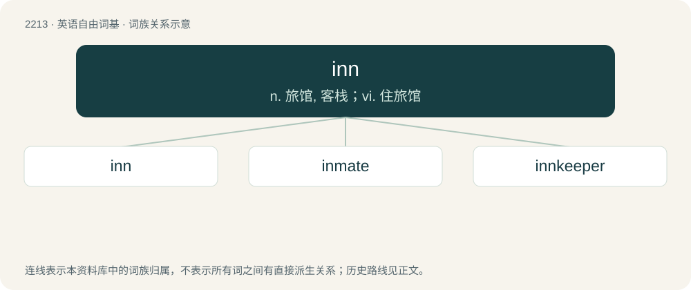

# 2318 · inn — n. 旅馆, 客栈；vi. 住旅馆

[总目录](../00_总目录_按常用程度.md)

**类型**：英语自由词基　｜　**来源语言**：见词源记录

## 核心含义与来源

- 核心含义：n. 旅馆, 客栈；vi. 住旅馆
- 英文含义：Any establishment where travellers can procure lodging, food, and drink.
- 词形：inn

**来源记录 1**（名词；Any establishment where travellers can procure lodging, food, and drink.）

From Middle English in, inn, from Old English inn (“a dwelling, house, chamber, lodging”); akin to Icelandic inni (“a dwelling place, home, abode”), Faroese inni (“home”).

## 词族图

## 单词速览（常用到不常用）

| 单词 | 音标 | 释义 |
|---|---|---|
| [inn](#w-1) | /ɪn/ | n. 旅馆, 客栈；vi. 住旅馆 |
| [inmate](#w-2) | 英 /ˈɪn.meɪt/ | n. 同住者, 被收容者；\[法\] 内部的, 接近中心的, 内在的 |
| [innkeeper](#w-3) | 美 /ˈɪnkiːpəɹ/ | n. 小旅馆老板, 客栈老板 |

## 逐词详解

### 1. inn

**词性**：名词　｜　**音标**：/ɪn/

**中文释义**：n. 旅馆, 客栈；vi. 住旅馆

**英文义项**：Any establishment where travellers can procure lodging, food, and drink. / A tavern.

**词源与演化**：

From Middle English in, inn, from Old English inn (“a dwelling, house, chamber, lodging”); akin to Icelandic inni (“a dwelling place, home, abode”), Faroese inni (“home”).

**用法示例／搭配（非完整句）**：

> the Inns of Court the Inns of Chancery Serjeants’ Inns

该用例对应义项：One of the colleges (societies or buildings) in London, for students of the law barristers.

### 2. inmate

**词性**：名词　｜　**音标**：英 /ˈɪn.meɪt/

**中文释义**：n. 同住者, 被收容者；\[法\] 内部的, 接近中心的, 内在的

**英文义项**：A person confined to an institution such as a prison (as a convict) or hospital (as a patient). / A person who shares a residence (such as a hotel guest, a lodger, or a student living on campus), or other place.

**构词拆分**：inn + -mate；in- + -mate

**词源与演化**：

From inn + -mate, or from in- + -mate.

**例句**：

> Dan asked fellow inmate Matt to supply him with a fork.

### 3. innkeeper

**词性**：名词　｜　**音标**：美 /ˈɪnkiːpəɹ/

**中文释义**：n. 小旅馆老板, 客栈老板

**英文义项**：The person responsible for the running of an inn, usually the proprietor.

**构词拆分**：inn + keeper

**词源与演化**：

From Middle English inkeper; equivalent to inn + keeper. Compare Middle English inholder (“innkeeper”).

**例句**：

> Ten minutes later, the innkeeper slipped into the room, his eyes bright with excitement.
