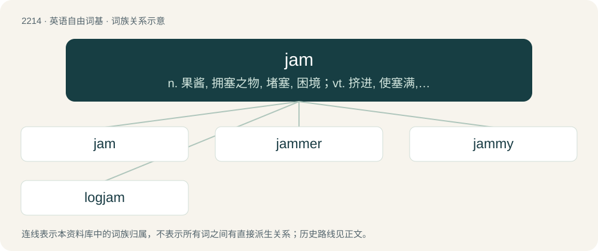

# 2319 · jam — n. 果酱, 拥塞之物, 堵塞, 困境；vt. 挤进, 使塞满, 混杂, 压碎, 使堵塞；vi. 堵塞, 轧住, 拥挤

[总目录](../00_总目录_按常用程度.md)

**类型**：英语自由词基　｜　**来源语言**：见词源记录

## 核心含义与来源

- 核心含义：n. 果酱, 拥塞之物, 堵塞, 困境；vt. 挤进, 使塞满, 混杂, 压碎, 使堵塞；vi. 堵塞, 轧住, 拥挤
- 英文含义：A sweet mixture of fruit boiled with sugar and allowed to congeal. Often spread on bread or toast or used in jam tarts
- 词形：jam

**多个词源／构词路径**：同一拼写可能有不同来源；以下按词性和含义分别列出。

**来源记录 1**（名词；A sweet mixture of fruit boiled with sugar and allowed to congeal. Often spread on bread or toast or used in jam tarts）

First attested in the early 18th c. as a verb meaning “to press, be pressed, be wedged in”. Compare dialectal jammock (“to press, squeeze, crush into a soft mass, chew food"; also "a soft, pulpy substance”). Perhaps from Middle English chammen, champen ("to bite upon something, gnash the teeth"; whence modern champ, chomp), of uncertain origin; probably originally onomatopoeic. The "performance" sense is first attested with regards to jazz in 1929, and its origin, though uncertain, is likely metaphorical, "something sweet made by the combination of many things", with influence from jamboree.

**来源记录 2**（名词；A kind of frock for children.）

Borrowed from Persian جامه (“garment”) and/or Hindustani (Hindi जामा (jāmā) / Urdu جامہ (jāma)), meaning "garment, robe". Related to pajamas and pyjamas.

## 词族图

## 单词速览（常用到不常用）

| 单词 | 音标 | 释义 |
|---|---|---|
| [jam](#w-1) | 英 /ˈd͡ʒæm/ | n. 果酱, 拥塞之物, 堵塞, 困境；vt. 挤进, 使塞满, 混杂, 压碎, 使堵塞；vi. 堵塞, 轧住, 拥挤 |
| [jammer](#w-2) | 美 /ˈd͡ʒæmɚ/ | \[计\] 电气干扰, 人为干扰台 |
| [jammy](#w-3) | /ˈd͡ʒæm.i/ | a. 粘上果酱的 |
| [logjam](#w-4) | /ˈlɒgdʒæm/ | n. 拥挤, 行不通, 为许多圆木材所阻 |

## 逐词详解

### 1. jam

**词性**：名词　｜　**音标**：英 /ˈd͡ʒæm/

**中文释义**：n. 果酱, 拥塞之物, 堵塞, 困境；vt. 挤进, 使塞满, 混杂, 压碎, 使堵塞；vi. 堵塞, 轧住, 拥挤

**英文义项**：A sweet mixture of fruit boiled with sugar and allowed to congeal. Often spread on bread or toast or used in jam tarts / A difficult situation.

**词源与演化**：

First attested in the early 18th c. as a verb meaning “to press, be pressed, be wedged in”. Compare dialectal jammock (“to press, squeeze, crush into a soft mass, chew food"; also "a soft, pulpy substance”). Perhaps from Middle English chammen, champen ("to bite upon something, gnash the teeth"; whence modern champ, chomp), of uncertain origin; probably originally onomatopoeic. The "performance" sense is first attested with regards to jazz in 1929, and its origin, though uncertain, is likely metaphorical, "something sweet made by the combination of many things", with influence from jamboree.

**例句**：

> The pitcher's in a jam now, having walked the bases loaded with the cleanup hitter coming to bat.

该用例对应义项：A difficult situation for a pitcher or defending team.

### 2. jammer

**词性**：名词　｜　**音标**：美 /ˈd͡ʒæmɚ/

**中文释义**：\[计\] 电气干扰, 人为干扰台

**英文义项**：Any device used to jam radio reception. / A musician who jams.

**构词拆分**：jam + -er

**词源与演化**：

From jam + -er.

**例句**：

> What can I say? I'm a bad mammer jammer.

### 3. jammy

**词性**：形容词　｜　**音标**：/ˈd͡ʒæm.i/

**中文释义**：a. 粘上果酱的

**英文义项**：Resembling jam in taste, texture, etc. / Covered in jam.

**构词拆分**：jam + -y

**词源与演化**：

From jam + -y.

**用法示例／搭配（非完整句）**：

> a child's jammy fingers

该用例对应义项：Covered in jam.

### 4. logjam

**词性**：名词　｜　**音标**：/ˈlɒgdʒæm/

**中文释义**：n. 拥挤, 行不通, 为许多圆木材所阻

**英文义项**：An excess of logs being conveyed on a river, so that their motion halts. / A clog or such jam or mess that halts or greatly delays progress.

**构词拆分**：log + jam

**词源与演化**：

From log + jam.

**例句**：

> Efforts to amend the law got sidetracked in an administrative logjam.

该用例对应义项：A clog or such jam or mess that halts or greatly delays progress.
