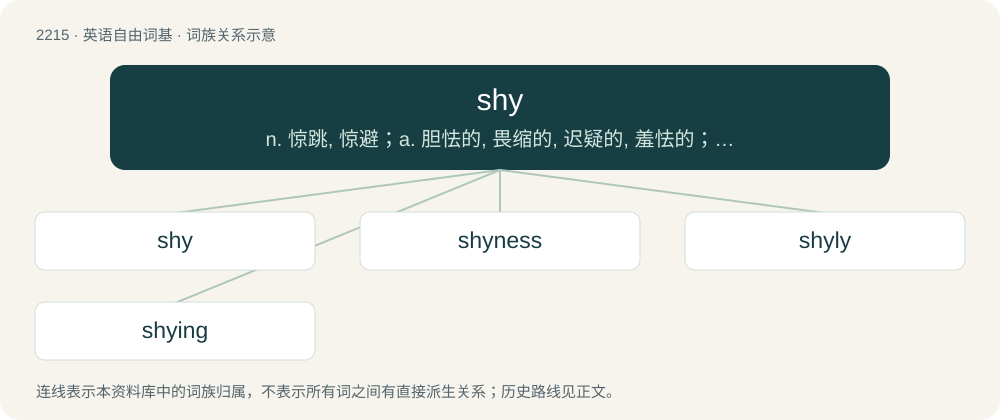

# 2320 · shy — n. 惊跳, 惊避；a. 胆怯的, 畏缩的, 迟疑的, 羞怯的；vi. 惊退, 乱投, 乱掷, 厌恶, 避开

[总目录](../00_总目录_按常用程度.md)

**类型**：英语自由词基　｜　**来源语言**：见词源记录

## 核心含义与来源

- 核心含义：n. 惊跳, 惊避；a. 胆怯的, 畏缩的, 迟疑的, 羞怯的；vi. 惊退, 乱投, 乱掷, 厌恶, 避开
- 英文含义：Easily frightened; timid.
- 词形：shy

**来源记录 1**（形容词；Easily frightened; timid.）

From Middle English shy (“shy”), from Old English sċēoh (“shy”), from Proto-West Germanic \*skeuh (“shy, fearful”), from Proto-Germanic \*skeuhaz (“shy, fearful”). Cognate with Saterland Frisian skjou (“shy”), Dutch schuw (“shy”), German scheu (“shy”), Danish sky (“shy”).

## 词族图

## 单词速览（常用到不常用）

| 单词 | 音标 | 释义 |
|---|---|---|
| [shy](#w-1) | /ʃaɪ/ | n. 惊跳, 惊避；a. 胆怯的, 畏缩的, 迟疑的, 羞怯的；vi. 惊退, 乱投, 乱掷, 厌恶, 避开 |
| [shyness](#w-2) | /ˈʃaɪnəs/ | n. 羞怯, 胆怯 |
| [shyly](#w-3) | /ˈʃaɪ.li/ | adv. 害羞地；羞怯地；胆怯地；小心地 |
| [shying](#w-4) | /ʃaiŋ/ | v. 惊退, 畏缩( shy的现在分词 ) |

## 逐词详解

### 1. shy

**词性**：形容词　｜　**音标**：/ʃaɪ/

**中文释义**：n. 惊跳, 惊避；a. 胆怯的, 畏缩的, 迟疑的, 羞怯的；vi. 惊退, 乱投, 乱掷, 厌恶, 避开

**英文义项**：Easily frightened; timid. / Reserved; disinclined to familiar approach.

**词源与演化**：

From Middle English shy (“shy”), from Old English sċēoh (“shy”), from Proto-West Germanic \*skeuh (“shy, fearful”), from Proto-Germanic \*skeuhaz (“shy, fearful”). Cognate with Saterland Frisian skjou (“shy”), Dutch schuw (“shy”), German scheu (“shy”), Danish sky (“shy”).

**例句**：

> By our count your shipment came up two shy of the bill of lading amount.

该用例对应义项：Short, insufficient or less than.

### 2. shyness

**词性**：名词　｜　**音标**：/ˈʃaɪnəs/

**中文释义**：n. 羞怯, 胆怯

**英文义项**：The quality of being shy; a fear of social interactions.

**构词拆分**：shy + -ness

**词源与演化**：

From shy + -ness.

**例句**：

> Her shyness kept her from asking him to the prom.

该用例对应义项：The quality of being shy; a fear of social interactions.

### 3. shyly

**词性**：副词　｜　**音标**：/ˈʃaɪ.li/

**中文释义**：adv. 害羞地；羞怯地；胆怯地；小心地

**英文义项**：In a shy manner.

**构词拆分**：shy + -ly

**词源与演化**：

From shy + -ly.

**例句**：

> The girl laughed merrily, and then, rather shyly, she thanked him.

### 4. shying

**词性**：名词　｜　**音标**：/ʃaiŋ/

**中文释义**：v. 惊退, 畏缩( shy的现在分词 )

**英文义项**：The act of one who shies or turns aside in fear.

**构词拆分**：shy + -ing

**词源与演化**：

From shy + -ing.

**例句**：

> Everyone keeps shying away from John.
