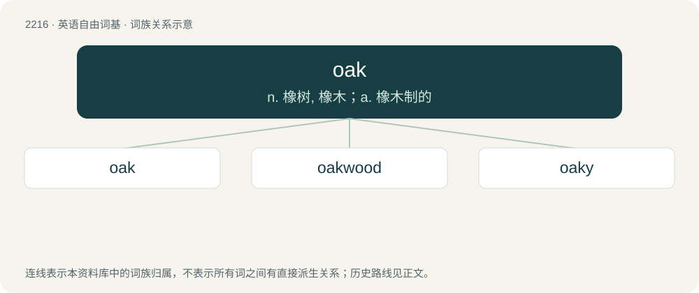

# 2321 · oak — n. 橡树, 橡木；a. 橡木制的

[总目录](../00_总目录_按常用程度.md)

**类型**：英语自由词基　｜　**来源语言**：见词源记录

## 核心含义与来源

- 核心含义：n. 橡树, 橡木；a. 橡木制的
- 英文含义：A deciduous tree with distinctive deeply lobed leaves, acorns, and notably strong wood, typically of England and northeastern North America, included in genus Quercus.
- 词形：oak

**来源记录 1**（名词；A deciduous tree with distinctive deeply lobed leaves, acorns, and notably strong wood, typically of England and northeastern North America, included in genus Quercus.）

Inherited from Middle English ake, hok, oek, ok, oke, from Old English aac, āc, ǣċ, from Proto-West Germanic \*aik, from Proto-Germanic \*aiks (“oak”), from Proto-Indo-European \*h₂eyǵ- (“oak”). Cognates From Proto-Germanic: Scots aik, ake, yik (“oak”), North Frisian iake, iik (“oak”), Saterland Frisian Eeke (“oak”), West Frisian iik (“oak”), Cimbrian aicha, oach (“oak”), Dutch eik (“oak”), German Eiche (“oak”), Luxembourgish Eech (“oak”), Vilamovian aach, aeh́, ǡh́ (“oak”), Danish eg (“oak”), Faroese, Icelandic, and Norwegian Nynorsk eik (“oak”), Norwegian Bokmål eik, ek (“oak”), Swedish ek (“oak”). From Proto-Indo-European: Latin aesculus (“Italian oak”), Ancient Greek αἰγίλωψ (aigílōps, “Turkey oak”), Albanian enjë (“English yew; stinking juniper”), Latvian ozols (“oak”), Lithuanian ąžuolas (“oak”).

## 词族图

## 单词速览（常用到不常用）

| 单词 | 音标 | 释义 |
|---|---|---|
| [oak](#w-1) | 英 /əʊk/；美 /oʊk/ | n. 橡树, 橡木；a. 橡木制的 |
| [oakwood](#w-2) |  | \[地名\] \[澳大利亚、美国、英国\] 奥克伍德 |
| [oaky](#w-3) | 美 /ˈoʊki/ | 【英文】Resembling or characteristic of the oak tree or its wood. |

## 逐词详解

### 1. oak

**词性**：名词　｜　**音标**：英 /əʊk/；美 /oʊk/

**中文释义**：n. 橡树, 橡木；a. 橡木制的

**英文义项**：A deciduous tree with distinctive deeply lobed leaves, acorns, and notably strong wood, typically of England and northeastern North America, included in genus Quercus. / The wood of the oak.

**词源与演化**：

Inherited from Middle English ake, hok, oek, ok, oke, from Old English aac, āc, ǣċ, from Proto-West Germanic \*aik, from Proto-Germanic \*aiks (“oak”), from Proto-Indo-European \*h₂eyǵ- (“oak”). Cognates From Proto-Germanic: Scots aik, ake, yik (“oak”), North Frisian iake, iik (“oak”), Saterland Frisian Eeke (“oak”), West Frisian iik (“oak”), Cimbrian aicha, oach (“oak”), Dutch eik (“oak”), German Eiche (“oak”), Luxembourgish Eech (“oak”), Vilamovian aach, aeh́, ǡh́ (“oak”), Danish eg (“oak”), Faroese, Icelandic, and Norwegian Nynorsk eik (“oak”), Norwegian Bokmål eik, ek (“oak”), Swedish ek (“oak”). From Proto-Indo-European: Latin aesculus (“Italian oak”), Ancient Greek αἰγίλωψ (aigílōps, “Turkey oak”), Albanian enjë (“English yew; stinking juniper”), Latvian ozols (“oak”), Lithuanian ąžuolas (“oak”).

**例句**：

> You used to climb our oak tree when you were a kid.

### 2. oakwood

**词性**：名词

**中文释义**：\[地名\] \[澳大利亚、美国、英国\] 奥克伍德

**英文义项**：A wood populated with oak trees. / The wood of the oak tree.

**构词拆分**：oak + wood

**词源与演化**：

From Old English āc wudu; equivalent to oak + wood.

**例句**：

> Phragmites plants growing on Staten Island draft in a breeze in the Oakwood Beach neighborhood of Staten Island.

### 3. oaky

**词性**：形容词　｜　**音标**：美 /ˈoʊki/

**英文义项**：Resembling or characteristic of the oak tree or its wood. / Describing the taste of wine that has been aged in oak and acquired tannins from the wood.

**构词拆分**：oak + -y

**词源与演化**：

From oak + -y.
