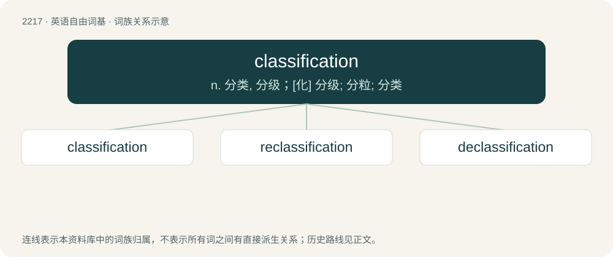

# 2322 · classification — n. 分类, 分级；\[化\] 分级; 分粒; 分类

[总目录](../00_总目录_按常用程度.md)

**类型**：英语自由词基　｜　**来源语言**：见词源记录

## 核心含义与来源

- 核心含义：n. 分类, 分级；\[化\] 分级; 分粒; 分类
- 英文含义：The act of forming into a class or classes; a distribution into groups, as classes, orders, families, etc., according to some common relations or attributes.
- 词形：classification

**来源记录 1**（名词；The act of forming into a class or classes; a distribution into groups, as classes, orders, families, etc., according to some common relations or attributes.）

Borrowed from French classification.

## 词族图

## 单词速览（常用到不常用）

| 单词 | 音标 | 释义 |
|---|---|---|
| [classification](#w-1) | 美 /ˌklæsɪfɪˈkeɪʃən/ | n. 分类, 分级；\[化\] 分级; 分粒; 分类 |
| [reclassification](#w-2) | /riː.klæsifiˈkeiʃən/ | n. 重新分类；再次分级 |
| [declassification](#w-3) | 英 /diːˌklæsɪfɪˈkeɪʃən/ | n. (文件)解密, 从机密表删除 |

## 逐词详解

### 1. classification

**词性**：名词　｜　**音标**：美 /ˌklæsɪfɪˈkeɪʃən/

**中文释义**：n. 分类, 分级；\[化\] 分级; 分粒; 分类

**英文义项**：The act of forming into a class or classes; a distribution into groups, as classes, orders, families, etc., according to some common relations or attributes.

**词源与演化**：

Borrowed from French classification.

**例句**：

> Support vector machines are supervised learning models used for classification and regression analysis.

### 2. reclassification

**词性**：名词　｜　**音标**：/riː.klæsifiˈkeiʃən/

**中文释义**：n. 重新分类；再次分级

**英文义项**：The act of reclassifying; a second or subsequent classification. / The assignment of a high-school student to a different graduation class (either a year earlier or later than their original), often to allow a potential athlete either to develop further or to start playing professionally earlier.

**构词拆分**：re- + classification

**词源与演化**：

From re- + classification.

### 3. declassification

**词性**：名词　｜　**音标**：英 /diːˌklæsɪfɪˈkeɪʃən/

**中文释义**：n. (文件)解密, 从机密表删除

**英文义项**：The process of declassifying.

**构词拆分**：de- + classification

**词源与演化**：

From de- + classification.
