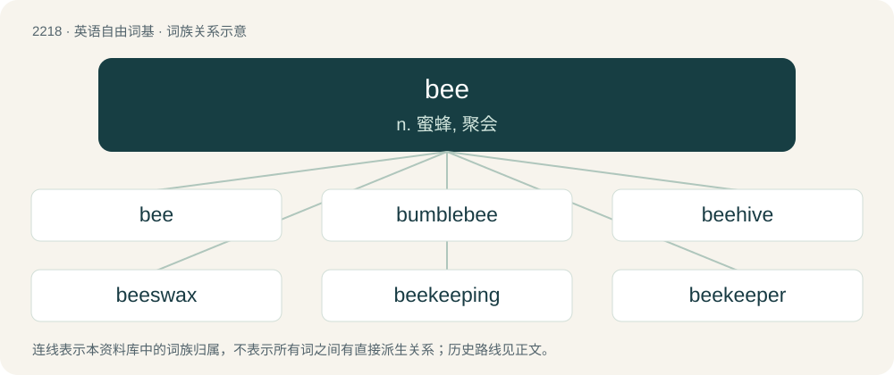

# 2323 · bee — n. 蜜蜂, 聚会

[总目录](../00_总目录_按常用程度.md)

**类型**：英语自由词基　｜　**来源语言**：见词源记录

## 核心含义与来源

- 核心含义：n. 蜜蜂, 聚会
- 英文含义：A flying insect, of the clade Anthophila within the hymenopteran superfamily Apoidea, known for its organised societies (though only a minority have them), for collecting pollen and (in some species) producing wax and honey.
- 词形：bee

**多个词源／构词路径**：同一拼写可能有不同来源；以下按词性和含义分别列出。

**来源记录 1**（名词；A flying insect, of the clade Anthophila within the hymenopteran superfamily Apoidea, known for its organised societies (though only a minority have them), for collecting pollen and (in some species) producing wax and honey.）

From Middle English be, bee, beo, bey, from Old English bēo, bīo (“bee”), from Proto-West Germanic \*bijā, from Proto-Germanic \*bijǭ (“bee”), from Proto-Indo-European \*bʰey- (“bee”). Cognates Cognate with Yola been (“bees”), North Frisian bi (“bee”), West Frisian bij (“bee”), Dutch bij, by (“bee”), German Biene (“bee”), Limburgish Bé, bie (“bee”), Luxembourgish Bei (“bee”), Vilamovian byn (“bee”), West Flemish bieë (“bee”), Yiddish בין (bin, “bee”), Danish and Swedish bi (“bee”), Faroese býfluga (“bee”), Icelandic bý, býfluga (“bee”), Norwegian Bokmål and Norwegian Nynorsk bie (“bee”); also Irish beach, meach (“bee”), Scottish Gaelic beach (“bee; beehive; wasp”), Latin fūcus (“bee”), Latvian bite (“bee”), Lithuanian bitė (“bee”), Belarusian пчала́ (pčalá, “bee”), Bulgarian, Macedonian, and Russian пчела́ (pčelá, “bee”), Czech včála, včela (“bee”), Polish pszczoła (“bee”), Serbo-Croatian пчѐла, bčela, pčèla (“bee”), Slovak včela (“bee”), Slovene čebela (“bee”), Ukrainian бджола́ (bdžolá, “bee”), Ossetian биндзӕ (binʒæ), бындз (bynʒ, “fly”), Pashto وينه (waynë́, wenë́, wuynë́, “termite; white ant”).

**来源记录 2**（名词；A contest, especially for spelling; see spelling bee.）

Possibly from dialectal bene, been, bean (“help given by neighbours”), from Middle English been, bene (“neighbourly help, prayer, petition, request, extra service given by a tenant to his lord”), from Old English bēn (“prayer, request, petition, favour, compulsory service”), from Proto-West Germanic \*bōni, from Proto-Germanic \*bōniz (“prayer, request, supplication”). Thus a variant of obsolete ben (“prayer; petition”) and doublet of boon. Cognate with Danish bøn (“prayer”), Dutch ban (“curse”), German Bann (“ban”). More at ban.

**来源记录 3**（名词；The name of the Latin script letter B/b.）

From Middle English \[Term?\], from Old English be, from Latin be (the name of the letter B).

**来源记录 4**（名词；Any of the pieces of hard wood bolted to the sides of the bowsprit, to reeve the fore-topmast stays through.）

Probably from Old English bēah (“ring”). Compare bow.

## 词族图

## 单词速览（常用到不常用）

| 单词 | 音标 | 释义 |
|---|---|---|
| [bee](#w-1) | /ˈbiː/ | n. 蜜蜂, 聚会 |
| [bumblebee](#w-2) | /ˈbʌmbəlˌbiː/ | n. \[动\]大黄蜂 |
| [beehive](#w-3) | /ˈbiːhaɪv/ | n. 蜂窝, 蜂箱；\[机\] 集气架, 蜂巢 |
| [beeswax](#w-4) | /ˈbiːzwæks/ | n. 蜂蜡, 蜜蜡；vt. 用蜡上光 |
| [beekeeping](#w-5) | /ˈbiːˌkiːpɪŋ/ | n. 养蜂 |
| [beekeeper](#w-6) | 美 /ˈbiˌkipɚ/ | n. 养蜂人 |
| [beeline](#w-7) | /ˈbiːlaɪn/ | n. 笔直线 |
| [beeman](#w-8) |  | n. (Beeman)人名；(英)比曼 |

## 逐词详解

### 1. bee

**词性**：名词　｜　**音标**：/ˈbiː/

**中文释义**：n. 蜜蜂, 聚会

**英文义项**：A flying insect, of the clade Anthophila within the hymenopteran superfamily Apoidea, known for its organised societies (though only a minority have them), for collecting pollen and (in some species) producing wax and honey. / Any stinging flying insect, especially a wasp.

**词源与演化**：

From Middle English be, bee, beo, bey, from Old English bēo, bīo (“bee”), from Proto-West Germanic \*bijā, from Proto-Germanic \*bijǭ (“bee”), from Proto-Indo-European \*bʰey- (“bee”). Cognates Cognate with Yola been (“bees”), North Frisian bi (“bee”), West Frisian bij (“bee”), Dutch bij, by (“bee”), German Biene (“bee”), Limburgish Bé, bie (“bee”), Luxembourgish Bei (“bee”), Vilamovian byn (“bee”), West Flemish bieë (“bee”), Yiddish בין (bin, “bee”), Danish and Swedish bi (“bee”), Faroese býfluga (“bee”), Icelandic bý, býfluga (“bee”), Norwegian Bokmål and Norwegian Nynorsk bie (“bee”); also Irish beach, meach (“bee”), Scottish Gaelic beach (“bee; beehive; wasp”), Latin fūcus (“bee”), Latvian bite (“bee”), Lithuanian bitė (“bee”), Belarusian пчала́ (pčalá, “bee”), Bulgarian, Macedonian, and Russian пчела́ (pčelá, “bee”), Czech včála, včela (“bee”), Polish pszczoła (“bee”), Serbo-Croatian пчѐла, bčela, pčèla (“bee”), Slovak včela (“bee”), Slovene čebela (“bee”), Ukrainian бджола́ (bdžolá, “bee”), Ossetian биндзӕ (binʒæ), бындз (bynʒ, “fly”), Pashto وينه (waynë́, wenë́, wuynë́, “termite; white ant”).

**例句**：

> Tom wasn't stung by a wasp. He was stung by a bee.

### 2. bumblebee

**词性**：名词　｜　**音标**：/ˈbʌmbəlˌbiː/

**中文释义**：n. \[动\]大黄蜂

**英文义项**：Any of several species of large bee in the genus Bombus. / A mid yellow, sometimes slightly orange.

**构词拆分**：bumble + bee

**词源与演化**：

1520s from bumble + bee, replacing Middle English humbul-be. Merged with Middle English bombeln (“to boom, buzz”), in the late 14th century. The name of the drink is a semantic loan from Ukrainian джміль (džmilʹ).

**例句**：

> Startled by the sudden appearance of the oversized bumblebee, Anna's heart raced.

### 3. beehive

**词性**：名词　｜　**音标**：/ˈbiːhaɪv/

**中文释义**：n. 蜂窝, 蜂箱；\[机\] 集气架, 蜂巢

**英文义项**：Such a home prepared by the bees themselves, in which some species of honey bees live and raise their young. / A man-made structure in which honey bees are kept so that humans can harvest their honey.

**构词拆分**：bee + hive

**词源与演化**：

From Middle English beehyve, equivalent to bee + hive.

**例句**：

> Ziri fell into a beehive and got stung to death.

### 4. beeswax

**词性**：名词　｜　**音标**：/ˈbiːzwæks/

**中文释义**：n. 蜂蜡, 蜜蜡；vt. 用蜡上光

**英文义项**：A wax secreted by bees from which they make honeycomb; or, the processed form of this wax used in the manufacture of various goods. / Business.

**构词拆分**：bee + -s- + wax

**词源与演化**：

From bee + -s- + wax.

**例句**：

> She polished the furniture with beeswax to give it a shine.

该用例对应义项：A wax secreted by bees from which they make honeycomb; or, the processed form of this wax used in the manufacture of various goods.

### 5. beekeeping

**词性**：名词　｜　**音标**：/ˈbiːˌkiːpɪŋ/

**中文释义**：n. 养蜂

**英文义项**：The practice or profession of keeping and caring for bees.

**构词拆分**：bee + keeping

**词源与演化**：

From bee + keeping.

**例句**：

> I could tell you about beekeeping for hours, but I don't want to bore you.

### 6. beekeeper

**词性**：名词　｜　**音标**：美 /ˈbiˌkipɚ/

**中文释义**：n. 养蜂人

**英文义项**：A person who maintains hives and keeps bees, especially for the production of honey.

**构词拆分**：bee + keeper

**词源与演化**：

From bee + keeper.

**例句**：

> The beekeeper was so confident that she didn't bother to wear protective gear.

### 7. beeline

**词性**：名词　｜　**音标**：/ˈbiːlaɪn/

**中文释义**：n. 笔直线

**英文义项**：A very direct or quick path or trip.

**构词拆分**：bee + line

**词源与演化**：

From bee + line, due to the belief that a bee returns to its hive in a straight course, originally an Americanism.

**例句**：

> The children made a beeline to the swimming pool.

该用例对应义项：A very direct or quick path or trip.

### 8. beeman

**词性**：名词

**中文释义**：n. (Beeman)人名；(英)比曼

**英文义项**：One who tends bees, usually as an occupation; beekeeper.

**构词拆分**：bee + -man

**词源与演化**：

From Middle English beman, bemon, perhaps a partial calque of Old English bēoċeorl (“beekeeper”), equivalent to bee + -man. Old English bēoċeorl may be an alteration of bēocere (“beekeeper”).
