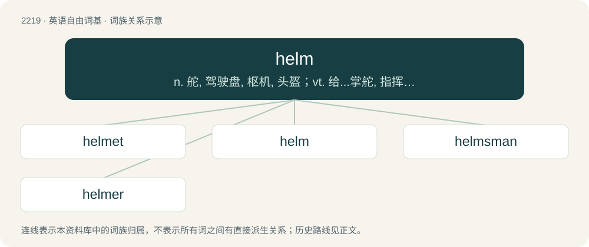

# 2325 · helm — n. 舵, 驾驶盘, 枢机, 头盔；vt. 给...掌舵, 指挥, 给...戴头盔

[总目录](../00_总目录_按常用程度.md)

**类型**：英语自由词基　｜　**来源语言**：见词源记录

## 核心含义与来源

- 核心含义：n. 舵, 驾驶盘, 枢机, 头盔；vt. 给...掌舵, 指挥, 给...戴头盔
- 英文含义：The tiller (or, in a large ship, the wheel) which is used to steer the rudder of a marine vessel; also, the entire steering apparatus of a vessel.
- 词形：helm

**多个词源／构词路径**：同一拼写可能有不同来源；以下按词性和含义分别列出。

**来源记录 1**（名词；The tiller (or, in a large ship, the wheel) which is used to steer the rudder of a marine vessel; also, the entire steering apparatus of a vessel.）

The noun is derived from Middle English helm, helme (“tiller of a ship”), from Old English helma (“helm, tiller”), from Proto-Germanic \*helmô (“handle; helm, tiller”), either from Proto-Indo-European \*ḱel- (“to cover”) or from the same source as haulm and helm (“bentgrass, straw”) (see below), Proto-Indo-European \*ḱélh₂-m(on)- (“reed, hollow stalk”), one form of which then developed a specialized meaning “handle” in Germanic. The verb is derived from the noun. Cognates \* German Holm (“beam”) \* Old Norse hjálm

**来源记录 2**（名词；A shelter for cattle or other farm animals; a hemmel, a shed.）

From Middle English helm (“helmet; crown of thorns of Jesus; warrior; inn or shop sign”) \[and other forms\], from Old English helm (“helmet”), from Proto-West Germanic \*helm, from Proto-Germanic \*helmaz (“protective covering”), probably from Proto-Indo-European \*ḱelmos, from the root \*ḱel- (“to cover”). Doublet of heaume and related to helmet. Cognates \* Gothic 𐌷𐌹𐌻𐌼𐍃 (hilms) \* Old Frisian helm (West Frisian helm) \* Old High German helm (Middle High German helm, modern German Helm; Italian elmo; Old French helme, modern French heaume; Spanish yelmo) \* Old Norse hjalmr (Danish hjelm, Norwegian hjelm, Swedish hjälm) \* Old Saxon helm (Low German Helm, Middle Dutch helm, modern Dutch helm)

**来源记录 3**（名词；A stalk of corn, or (uncountable) stalks of corn collectively (that is, straw), especially when bundled together or laid out straight to be used for thatching roofs.）

The noun is possibly: \* a variant of haulm; or \* from its etymon Middle English halm, helm, Early Middle English healm (“straw, stubble; stalk (?); handle of a tool or weapon”) \[and other forms\], from Old English healm (“stalk of a grass or plant; hay, straw, stubble”) or an unattested variant \*helm, from Proto-Germanic \*helmaz (see Proto-West Germanic \*helm) or \*halmaz (“stalk of a grass or plant; hay, straw”), ultimately from Proto-Indo-European \*ḱelh₂- (“to prick, stab, stick”). The verb is either derived from the noun, or is possibly a variant of yelm. Cognates Dutch helm (“haulm”); helm, hellem, hellim (“straw”) (dialectal) Low German helm (“haulm”) (hallem (Heligoland), halm (Holstein))

## 词族图

## 单词速览（常用到不常用）

| 单词 | 音标 | 释义 |
|---|---|---|
| [helmet](#w-1) | /ˈhɛlmɪt/ | n. 钢盔, 盔, 防护帽；vt. 给...戴头盔 |
| [helm](#w-2) | 英 /hɛlm/ | n. 舵, 驾驶盘, 枢机, 头盔；vt. 给...掌舵, 指挥, 给...戴头盔 |
| [helmsman](#w-3) | /ˈhɛlmz.mən/ | n. 舵手 |
| [helmer](#w-4) |  | n. 赫尔默（姓氏） |

## 逐词详解

### 1. helmet

**词性**：名词　｜　**音标**：/ˈhɛlmɪt/

**中文释义**：n. 钢盔, 盔, 防护帽；vt. 给...戴头盔

**英文义项**：A hard, protective head covering, typically part of armour. / The upper part of a chemist's retort.

**构词拆分**：helm + -et

**词源与演化**：

From Middle English helmet, helmett, a borrowing from Old French helmet, heaumet, a diminutive of helme (Modern French heaume), equivalent to helm + -et. The Old French is itself of Germanic origin (whence Old English helm). Used in English since the 15th century, it has largely displaced helm as the general word.

**例句**：

> Tom took off his bicycle helmet and put it on the table.

### 2. helm

**词性**：名词　｜　**音标**：英 /hɛlm/

**中文释义**：n. 舵, 驾驶盘, 枢机, 头盔；vt. 给...掌舵, 指挥, 给...戴头盔

**英文义项**：The tiller (or, in a large ship, the wheel) which is used to steer the rudder of a marine vessel; also, the entire steering apparatus of a vessel. / The use of a helm (sense 1); also, the amount of space through which a helm is turned.

**词源与演化**：

The noun is derived from Middle English helm, helme (“tiller of a ship”), from Old English helma (“helm, tiller”), from Proto-Germanic \*helmô (“handle; helm, tiller”), either from Proto-Indo-European \*ḱel- (“to cover”) or from the same source as haulm and helm (“bentgrass, straw”) (see below), Proto-Indo-European \*ḱélh₂-m(on)- (“reed, hollow stalk”), one form of which then developed a specialized meaning “handle” in Germanic. The verb is derived from the noun. Cognates \* German Holm (“beam”) \* Old Norse hjálm

**用法示例／搭配（非完整句）**：

> the helm of the Commonwealth

该用例对应义项：A position of control or leadership.

### 3. helmsman

**词性**：名词　｜　**音标**：/ˈhɛlmz.mən/

**中文释义**：n. 舵手

**英文义项**：A member of a ship's crew who is responsible for steering. / A leader.

**构词拆分**：helm + -s- + man

**词源与演化**：

From helm + -s- + man.

**例句**：

> You only get to know a good helmsman in a storm.

### 4. helmer

**词性**：名词

**中文释义**：n. 赫尔默（姓氏）

**英文义项**：Synonym of showrunner.

**构词拆分**：From helm + -er.

**词源与演化**：

From helm + -er.
