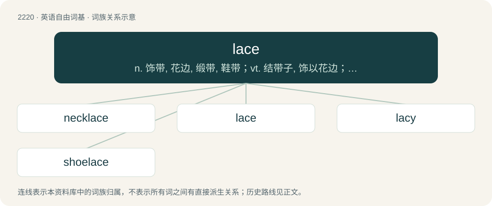

# 2326 · lace — n. 饰带, 花边, 缎带, 鞋带；vt. 结带子, 饰以花边；vi. 系带子

[总目录](../00_总目录_按常用程度.md)

**类型**：英语自由词基　｜　**来源语言**：见词源记录

## 核心含义与来源

- 核心含义：n. 饰带, 花边, 缎带, 鞋带；vt. 结带子, 饰以花边；vi. 系带子
- 英文含义：A light fabric containing patterns of holes, usually built up from a single thread.
- 词形：lace

**多个词源／构词路径**：同一拼写可能有不同来源；以下按词性和含义分别列出。

**来源记录 1**（名词；A light fabric containing patterns of holes, usually built up from a single thread.）

From Middle English lace, laace, las, from Old French las, from Vulgar Latin \*laceum, based on Latin laqueus. Doublet of lasso.

**来源记录 2**（动词；To fasten (something) with laces.）

From Middle English lacen, lasen, from Old French lacer, lacier, lasser, lachier, from the noun (see above).

## 词族图

## 单词速览（常用到不常用）

| 单词 | 音标 | 释义 |
|---|---|---|
| [necklace](#w-1) | 英 /ˈnɛklɪs/；美 /ˈnɛkləs/ | n. 项链 |
| [lace](#w-2) | 英 /leɪs/ | n. 饰带, 花边, 缎带, 鞋带；vt. 结带子, 饰以花边；vi. 系带子 |
| [lacy](#w-3) | 英 /ˈleɪ.si/ | a. 丝带的, 花边的, 花边状的 |
| [shoelace](#w-4) | /ˈʃuːˌleɪs/ | n. 鞋带 |

## 逐词详解

### 1. necklace

**词性**：名词　｜　**音标**：英 /ˈnɛklɪs/；美 /ˈnɛkləs/

**中文释义**：n. 项链

**英文义项**：An article of jewelry that is worn around the neck, most often made of a string of precious metal, pearls, gems, beads or shells, and sometimes having a pendant attached. / Anything resembling a necklace in shape.

**构词拆分**：neck + lace

**词源与演化**：

From neck + lace.

**用法示例／搭配（非完整句）**：

> a necklace of coral islands

该用例对应义项：Anything resembling a necklace in shape.

### 2. lace

**词性**：名词　｜　**音标**：英 /leɪs/

**中文释义**：n. 饰带, 花边, 缎带, 鞋带；vt. 结带子, 饰以花边；vi. 系带子

**英文义项**：A light fabric containing patterns of holes, usually built up from a single thread. / A cord or ribbon passed through eyelets in a shoe or garment, pulled tight and tied to fasten the shoe or garment firmly.

**词源与演化**：

From Middle English lace, laace, las, from Old French las, from Vulgar Latin \*laceum, based on Latin laqueus. Doublet of lasso.

**例句**：

> your laces are untied, do them up!

该用例对应义项：A cord or ribbon passed through eyelets in a shoe or garment, pulled tight and tied to fasten the shoe or garment firmly.

### 3. lacy

**词性**：形容词　｜　**音标**：英 /ˈleɪ.si/

**中文释义**：a. 丝带的, 花边的, 花边状的

**英文义项**：Made of lace or decorated with it. / Looking like lace.

**构词拆分**：lace + -y

**词源与演化**：

From lace + -y.

**用法示例／搭配（非完整句）**：

> lacy lingerie

该用例对应义项：Made of lace or decorated with it.

### 4. shoelace

**词性**：名词　｜　**音标**：/ˈʃuːˌleɪs/

**中文释义**：n. 鞋带

**英文义项**：A lace used for fastening a shoe.

**构词拆分**：shoe + lace

**词源与演化**：

shoe + lace

**例句**：

> The hiker’s shoelace snapped halfway up the trail.

该用例对应义项：A lace used for fastening a shoe.
