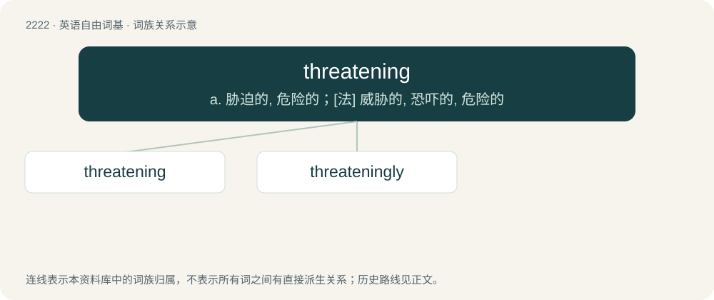

# 2327 · threatening — a. 胁迫的, 危险的；\[法\] 威胁的, 恐吓的, 危险的

[总目录](../00_总目录_按常用程度.md)

**类型**：英语自由词基　｜　**来源语言**：见词源记录

## 核心含义与来源

- 核心含义：a. 胁迫的, 危险的；\[法\] 威胁的, 恐吓的, 危险的
- 英文含义：Presenting a threat, posing a likely risk of harm.
- 词形：threatening

**多个词源／构词路径**：同一拼写可能有不同来源；以下按词性和含义分别列出。

**来源记录 1**（形容词；Presenting a threat, posing a likely risk of harm.）

From Middle English thretenyng, þreteninde, equivalent to threaten + -ing.

**来源记录 2**（名词；An act of threatening; a threat.）

From Middle English thretenyng, thretnynge, þretnynge, equivalent to threaten + -ing.

## 词族图

## 单词速览（常用到不常用）

| 单词 | 音标 | 释义 |
|---|---|---|
| [threatening](#w-1) | /ˈθɹɛtə.nɪŋ/ | a. 胁迫的, 危险的；\[法\] 威胁的, 恐吓的, 危险的 |
| [threateningly](#w-2) | /ˈθretnɪŋlɪ/ | adv. 威胁地, 胁迫地, 危险地 |

## 逐词详解

### 1. threatening

**词性**：形容词　｜　**音标**：/ˈθɹɛtə.nɪŋ/

**中文释义**：a. 胁迫的, 危险的；\[法\] 威胁的, 恐吓的, 危险的

**英文义项**：Presenting a threat, posing a likely risk of harm. / Making threats, making statements about a willingness to cause harm.

**构词拆分**：threaten + -ing

**词源与演化**：

From Middle English thretenyng, þreteninde, equivalent to threaten + -ing.

**例句**：

> Never turn your back to someone who is displaying threatening behavior.

该用例对应义项：Presenting a threat, posing a likely risk of harm.

### 2. threateningly

**词性**：副词　｜　**音标**：/ˈθretnɪŋlɪ/

**中文释义**：adv. 威胁地, 胁迫地, 危险地

**英文义项**：In a threatening manner.

**构词拆分**：threatening + -ly

**词源与演化**：

From threatening + -ly.

**例句**：

> He tried to glare threateningly, but how much of a threat can you be when you are naked AND tied to a bed?

该用例对应义项：In a threatening manner.
