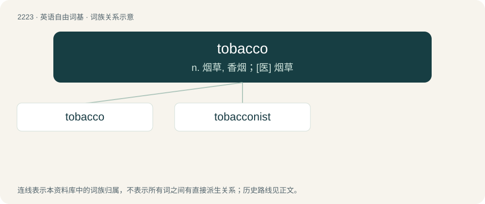

# 2328 · tobacco — n. 烟草, 香烟；\[医\] 烟草

[总目录](../00_总目录_按常用程度.md)

**类型**：英语自由词基　｜　**来源语言**：见词源记录

## 核心含义与来源

- 核心含义：n. 烟草, 香烟；\[医\] 烟草
- 英文含义：Any plant of the genus Nicotiana.
- 词形：tobacco

**来源记录 1**（名词；Any plant of the genus Nicotiana.）

Attested since 1588, borrowed from Spanish tabaco. The Spanish word could be from Arabic طُبَّاق (ṭubbāq, “Dittrichia viscosa”) or from a Caribbean language such as Kari'na or Taíno or multiple of them, from a word meaning "roll of tobacco leaves" or "a pipe for smoking tobacco," such as tabago (“tube for inhaling smoke or powdered intoxicating plants”).

## 词族图

## 单词速览（常用到不常用）

| 单词 | 音标 | 释义 |
|---|---|---|
| [tobacco](#w-1) | 英 /təˈbækəʊ/；美 /təˈbækoʊ/ | n. 烟草, 香烟；\[医\] 烟草 |
| [tobacconist](#w-2) | /təˈbækənist/ | n. 烟草商 |

## 逐词详解

### 1. tobacco

**词性**：名词　｜　**音标**：英 /təˈbækəʊ/；美 /təˈbækoʊ/

**中文释义**：n. 烟草, 香烟；\[医\] 烟草

**英文义项**：Any plant of the genus Nicotiana. / Leaves of Nicotiana tabacum and some other species cultivated and harvested to make cigarettes, cigars, snuff, for smoking in pipes or for chewing.

**词源与演化**：

Attested since 1588, borrowed from Spanish tabaco. The Spanish word could be from Arabic طُبَّاق (ṭubbāq, “Dittrichia viscosa”) or from a Caribbean language such as Kari'na or Taíno or multiple of them, from a word meaning "roll of tobacco leaves" or "a pipe for smoking tobacco," such as tabago (“tube for inhaling smoke or powdered intoxicating plants”).

**例句**：

> Tobaccos from the Connecticut Valley were used for wrapping cigars.

该用例对应义项：A variety of tobacco.

### 2. tobacconist

**词性**：名词　｜　**音标**：/təˈbækənist/

**中文释义**：n. 烟草商

**英文义项**：A person who sells tobacco, cigarettes, cigars, snuff and sundry items. / A tobacconist's shop.

**构词拆分**：tobacco + -n- + -ist

**词源与演化**：

From tobacco + -n- + -ist.

**例句**：

> People used to buy their smokes at a tobacconist. Now they buy them at a convenience store.
