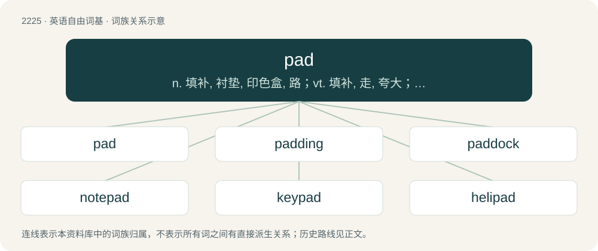

# 2329 · pad — n. 填补, 衬垫, 印色盒, 路；vt. 填补, 走, 夸大；vi. 步行

[总目录](../00_总目录_按常用程度.md)

**类型**：英语自由词基　｜　**来源语言**：见词源记录

## 核心含义与来源

- 核心含义：n. 填补, 衬垫, 印色盒, 路；vt. 填补, 走, 夸大；vi. 步行
- 英文含义：A flattened mass of anything soft, to sit or lie on.
- 词形：pad

**多个词源／构词路径**：同一拼写可能有不同来源；以下按词性和含义分别列出。

**来源记录 1**（名词；A flattened mass of anything soft, to sit or lie on.）

1554, "bundle of straw to lie on". Unknown, and unclear all senses have common etymology. For sense "ends of a digit", cf. Low German or West Flemish pad (“sole of the foot”), perhaps ultimately from Proto-Indo-European \*pent- (“to pass”), which would make it related to both path and find.

**来源记录 2**（名词；A toad.）

From Middle English pade, padde, from Old English padde, from Proto-West Germanic \*paddā, from Proto-Germanic \*paddǭ (“toad”). Cognate with Dutch pad, German Low German Pad (“toad”), dialectal German Padde, Danish padde, Swedish padda, Icelandic padda (“toad”), and possibly to English paddle. Doublet of pode

**来源记录 3**（名词；A path, particularly one unformed or unmaintained; a track made by animals.）

From Dutch pad or Middle Low German pat (“path”). Doublet of path.

**来源记录 4**（名词；A type of wickerwork basket, especially as used as a measure of fish or other goods.）

Perhaps an alteration of ped.

**来源记录 5**（动词；To travel along (a road, path etc.).）

Probably partly from Middle Low German pat, partly imitative. Some senses possibly influenced by pad (“soft part of an animal's foot”, noun).

**来源记录 6**（感叹词；Indicating a soft flat sound, as of bare footsteps.）

Probably imitative, perhaps related to or influenced by Etymology 5, above.

## 词族图

## 单词速览（常用到不常用）

| 单词 | 音标 | 释义 |
|---|---|---|
| [pad](#w-1) | 英 /pæd/ | n. 填补, 衬垫, 印色盒, 路；vt. 填补, 走, 夸大；vi. 步行 |
| [padding](#w-2) | /ˈpædɪŋ/ | n. 垫充, 垫塞, 填料, 废话, 虚报的费用；\[计\] 填充; 装填 |
| [paddock](#w-3) | 英 /ˈpædək/；美 /ˈpædək/ | 【英文】A frog. |
| [notepad](#w-4) |  | n. 记事本；\[计\] 记事本 |
| [keypad](#w-5) | /ˈkiːpæd/ | n. 键区；\[计\] 键区 |
| [helipad](#w-6) | 英 /ˈhɛ.liˌpæd/ | n. 直升机起飞及降落场,直升机停机坪 |
| [touchpad](#w-7) | 美 /ˈtʌt͡ʃˌpæd/ | n. 触摸屏设备, 触摸板 |
| [gamepad](#w-8) | /ˈɡeɪm.pæd/ | n. 游戏手柄; \[计\]\[WIN\]游戏键盘 |
| [trackpad](#w-9) | 美 /ˈtɹækˌpæd/ | n. （手指在其上滑动以移动光标的）触控板 |

## 逐词详解

### 1. pad

**词性**：动词　｜　**音标**：英 /pæd/

**中文释义**：n. 填补, 衬垫, 印色盒, 路；vt. 填补, 走, 夸大；vi. 步行

**英文义项**：To stuff. / To furnish with a pad or padding.

**词源与演化**：

1554, "bundle of straw to lie on". Unknown, and unclear all senses have common etymology. For sense "ends of a digit", cf. Low German or West Flemish pad (“sole of the foot”), perhaps ultimately from Proto-Indo-European \*pent- (“to pass”), which would make it related to both path and find.

**例句**：

> The author began to pad her succinct stories with trite descriptions to keep up with current market trends.

该用例对应义项：To increase the size of, especially by adding undesirable filler.

### 2. padding

**词性**：名词　｜　**音标**：/ˈpædɪŋ/

**中文释义**：n. 垫充, 垫塞, 填料, 废话, 虚报的费用；\[计\] 填充; 装填

**英文义项**：Soft filling material used in cushions etc. / Extra characters such as spaces added to a record to fill it out to a fixed length.

**构词拆分**：pad + -ing

**词源与演化**：

From pad + -ing.

**例句**：

> That magazine is mostly advertisements; the rest is padding.

该用例对应义项：Anything of little value used to fill up space.

### 3. paddock

**词性**：名词　｜　**音标**：英 /ˈpædək/；美 /ˈpædək/

**英文义项**：A frog. / A toad.

**构词拆分**：pad (“(Britain, dialectal) frog; toad”) + -ock (suffix forming nouns, originally with diminutive senses)

**词源与演化**：

From Middle English paddok, paddoke (“frog; toad”) \[and other forms\], from pad, pade (“frog; toad”) + -ok (diminutive suffix). Pad, pade is derived from Old English \*pada, \*padda, padde, from Proto-West Germanic \*paddā, from Proto-Germanic \*paddǭ (“toad”); further etymology uncertain, possibly ultimately from Proto-Indo-European \*bʰew- (“to swell”). The English word is analysable as pad (“(Britain, dialectal) frog; toad”) + -ock (suffix forming nouns, originally with diminutive senses). Sense 2 (“sledge”) is probably from the supposed resemblance of the object to a frog or toad.

**例句**：

> Cold as a paddock.

该用例对应义项：A frog.

### 4. notepad

**词性**：名词

**中文释义**：n. 记事本；\[计\] 记事本

**英文义项**：A pad of paper, often bound, in which one jots down notes; a notebook.

**构词拆分**：note + pad

**词源与演化**：

From note + pad.

**例句**：

> Tom opened the drawer again and took out a notepad.

### 5. keypad

**词性**：名词　｜　**音标**：/ˈkiːpæd/

**中文释义**：n. 键区；\[计\] 键区

**英文义项**：A small board with keys primarily used for tactile input into a machine.

**构词拆分**：key + pad

**词源与演化**：

From key + pad.

**例句**：

> Many laptop computers have special function keys which turn part of the alphabetical keyboard into a numeric keypad.

该用例对应义项：A small board with keys primarily used for tactile input into a machine.

### 6. helipad

**词性**：名词　｜　**音标**：英 /ˈhɛ.liˌpæd/

**中文释义**：n. 直升机起飞及降落场,直升机停机坪

**英文义项**：A small landing area for helicopters.

**构词拆分**：heli- + pad

**词源与演化**：

From heli- + pad.

**例句**：

> There is a helipad on the roof of the hospital.

### 7. touchpad

**词性**：名词　｜　**音标**：美 /ˈtʌt͡ʃˌpæd/

**中文释义**：n. 触摸屏设备, 触摸板

**英文义项**：A flat surface which is sensitive to touch, used mostly in laptop computers to control an on-screen cursor.

**构词拆分**：touch + pad

**词源与演化**：

From touch + pad.

**例句**：

> To select, one presses down on the touchpad instead of a physical button.

### 8. gamepad

**词性**：名词　｜　**音标**：/ˈɡeɪm.pæd/

**中文释义**：n. 游戏手柄; \[计\]\[WIN\]游戏键盘

**英文义项**：A type of game controller held in both hands and controlled with the thumbs.

**构词拆分**：game + pad

**例句**：

> This game is basically designed for use with keyboard and gamepad but configuration can only be done by mouse.

### 9. trackpad

**词性**：名词　｜　**音标**：美 /ˈtɹækˌpæd/

**中文释义**：n. （手指在其上滑动以移动光标的）触控板

**英文义项**：touchpad

**构词拆分**：track + pad

**词源与演化**：

from track + pad, coined by Apple Inc.
