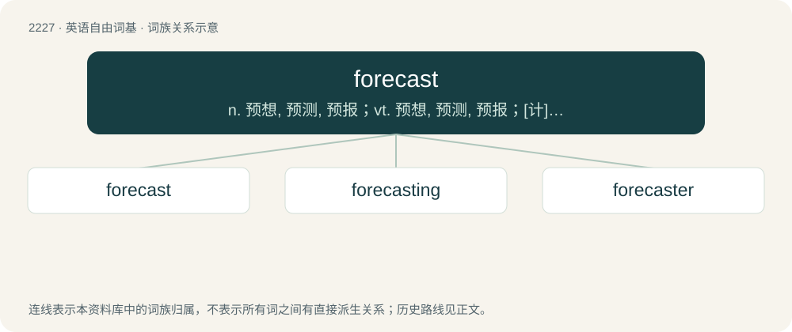

# 2330 · forecast — n. 预想, 预测, 预报；vt. 预想, 预测, 预报；\[计\] 趋势预测

[总目录](../00_总目录_按常用程度.md)

**类型**：英语自由词基　｜　**来源语言**：见词源记录

## 核心含义与来源

- 核心含义：n. 预想, 预测, 预报；vt. 预想, 预测, 预报；\[计\] 趋势预测
- 英文含义：To estimate how something will be in the future.
- 词形：forecast

**来源记录 1**（动词；To estimate how something will be in the future.）

From Middle English forecasten, forcasten, equivalent to fore- + cast. The noun is from Middle English forecast, forcast.

## 词族图

## 单词速览（常用到不常用）

| 单词 | 音标 | 释义 |
|---|---|---|
| [forecast](#w-1) | 英 /ˈfɔːkɑːst/；美 /ˈfɔɹkæst/ | n. 预想, 预测, 预报；vt. 预想, 预测, 预报；\[计\] 趋势预测 |
| [forecasting](#w-2) | /ˈfɔːkɑːstiŋ/ | \[计\] 预报, 预测；\[经\] 预测 |
| [forecaster](#w-3) | 英 /ˈfɔːkɑːstə/；美 /ˈfɔɹkæstəɹ/ | n. 预报员 |

## 逐词详解

### 1. forecast

**词性**：动词　｜　**音标**：英 /ˈfɔːkɑːst/；美 /ˈfɔɹkæst/

**中文释义**：n. 预想, 预测, 预报；vt. 预想, 预测, 预报；\[计\] 趋势预测

**英文义项**：To estimate how something will be in the future. / To foreshadow; to suggest something in advance.

**构词拆分**：fore- + cast

**词源与演化**：

From Middle English forecasten, forcasten, equivalent to fore- + cast. The noun is from Middle English forecast, forcast.

**用法示例／搭配（非完整句）**：

> to forecast the weather, or a storm

该用例对应义项：To estimate how something will be in the future.

### 2. forecasting

**词性**：名词　｜　**音标**：/ˈfɔːkɑːstiŋ/

**中文释义**：\[计\] 预报, 预测；\[经\] 预测

**英文义项**：A forecast or prediction.

**构词拆分**：forecast + -ing

**词源与演化**：

From Middle English forcastyng, forcastynge, equivalent to forecast + -ing.

**例句**：

> Forecasting is saying what will happen and then explaining why it didn't.

### 3. forecaster

**词性**：名词　｜　**音标**：英 /ˈfɔːkɑːstə/；美 /ˈfɔɹkæstəɹ/

**中文释义**：n. 预报员

**英文义项**：A person who forecasts. / A software program or algorithm that forecasts.

**构词拆分**：forecast + -er

**词源与演化**：

From forecast + -er.

**例句**：

> The weather forecaster predicts sunny weather tomorrow.
