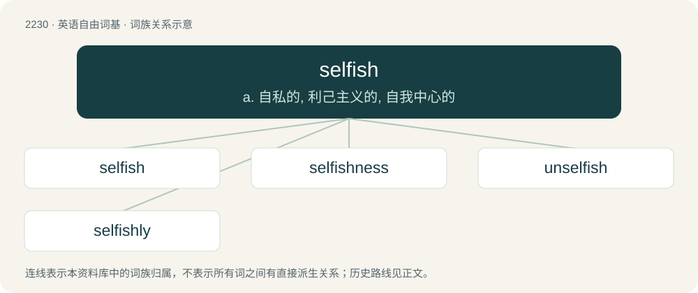

# 2332 · selfish — a. 自私的, 利己主义的, 自我中心的

[总目录](../00_总目录_按常用程度.md)

**类型**：英语自由词基　｜　**来源语言**：见词源记录

## 核心含义与来源

- 核心含义：a. 自私的, 利己主义的, 自我中心的
- 英文含义：Holding one's own self-interest as the standard for decision making.
- 词形：selfish

**来源记录 1**（形容词；Holding one's own self-interest as the standard for decision making.）

From self + -ish. Compare Danish selvisk (“selfish”), Swedish självisk (“selfish”).

## 词族图

## 单词速览（常用到不常用）

| 单词 | 音标 | 释义 |
|---|---|---|
| [selfish](#w-1) | /ˈsɛl.fɪʃ/ | a. 自私的, 利己主义的, 自我中心的 |
| [selfishness](#w-2) | /ˈsɛl.fɪʃ.nəs/ | n. 自我中心, 利己主义, 任性 |
| [unselfish](#w-3) | /.ʌnˈselfiʃ/ | a. 不自私的, 无我的, 不谋私利的 |
| [selfishly](#w-4) | /ˈselfiʃli/ | adv. 自私地, 自我中心地, 任性地 |

## 逐词详解

### 1. selfish

**词性**：形容词　｜　**音标**：/ˈsɛl.fɪʃ/

**中文释义**：a. 自私的, 利己主义的, 自我中心的

**英文义项**：Holding one's own self-interest as the standard for decision making. / Having excessive or exclusive regard and concern for one's own well-being, profit or pleasure, with little or no consideration for others.

**构词拆分**：self + -ish

**词源与演化**：

From self + -ish. Compare Danish selvisk (“selfish”), Swedish självisk (“selfish”).

**例句**：

> Selfish men were...trying to make capital for themselves out of the sacred cause of civil rights.

该用例对应义项：concerned chiefly or only with yourself and your advantage to the exclusion of others

### 2. selfishness

**词性**：名词　｜　**音标**：/ˈsɛl.fɪʃ.nəs/

**中文释义**：n. 自我中心, 利己主义, 任性

**英文义项**：The quality of being selfish, the condition of putting one's own interests before those of others.

**构词拆分**：selfish + -ness

**词源与演化**：

From selfish + -ness.

**例句**：

> Maybe it's better to suppose that we all aren't born with selfishness.

### 3. unselfish

**词性**：形容词　｜　**音标**：/.ʌnˈselfiʃ/

**中文释义**：a. 不自私的, 无我的, 不谋私利的

**英文义项**：Not selfish.

**构词拆分**：un- + selfish

**词源与演化**：

From un- + selfish.

**例句**：

> The man was in an unselfish mood that day, so decided to give a £20 note to the next charity he came across.

该用例对应义项：Not selfish.

### 4. selfishly

**词性**：副词　｜　**音标**：/ˈselfiʃli/

**中文释义**：adv. 自私地, 自我中心地, 任性地

**英文义项**：In a selfish manner; with regard to private interest only or chiefly.

**构词拆分**：selfish + -ly

**词源与演化**：

From selfish + -ly.

**例句**：

> After everything I've done for you, you're acting this selfishly? I've raised a monster.
