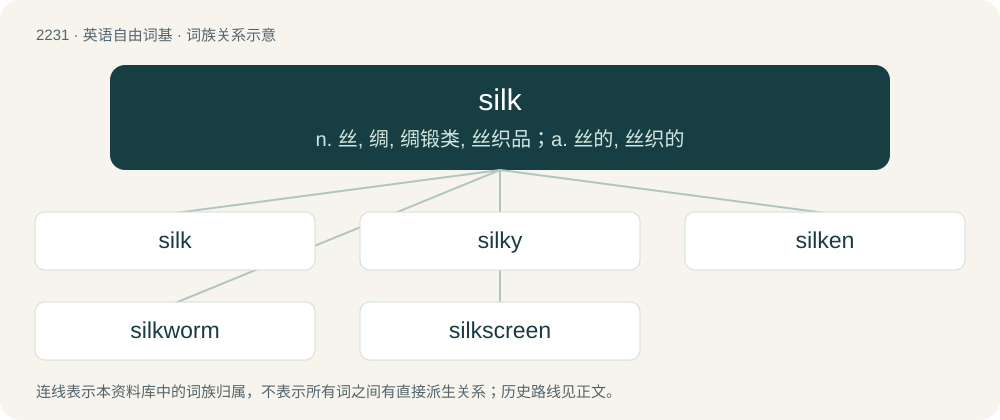

# 2333 · silk — n. 丝, 绸, 绸锻类, 丝织品；a. 丝的, 丝织的

[总目录](../00_总目录_按常用程度.md)

**类型**：英语自由词基　｜　**来源语言**：见词源记录

## 核心含义与来源

- 核心含义：n. 丝, 绸, 绸锻类, 丝织品；a. 丝的, 丝织的
- 英文含义：A fine fiber excreted by the silkworm or other arthropod (such as a spider).
- 词形：silk

**来源记录 1**（名词；A fine fiber excreted by the silkworm or other arthropod (such as a spider).）

From Middle English silk, sylk, selk, selc, from Old English sioloc, seoloc, seolc (“silk”). The immediate source is uncertain; it probably reached English via the Baltic trade routes (cognates in Old Norse silki (&gt; Danish silke, Swedish silke (“silk”)), Russian шёлк (šolk), obsolete Lithuanian zilkai̇̃), all ultimately from Late Latin sēricus, from Ancient Greek σηρικός (sērikós), ultimately from an Oriental language (represented now by e.g. Chinese 絲 /丝 (sī, “silk”)). Displaced Old English sīde (“silk”). Compare Seres. Doublet of seric and serge.

## 词族图

## 单词速览（常用到不常用）

| 单词 | 音标 | 释义 |
|---|---|---|
| [silk](#w-1) | /sɪlk/ | n. 丝, 绸, 绸锻类, 丝织品；a. 丝的, 丝织的 |
| [silky](#w-2) | /ˈsɪlki/ | a. 丝的, 柔滑的 |
| [silken](#w-3) | /ˈsɪlkən/ | a. 丝的, 绸制的, 柔软的, 圆滑的 |
| [silkworm](#w-4) | 英 /ˈsɪlkwɜːm/ | n. 蚕 |
| [silkscreen](#w-5) | 美 /ˈsɪlkˌskɹin/ | n. 丝网印刷,丝网印刷品；a. 丝网印刷的,用丝网印刷术印制的 |

## 逐词详解

### 1. silk

**词性**：名词　｜　**音标**：/sɪlk/

**中文释义**：n. 丝, 绸, 绸锻类, 丝织品；a. 丝的, 丝织的

**英文义项**：A fine fiber excreted by the silkworm or other arthropod (such as a spider). / A thread or yarn made from silk fibers.

**词源与演化**：

From Middle English silk, sylk, selk, selc, from Old English sioloc, seoloc, seolc (“silk”). The immediate source is uncertain; it probably reached English via the Baltic trade routes (cognates in Old Norse silki (&gt; Danish silke, Swedish silke (“silk”)), Russian шёлк (šolk), obsolete Lithuanian zilkai̇̃), all ultimately from Late Latin sēricus, from Ancient Greek σηρικός (sērikós), ultimately from an Oriental language (represented now by e.g. Chinese 絲 /丝 (sī, “silk”)). Displaced Old English sīde (“silk”). Compare Seres. Doublet of seric and serge.

**例句**：

> We harvested a load of silk from the silkworm farm.

该用例对应义项：A fine fiber excreted by the silkworm or other arthropod (such as a spider).

### 2. silky

**词性**：形容词　｜　**音标**：/ˈsɪlki/

**中文释义**：a. 丝的, 柔滑的

**英文义项**：Similar in appearance or texture (especially in softness and smoothness) to silk. / Smooth and pleasant; seductive.

**构词拆分**：silk + -y

**词源与演化**：

From Middle English sylky, equivalent to silk + -y.

**例句**：

> Cribs and formula, strollers and baby food epitomize silky parenting.

该用例对应义项：Having sensibilities of mainstream culture, in contrast to crunchy.

### 3. silken

**词性**：形容词　｜　**音标**：/ˈsɪlkən/

**中文释义**：a. 丝的, 绸制的, 柔软的, 圆滑的

**英文义项**：Made of silk. / Having a smooth, soft, or light texture.

**构词拆分**：silk + -en (“made of”)

**词源与演化**：

From Middle English silken, selken, seolkene, from Old English seolcen, from seolc (“silk”) + -en, from an unattested early Proto-West Germanic borrowing from Latin sēricum, from Ancient Greek σηρικός (sērikós, “silken”), from σήρ (sḗr, “silkworm”) + -ικός (-ikós, “-ic”). Equivalent to silk + -en (“made of”). Cognate with Scots selkin, silkin (“silken”), Icelandic silki (“silken”).

**用法示例／搭配（非完整句）**：

> a silken veil

该用例对应义项：Made of silk.

### 4. silkworm

**词性**：名词　｜　**音标**：英 /ˈsɪlkwɜːm/

**中文释义**：n. 蚕

**英文义项**：Any of various caterpillars of moths that produce silk cocoons, especially Bombyx mori, the source of most commercial silk.

**构词拆分**：silk + worm

**词源与演化**：

From Middle English silkwirm, from Old English seolcwyrm (“silkworm”), equivalent to silk + worm.

**例句**：

> What the silkworm won't eat, the bug will.

### 5. silkscreen

**词性**：名词　｜　**音标**：美 /ˈsɪlkˌskɹin/

**中文释义**：n. 丝网印刷,丝网印刷品；a. 丝网印刷的,用丝网印刷术印制的

**英文义项**：A sheet of material (originally silk but now synthetic) with areas that are porous to ink and others that are non-porous to allow printing of images, such as on T-shirts.

**构词拆分**：silk + screen

**词源与演化**：

From silk + screen.
