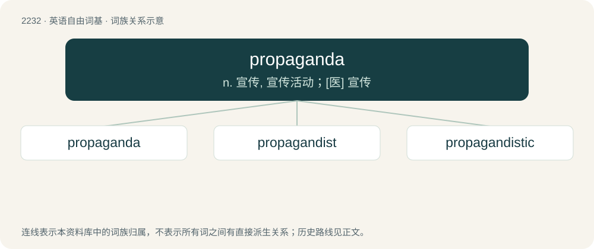

# 2335 · propaganda — n. 宣传, 宣传活动；\[医\] 宣传

[总目录](../00_总目录_按常用程度.md)

**类型**：英语自由词基　｜　**来源语言**：见词源记录

## 核心含义与来源

- 核心含义：n. 宣传, 宣传活动；\[医\] 宣传
- 英文含义：Agitation, publicity, public communication aimed at influencing an audience and furthering an agenda.
- 词形：propaganda

**来源记录 1**（名词；Agitation, publicity, public communication aimed at influencing an audience and furthering an agenda.）

From New Latin prōpāganda, short for Congregātiō dē Prōpāgandā Fidē (“a committee of cardinals established in 1622 by Gregory XV to supervise foreign missions”, literally “congregation for propagating the faith”), and properly the ablative feminine gerundive of Latin prōpāgō (“propagate”). Once the word had been detached from the phrase from which it originated, it could be reinterpreted as a neuter plural gerundive, meaning "things to be propagated"; compare agenda. Modern political sense dates from World War I, not originally pejorative.

## 词族图

## 单词速览（常用到不常用）

| 单词 | 音标 | 释义 |
|---|---|---|
| [propaganda](#w-1) | 英 /ˌpɹɒpəˈɡændə/；美 /ˌpɹɑpəˈɡændə/ | n. 宣传, 宣传活动；\[医\] 宣传 |
| [propagandist](#w-2) | 英 /pɹɒpəˈɡandɪst/ | n. 宣传者；a. 宣传的, 宣传者的 |
| [propagandistic](#w-3) | 英 /pɹɒpəɡanˈdɪstɪk/ | a. 宣传的, 宣传家的 |

## 逐词详解

### 1. propaganda

**词性**：名词　｜　**音标**：英 /ˌpɹɒpəˈɡændə/；美 /ˌpɹɑpəˈɡændə/

**中文释义**：n. 宣传, 宣传活动；\[医\] 宣传

**英文义项**：Agitation, publicity, public communication aimed at influencing an audience and furthering an agenda. / Such communication specifically when it is biased, misleading, or provoking mainly emotional responses.

**词源与演化**：

From New Latin prōpāganda, short for Congregātiō dē Prōpāgandā Fidē (“a committee of cardinals established in 1622 by Gregory XV to supervise foreign missions”, literally “congregation for propagating the faith”), and properly the ablative feminine gerundive of Latin prōpāgō (“propagate”). Once the word had been detached from the phrase from which it originated, it could be reinterpreted as a neuter plural gerundive, meaning "things to be propagated"; compare agenda. Modern political sense dates from World War I, not originally pejorative.

**例句**：

> Despite being biased and often untrue, propaganda material can be useful in OSINT analysis.

该用例对应义项：Agitation, publicity, public communication aimed at influencing an audience and furthering an agenda.

### 2. propagandist

**词性**：名词　｜　**音标**：英 /pɹɒpəˈɡandɪst/

**中文释义**：n. 宣传者；a. 宣传的, 宣传者的

**英文义项**：A person who disseminates propaganda.

**构词拆分**：propaganda + -ist

**词源与演化**：

From propaganda + -ist, after French propagandiste.

**例句**：

> Are you just a paid state propagandist or what?

### 3. propagandistic

**词性**：形容词　｜　**音标**：英 /pɹɒpəɡanˈdɪstɪk/

**中文释义**：a. 宣传的, 宣传家的

**英文义项**：Having the characteristics of propaganda; spreading propaganda.

**构词拆分**：propagandist + -ic；propaganda + -istic

**词源与演化**：

From propagandist + -ic or propaganda + -istic.

**例句**：

> The propagandistic radio station disseminated lies and half-truths about how great America was.
