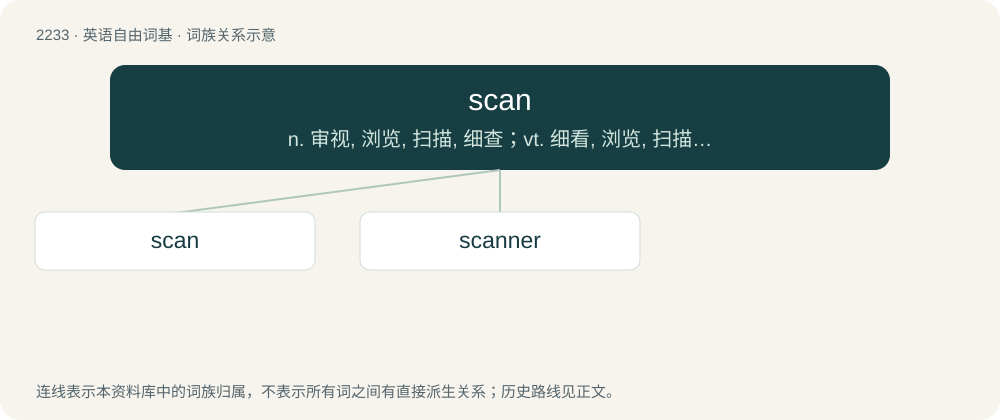

# 2336 · scan — n. 审视, 浏览, 扫描, 细查；vt. 细看, 浏览, 扫描, 详细调查, 标出格律；vi. 押韵, 扫描

[总目录](../00_总目录_按常用程度.md)

**类型**：英语自由词基　｜　**来源语言**：见词源记录

## 核心含义与来源

- 核心含义：n. 审视, 浏览, 扫描, 细查；vt. 细看, 浏览, 扫描, 详细调查, 标出格律；vi. 押韵, 扫描
- 英文含义：To examine sequentially, carefully, or critically; to scrutinize; to behold closely.
- 词形：scan

**来源记录 1**（动词；To examine sequentially, carefully, or critically; to scrutinize; to behold closely.）

From late Middle English scanne (“to mark off verse to show metrical structure”), from earlier scanden, from Late Latin scandere (“to scan verse”), from Classical Latin scandō (“to climb, rise, mount”), from Proto-Indo-European \*skend- (“to jump, dart, climb, scale, scan”).

## 词族图

## 单词速览（常用到不常用）

| 单词 | 音标 | 释义 |
|---|---|---|
| [scan](#w-1) | 英 /skæn/ | n. 审视, 浏览, 扫描, 细查；vt. 细看, 浏览, 扫描, 详细调查, 标出格律；vi. 押韵, 扫描 |
| [scanner](#w-2) | 英 /ˈskænə/；/ˈskænɚ/ | n. 扫描仪, 扫描盘, 审视者；\[计\] 扫描器; 词法分析程序; 扫描程序; 扫视程序 |

## 逐词详解

### 1. scan

**词性**：动词　｜　**音标**：英 /skæn/

**中文释义**：n. 审视, 浏览, 扫描, 细查；vt. 细看, 浏览, 扫描, 详细调查, 标出格律；vi. 押韵, 扫描

**英文义项**：To examine sequentially, carefully, or critically; to scrutinize; to behold closely. / To inspect, analyse or go over, often to find something.

**词源与演化**：

From late Middle English scanne (“to mark off verse to show metrical structure”), from earlier scanden, from Late Latin scandere (“to scan verse”), from Classical Latin scandō (“to climb, rise, mount”), from Proto-Indo-European \*skend- (“to jump, dart, climb, scale, scan”).

**例句**：

> Pencil drawings don't scan very well.

该用例对应义项：To create an image of something with the use of a scanner.

### 2. scanner

**词性**：名词　｜　**音标**：英 /ˈskænə/；/ˈskænɚ/

**中文释义**：n. 扫描仪, 扫描盘, 审视者；\[计\] 扫描器; 词法分析程序; 扫描程序; 扫视程序

**英文义项**：One who scans. / A device which scans documents in order to convert them to a digital medium.

**构词拆分**：scan + -er

**词源与演化**：

From scan + -er.

**例句**：

> He put the picture in the scanner, then e-mailed a copy of it to his family.

该用例对应义项：A device which scans documents in order to convert them to a digital medium.
