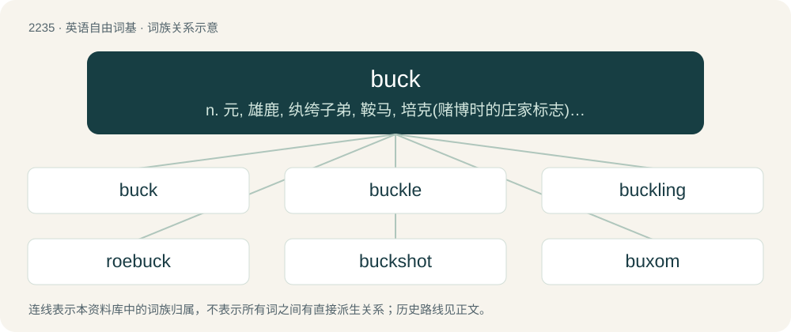

# 2339 · buck — n. 元, 雄鹿, 纨绔子弟, 鞍马, 培克(赌博时的庄家标志), 碱水, 自夸, 谈话；vi. 马背突然拱起, 反对, 吹牛, 闲聊；vt. 马背突然拱起将骑手摔下, 反对, 用碱水洗

[总目录](../00_总目录_按常用程度.md)

**类型**：英语自由词基　｜　**来源语言**：见词源记录

## 核心含义与来源

- 核心含义：n. 元, 雄鹿, 纨绔子弟, 鞍马, 培克(赌博时的庄家标志), 碱水, 自夸, 谈话；vi. 马背突然拱起, 反对, 吹牛, 闲聊；vt. 马背突然拱起将骑手摔下, 反对, 用碱水洗
- 英文含义：A male deer, antelope, sheep, goat, rabbit, hare, and sometimes the male of other animals such as the hamster, ferret, salmonid, shad, skunk and kangaroo.
- 词形：buck

**多个词源／构词路径**：同一拼写可能有不同来源；以下按词性和含义分别列出。

**来源记录 1**（名词；A male deer, antelope, sheep, goat, rabbit, hare, and sometimes the male of other animals such as the hamster, ferret, salmonid, shad, skunk and kangaroo.）

Inherited from Middle English bukke. Doublet of puck (“billy goat”). Currency-related senses hail from American English, a clipping of buckskin as a unit of trade among Native Americans and Europeans in frontier days (attested from 1748). The idea of rigidly standing implements is instilled by Dutch bok (“sawhorse”) as in zaagbok (“sawbuck”). The sense of an object indicating someone’s turn then occurred in American English, possibly originating from the game poker, where a knife (typically with a hilt made from a stag horn) was used as a place-marker to signify whose turn it was to deal. The place-marker was commonly referred to as a buck, which reinforced the term “pass the buck” used in poker, and eventually a silver dollar was used in place of a knife, which also led to a dollar being referred to as a buck.

**来源记录 2**（动词；To bend; buckle.）

From dialectal buck ("to give in, yield"; also bug (“to bend”)), from Middle Low German bucken (“to bend”) or Middle Dutch bucken, bocken (“to bend”), ultimately from Proto-West Germanic \*bukkōn (“to bend, bend repeatedly”), from Proto-Germanic \*bukkōną (“to bend”), from Proto-Indo-European \*bʰugʰ-, \*bʰewgʰ- (“to bend”) + Proto-Germanic \*-(u)kōną. Cognate with Old Frisian bukkia (“to bend”). Influenced in some senses by buck “male goat” (see above). Sense “to meet, to encounter” is a semantic loan from Jamaican Creole buck. Compare bow and elbow.

**来源记录 3**（名词；The beech tree.）

See beech.

## 词族图

## 单词速览（常用到不常用）

| 单词 | 音标 | 释义 |
|---|---|---|
| [buck](#w-1) | 英 /ˈbʌk/；/ˈbɜk/ | n. 元, 雄鹿, 纨绔子弟, 鞍马, 培克(赌博时的庄家标志), 碱水, 自夸, 谈话；vi. 马背突然拱起, 反对, 吹牛, 闲聊；vt. 马背突然拱起将骑手摔下, 反对, 用碱水洗 |
| [buckle](#w-2) | /ˈbʌkəl/ | 【英文】To cause (something) to bend, or to become distorted. |
| [buckling](#w-3) | /ˈbʌk.lɪŋ/ | 【英文】A young male domestic goat of between one and two years. |
| [roebuck](#w-4) | 英 /ˈɹəʊ.bʌk/ | n. 雄狍 |
| [buckshot](#w-5) | /ˈbʌkʃɔt/ | n. &lt;美&gt;(猎兽用)大型铅弹 |
| [buxom](#w-6) | /ˈbʌksəm/ | a. (妇女)丰满的, 健美的 |
| [buckskin](#w-7) | /ˈbʌkˌskɪn/ | n. 鹿皮；\[化\] 鹿皮 |
| [bucko](#w-8) | 英 /ˈbʌkəʊ/；美 /ˈbʌkoʊ/ | n. 欺凌弱小者；a. 持强凌弱的 |
| [humbucker](#w-9) |  | 【英文】A pickup, on an electric guitar, that has a pair of coils of reverse polarity connected in series in order to reduce buzzing noise caused by mains frequency. |

## 逐词详解

### 1. buck

**词性**：名词　｜　**音标**：英 /ˈbʌk/；/ˈbɜk/

**中文释义**：n. 元, 雄鹿, 纨绔子弟, 鞍马, 培克(赌博时的庄家标志), 碱水, 自夸, 谈话；vi. 马背突然拱起, 反对, 吹牛, 闲聊；vt. 马背突然拱起将骑手摔下, 反对, 用碱水洗

**英文义项**：A male deer, antelope, sheep, goat, rabbit, hare, and sometimes the male of other animals such as the hamster, ferret, salmonid, shad, skunk and kangaroo. / An uncastrated sheep, a ram.

**词源与演化**：

Inherited from Middle English bukke. Doublet of puck (“billy goat”). Currency-related senses hail from American English, a clipping of buckskin as a unit of trade among Native Americans and Europeans in frontier days (attested from 1748). The idea of rigidly standing implements is instilled by Dutch bok (“sawhorse”) as in zaagbok (“sawbuck”). The sense of an object indicating someone’s turn then occurred in American English, possibly originating from the game poker, where a knife (typically with a hilt made from a stag horn) was used as a place-marker to signify whose turn it was to deal. The place-marker was commonly referred to as a buck, which reinforced the term “pass the buck” used in poker, and eventually a silver dollar was used in place of a knife, which also led to a dollar being referred to as a buck.

**例句**：

> That skinny guy? C’mon, he can’t weigh more than a buck and a quarter \[125 pounds\].

该用例对应义项：One hundred.

### 2. buckle

**词性**：动词　｜　**音标**：/ˈbʌkəl/

**英文义项**：To cause (something) to bend, or to become distorted. / Of a thing (especially a slender structure under compression): to collapse or distort under physical pressure.

**构词拆分**：buck (“to bend, yield, buckle”) + -le (frequentative suffix)

**词源与演化**：

Origin uncertain. Probably from Middle English bukklen, bokelen (“to arch the body”), from Middle French boucler (“to bulge”, literally “to take the shape of a shield boss”), perhaps from the same ultimate origin as Etymology 1 above, or perhaps related to Middle Low German bockelen (“to bang out curves in metal”), German buckeln (“to bend over, hunch”). In some senses, possibly from buck (“to bend, yield, buckle”) + -le (frequentative suffix).

### 3. buckling

**词性**：名词　｜　**音标**：/ˈbʌk.lɪŋ/

**英文义项**：A young male domestic goat of between one and two years.

**构词拆分**：buck + -ling

**词源与演化**：

From buck + -ling.

### 4. roebuck

**词性**：名词　｜　**音标**：英 /ˈɹəʊ.bʌk/

**中文释义**：n. 雄狍

**英文义项**：A male roe deer.

**构词拆分**：roe + buck (“male deer”)

**词源与演化**：

From Middle English roobukke; equivalent to roe + buck (“male deer”). Doublet of rhebok.

**例句**：

> A roe is a kind of deer. The male is called a roebuck, the female a doe, and their young are called fawns.

### 5. buckshot

**词性**：名词　｜　**音标**：/ˈbʌkʃɔt/

**中文释义**：n. &lt;美&gt;(猎兽用)大型铅弹

**英文义项**：Lead shot used in shotgun cartridges, made of larger pellets than birdshot and suitable for hunting larger game.

**构词拆分**：buck + shot

**词源与演化**：

From buck + shot.

**例句**：

> I couldn't find anywhere to buy buckshot.

### 6. buxom

**词性**：形容词　｜　**音标**：/ˈbʌksəm/

**中文释义**：a. (妇女)丰满的, 健美的

**英文义项**：Having a full, voluptuous figure, especially possessing large breasts. / Full of health, vigour, and good temper.

**构词拆分**：bow (“to bend, bow at the waist”) + -some；buck (“to bend, buckle, kick”) + -some

**词源与演化**：

From Middle English buxom, also ibucsum, ibuhsum (“bendsome, flexible, pliant, obedient”), from Old English bōcsum, \*būhsum, \*ġebūhsum (“bendsome, pliant, obedient”), from Proto-West Germanic \*beuhsam, \*beugsam, equivalent to bow (“to bend, bow at the waist”) + -some or buck (“to bend, buckle, kick”) + -some. Cognate with Scots bowsome (“compliant”), West Frisian bûgsum (“flexible, bendy”), Dutch buigzaam (“flexible, pliant”), German biegsam (“flexible, pliant”).

**例句**：

> Skura was quite buxom and Yanni liked that about her.

### 7. buckskin

**词性**：名词　｜　**音标**：/ˈbʌkˌskɪn/

**中文释义**：n. 鹿皮；\[化\] 鹿皮

**英文义项**：The skin of a male deer, a buck. / Clothing made from buckskin.

**构词拆分**：buck + skin

**词源与演化**：

From Middle English bukskyn; equivalent to buck + skin.

### 8. bucko

**词性**：名词　｜　**音标**：英 /ˈbʌkəʊ/；美 /ˈbʌkoʊ/

**中文释义**：n. 欺凌弱小者；a. 持强凌弱的

**英文义项**：A boastful or bullying man. / Used as a term of address: young lad, friend, pal.

**构词拆分**：buck (“male antelope, deer, etc.; adventurous or high-spirited young man”) + -o (colloquializing suffix)

**词源与演化**：

From buck (“male antelope, deer, etc.; adventurous or high-spirited young man”) + -o (colloquializing suffix).

**例句**：

> Hold on, bucko. Let me see what you got there.

### 9. humbucker

**词性**：名词

**英文义项**：A pickup, on an electric guitar, that has a pair of coils of reverse polarity connected in series in order to reduce buzzing noise caused by mains frequency.

**构词拆分**：From hum (“noise”) + buck (“resist, overcome”) + -er.

**词源与演化**：

From hum (“noise”) + buck (“resist, overcome”) + -er.
