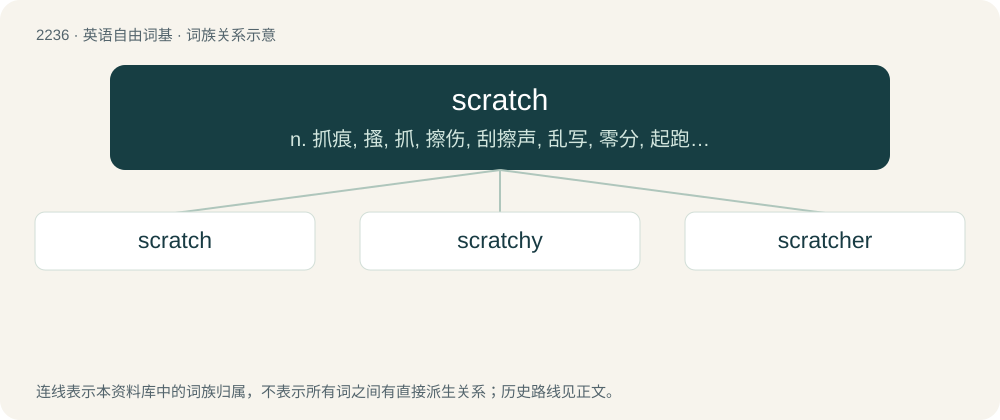

# 2341 · scratch — n. 抓痕, 搔, 抓, 擦伤, 刮擦声, 乱写, 零分, 起跑线；vt. 搔, 抓, 挖出, 擦, 刮, 乱涂, 勾抹掉；vi. 搔, 抓, 发刮擦声, 勉强糊口

[总目录](../00_总目录_按常用程度.md)

**类型**：英语自由词基　｜　**来源语言**：见词源记录

## 核心含义与来源

- 核心含义：n. 抓痕, 搔, 抓, 擦伤, 刮擦声, 乱写, 零分, 起跑线；vt. 搔, 抓, 挖出, 擦, 刮, 乱涂, 勾抹掉；vi. 搔, 抓, 发刮擦声, 勉强糊口
- 英文含义：To rub a surface with a sharp object, especially by a living creature to remove itching with nails, claws, etc.
- 词形：scratch

**来源记录 1**（动词；To rub a surface with a sharp object, especially by a living creature to remove itching with nails, claws, etc.）

From Middle English scracchen, of uncertain origin. Potentially a blend of Middle English scratten (“to scratch”) and cracchen (“to scratch”). More at scrat and cratch. Compare Old English scrama, Old Norse skråma, German Schramme (“scratch”), which may be related.

## 词族图

## 单词速览（常用到不常用）

| 单词 | 音标 | 释义 |
|---|---|---|
| [scratch](#w-1) | /skɹæt͡ʃ/ | n. 抓痕, 搔, 抓, 擦伤, 刮擦声, 乱写, 零分, 起跑线；vt. 搔, 抓, 挖出, 擦, 刮, 乱涂, 勾抹掉；vi. 搔, 抓, 发刮擦声, 勉强糊口 |
| [scratchy](#w-2) | /ˈskɹæt͡ʃi/ | a. 潦草的, 刺痛的, 发痒的, 凑合的, 发擦刮声的, 乖戾的 |
| [scratcher](#w-3) | 英 /ˈskɹæt͡ʃə/；美 /ˈskɹæt͡ʃɚ/ | n. 抓扒者, 抓扒工具 |

## 逐词详解

### 1. scratch

**词性**：动词　｜　**音标**：/skɹæt͡ʃ/

**中文释义**：n. 抓痕, 搔, 抓, 擦伤, 刮擦声, 乱写, 零分, 起跑线；vt. 搔, 抓, 挖出, 擦, 刮, 乱涂, 勾抹掉；vi. 搔, 抓, 发刮擦声, 勉强糊口

**英文义项**：To rub a surface with a sharp object, especially by a living creature to remove itching with nails, claws, etc. / To rub the skin with rough material causing a sensation of irritation; to cause itching.

**词源与演化**：

From Middle English scracchen, of uncertain origin. Potentially a blend of Middle English scratten (“to scratch”) and cracchen (“to scratch”). More at scrat and cratch. Compare Old English scrama, Old Norse skråma, German Schramme (“scratch”), which may be related.

**例句**：

> When the favorite was scratched from the race, there was a riot at the betting windows.

该用例对应义项：Hence, to remove, ignore, or delete.

### 2. scratchy

**词性**：形容词　｜　**音标**：/ˈskɹæt͡ʃi/

**中文释义**：a. 潦草的, 刺痛的, 发痒的, 凑合的, 发擦刮声的, 乖戾的

**英文义项**：Characterized by scratches. / Irritating; itchy.

**构词拆分**：scratch + -y

**词源与演化**：

From scratch + -y.

**例句**：

> The FM station two hundred miles away was receivable, but the audio was too scratchy to positively identify.

该用例对应义项：Noisy, lossy; marred by white noise or static as a result of poor or low signal, interference or unfavourable atmospheric conditions.

### 3. scratcher

**词性**：名词　｜　**音标**：英 /ˈskɹæt͡ʃə/；美 /ˈskɹæt͡ʃɚ/

**中文释义**：n. 抓扒者, 抓扒工具

**英文义项**：Someone who scratches. / A piece of equipment used to scratch part of the body to relieve an itch.

**构词拆分**：From scratch + -er.

**词源与演化**：

From scratch + -er.
