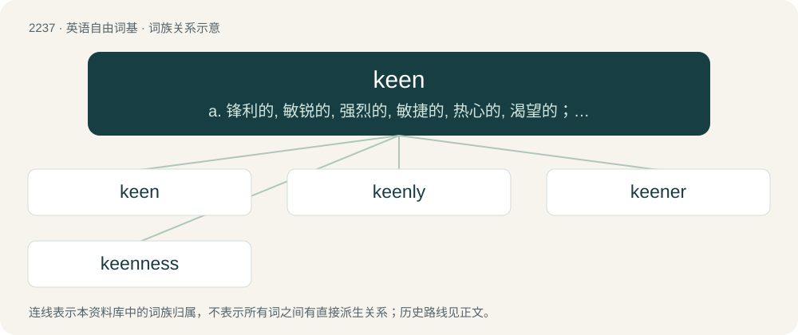

# 2342 · keen — a. 锋利的, 敏锐的, 强烈的, 敏捷的, 热心的, 渴望的；n. 挽歌, 痛哭；v. 唱挽歌, 痛哭

[总目录](../00_总目录_按常用程度.md)

**类型**：英语自由词基　｜　**来源语言**：见词源记录

## 核心含义与来源

- 核心含义：a. 锋利的, 敏锐的, 强烈的, 敏捷的, 热心的, 渴望的；n. 挽歌, 痛哭；v. 唱挽歌, 痛哭
- 英文含义：Often with a prepositional phrase, or with to and an infinitive: showing a quick and ardent responsiveness or willingness; eager, enthusiastic, interested.
- 词形：keen

**多个词源／构词路径**：同一拼写可能有不同来源；以下按词性和含义分别列出。

**来源记录 1**（形容词；Often with a prepositional phrase, or with to and an infinitive: showing a quick and ardent responsiveness or willingness; eager, enthusiastic, interested.）

From Middle English kene (“bold, brave, sharp”), from Old English cēne (“keen, fierce, bold, brave, warlike, powerful; learned, clever, wise”), from Proto-Germanic \*kōniz (“knowledgeable, skilful, experienced, clever, capable”), from Proto-Indo-European \*ǵneh₃- (“to know”). Cognate with Danish køn (“handsome, pretty”), Dutch kien (“smart, wise, able”), koen (“daring, valiant, doughty, courageous”), German kühn (“bold, daring, audacious, hardy, valiant, venturesome”), Icelandic kænn (“wise, crafty, clever, able”), Faroese kønur (“expert (in, on), experienced, skilful, able, capable”), Scots keen (“lively, brisk; avaricious”). Related to Old English cunnan (“to know how to, be able to”). More at cunning, can.

**来源记录 2**（名词；A prolonged wail for a deceased person.）

From Irish caoin (“to lament, keen”).

## 词族图

## 单词速览（常用到不常用）

| 单词 | 音标 | 释义 |
|---|---|---|
| [keen](#w-1) | 英 /kiːn/；美 /kin/ | a. 锋利的, 敏锐的, 强烈的, 敏捷的, 热心的, 渴望的；n. 挽歌, 痛哭；v. 唱挽歌, 痛哭 |
| [keenly](#w-2) | /ˈkiːnli/ | adv. 锐利地, 敏捷地, 激烈地 |
| [keener](#w-3) | /ˈkiːnə/ | n. 痛哭者 |
| [keenness](#w-4) | /ˈkiːnnis/ | n. 锐利, 尖锐, 敏感 |

## 逐词详解

### 1. keen

**词性**：形容词　｜　**音标**：英 /kiːn/；美 /kin/

**中文释义**：a. 锋利的, 敏锐的, 强烈的, 敏捷的, 热心的, 渴望的；n. 挽歌, 痛哭；v. 唱挽歌, 痛哭

**英文义项**：Often with a prepositional phrase, or with to and an infinitive: showing a quick and ardent responsiveness or willingness; eager, enthusiastic, interested. / Fierce, intense, vehement.

**词源与演化**：

From Middle English kene (“bold, brave, sharp”), from Old English cēne (“keen, fierce, bold, brave, warlike, powerful; learned, clever, wise”), from Proto-Germanic \*kōniz (“knowledgeable, skilful, experienced, clever, capable”), from Proto-Indo-European \*ǵneh₃- (“to know”). Cognate with Danish køn (“handsome, pretty”), Dutch kien (“smart, wise, able”), koen (“daring, valiant, doughty, courageous”), German kühn (“bold, daring, audacious, hardy, valiant, venturesome”), Icelandic kænn (“wise, crafty, clever, able”), Faroese kønur (“expert (in, on), experienced, skilful, able, capable”), Scots keen (“lively, brisk; avaricious”). Related to Old English cunnan (“to know how to, be able to”). More at cunning, can.

**例句**：

> “Do you want to go on holiday with me?” “Yes, I’m keen.”

该用例对应义项：Often with a prepositional phrase, or with to and an infinitive: showing a quick and ardent responsiveness or willingness; eager, enthusiastic, interested.

### 2. keenly

**词性**：副词　｜　**音标**：/ˈkiːnli/

**中文释义**：adv. 锐利地, 敏捷地, 激烈地

**英文义项**：In a keen manner.

**构词拆分**：keen + -ly

**词源与演化**：

From Middle English kenely, kenliche, from Old English cēnlīċe (“keenly, boldly, courageously”), equivalent to keen + -ly. Cognate with Saterland Frisian köinlik (“boldly”), archaic German kühnlich (“bravely”).

**用法示例／搭配（非完整句）**：

> watch something keenly

该用例对应义项：In a keen manner.

### 3. keener

**词性**：名词　｜　**音标**：/ˈkiːnə/

**中文释义**：n. 痛哭者

**英文义项**：Someone who is excessively keen or eager, possibly making others look bad; a brown-noser.

**构词拆分**：keen + -er

**词源与演化**：

From keen (“enthusiastic”) + -er (“one who is”).

**例句**：

> A dog's sense of smell is much keener than a human's.

### 4. keenness

**词性**：名词　｜　**音标**：/ˈkiːnnis/

**中文释义**：n. 锐利, 尖锐, 敏感

**英文义项**：sharpness or cutting ability / astuteness or sagacity

**构词拆分**：keen + -ness

**词源与演化**：

From keen + -ness.

**例句**：

> Tom acted the fool but, in reality, had an education and keenness of mind second to none.
