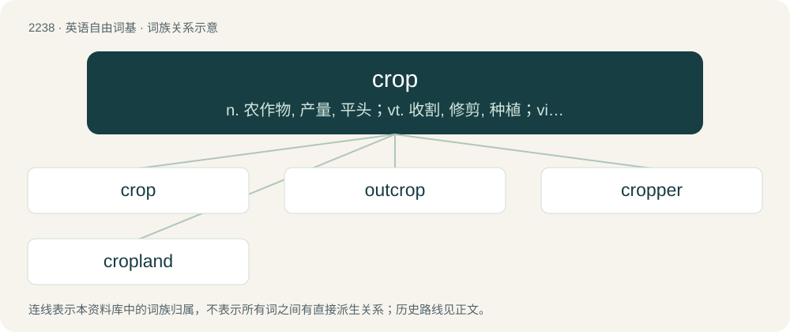

# 2344 · crop — n. 农作物, 产量, 平头；vt. 收割, 修剪, 种植；vi. 收获

[总目录](../00_总目录_按常用程度.md)

**类型**：英语自由词基　｜　**来源语言**：见词源记录

## 核心含义与来源

- 核心含义：n. 农作物, 产量, 平头；vt. 收割, 修剪, 种植；vi. 收获
- 英文含义：A plant, grown for it, or its fruits or seeds, to be harvested as food, livestock fodder, or fuel or for any other economic purpose.
- 词形：crop

**多个词源／构词路径**：同一拼写可能有不同来源；以下按词性和含义分别列出。

**来源记录 1**（名词；A plant, grown for it, or its fruits or seeds, to be harvested as food, livestock fodder, or fuel or for any other economic purpose.）

From Middle English crop, croppe, from Old English cropp, croppa (“the head or top of a plant, a sprout or herb, a bunch or cluster of flowers, an ear of corn, the craw of a bird, a kidney”), from Proto-West Germanic \*kropp, from Proto-Germanic \*kruppaz (“body, trunk, crop”), from Proto-Indo-European \*grewb- (“to warp, bend, crawl”). Doublet of group. Cognates Cognate with Dutch krop (“crop”), German Low German Kropp (“a swelling on the neck, the craw, maw”), German Kropf (“the craw, ear of grain, head of lettuce or cabbage”), Danish, Norwegian, and Swedish kropp (“body, trunk”), Faroese and Icelandic kroppur (“body”). Related to crap. Doublet of group and croup.

**来源记录 2**（动词；To remove the top end of something, especially a plant.）

From Middle English croppen (“to cut, pluck and eat”), from Old English \*croppian. Cognate with Scots crap (“to crop”), Dutch kroppen (“to cram, digest”), Low German kröppen (“to cut, crop, stuff the craw”), German kröpfen (“to crop”), Icelandic kroppa (“to cut, crop, pick”). Literally, to take off the crop (top, head, ear) of a plant. See Etymology 1.

## 词族图

## 单词速览（常用到不常用）

| 单词 | 音标 | 释义 |
|---|---|---|
| [crop](#w-1) | 英 /kɹɒp/；美 /kɹɑp/ | n. 农作物, 产量, 平头；vt. 收割, 修剪, 种植；vi. 收获 |
| [outcrop](#w-2) | 英 /ˈaʊt.kɹɒp/；美 /ˈaʊt.kɹɑp/ | n. 露出, 露头, 爆发；vi. 露出地表, 出现 |
| [cropper](#w-3) | /ˈkrɒpə/ | 【英文】A breed of domestic pigeon with large crop. |
| [cropland](#w-4) | /ˈkrɔplænd/ | \[经\] 农地 |

## 逐词详解

### 1. crop

**词性**：名词　｜　**音标**：英 /kɹɒp/；美 /kɹɑp/

**中文释义**：n. 农作物, 产量, 平头；vt. 收割, 修剪, 种植；vi. 收获

**英文义项**：A plant, grown for it, or its fruits or seeds, to be harvested as food, livestock fodder, or fuel or for any other economic purpose. / The production amount of such an output for a specific season or year, particularly of plants.

**词源与演化**：

From Middle English crop, croppe, from Old English cropp, croppa (“the head or top of a plant, a sprout or herb, a bunch or cluster of flowers, an ear of corn, the craw of a bird, a kidney”), from Proto-West Germanic \*kropp, from Proto-Germanic \*kruppaz (“body, trunk, crop”), from Proto-Indo-European \*grewb- (“to warp, bend, crawl”). Doublet of group. Cognates Cognate with Dutch krop (“crop”), German Low German Kropp (“a swelling on the neck, the craw, maw”), German Kropf (“the craw, ear of grain, head of lettuce or cabbage”), Danish, Norwegian, and Swedish kropp (“body, trunk”), Faroese and Icelandic kroppur (“body”). Related to crap. Doublet of group and croup.

**例句**：

> It was a good crop of oats this year. What a nice change after last year's crop!

该用例对应义项：The production amount of such an output for a specific season or year, particularly of plants.

### 2. outcrop

**词性**：名词　｜　**音标**：英 /ˈaʊt.kɹɒp/；美 /ˈaʊt.kɹɑp/

**中文释义**：n. 露出, 露头, 爆发；vi. 露出地表, 出现

**英文义项**：A piece of land that stands out (usually into water) from the land surrounding. / A coming out of bedrock or of an unconsolidated deposit to the surface of the ground.

**构词拆分**：out- + crop

**词源与演化**：

From out- + crop.

**例句**：

> The sharp, layered outcrop appeared to pierce the desert sand like an ancient blade.

### 3. cropper

**词性**：名词　｜　**音标**：/ˈkrɒpə/

**英文义项**：A breed of domestic pigeon with large crop.

**构词拆分**：crop + -er

**词源与演化**：

From crop + -er, in reference to a bird's crop.

### 4. cropland

**词性**：名词　｜　**音标**：/ˈkrɔplænd/

**中文释义**：\[经\] 农地

**英文义项**：arable land

**构词拆分**：crop + land

**词源与演化**：

From crop + land.

**例句**：

> Flooding has destroyed six thousand hectares of cropland.
