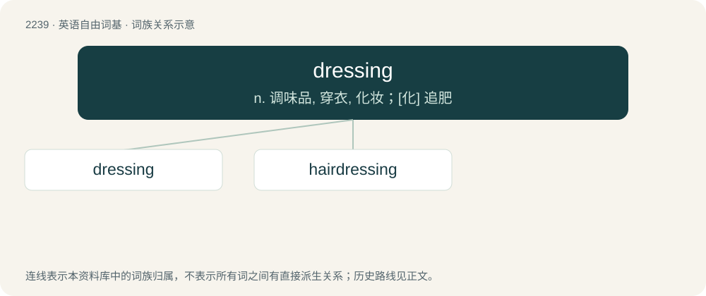

# 2345 · dressing — n. 调味品, 穿衣, 化妆；\[化\] 追肥

[总目录](../00_总目录_按常用程度.md)

**类型**：英语自由词基　｜　**来源语言**：见词源记录

## 核心含义与来源

- 核心含义：n. 调味品, 穿衣, 化妆；\[化\] 追肥
- 英文含义：Material applied to a wound for protection or therapy.
- 词形：dressing

**来源记录 1**（名词；Material applied to a wound for protection or therapy.）

From Middle English dressing, dressinge, dressynge, equivalent to dress + -ing.

## 词族图

## 单词速览（常用到不常用）

| 单词 | 音标 | 释义 |
|---|---|---|
| [dressing](#w-1) | /ˈdɹɛsɪŋ/ | n. 调味品, 穿衣, 化妆；\[化\] 追肥 |
| [hairdressing](#w-2) | /ˈhєədresiŋ/ | n. 理发, 美发 |

## 逐词详解

### 1. dressing

**词性**：名词　｜　**音标**：/ˈdɹɛsɪŋ/

**中文释义**：n. 调味品, 穿衣, 化妆；\[化\] 追肥

**英文义项**：Material applied to a wound for protection or therapy. / A sauce, especially a cold one for salads.

**构词拆分**：dress + -ing

**词源与演化**：

From Middle English dressing, dressinge, dressynge, equivalent to dress + -ing.

**例句**：

> After you've mixed everything well, add salad dressing and a little pepper!

### 2. hairdressing

**词性**：名词　｜　**音标**：/ˈhєədresiŋ/

**中文释义**：n. 理发, 美发

**英文义项**：The washing, colouring, cutting and styling of the hair; the art or trade of a hairdresser.

**构词拆分**：hair + dressing

**词源与演化**：

From hair + dressing.

**例句**：

> I'm an apprentice at a hairdressing salon.
