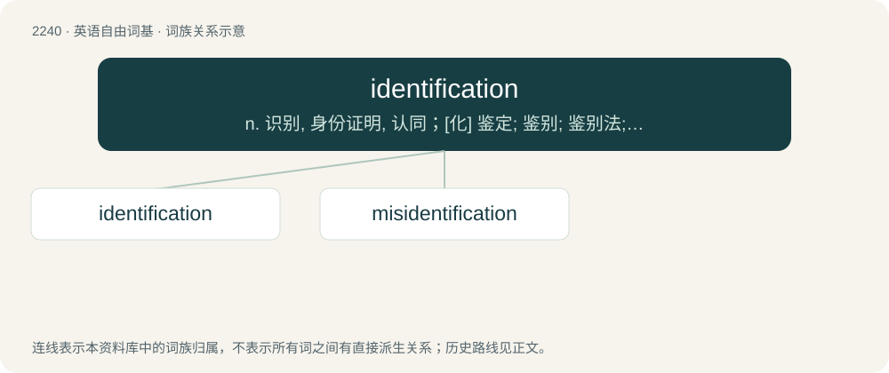

# 2346 · identification — n. 识别, 身份证明, 认同；\[化\] 鉴定; 鉴别; 鉴别法; 认证

[总目录](../00_总目录_按常用程度.md)

**类型**：英语自由词基　｜　**来源语言**：见词源记录

## 核心含义与来源

- 核心含义：n. 识别, 身份证明, 认同；\[化\] 鉴定; 鉴别; 鉴别法; 认证
- 英文含义：The act of identifying (i.e., which one, which thing).
- 词形：identification

**来源记录 1**（名词；The act of identifying (i.e., which one, which thing).）

From French identification.

## 词族图

## 单词速览（常用到不常用）

| 单词 | 音标 | 释义 |
|---|---|---|
| [identification](#w-1) | 美 /aɪˌdɛn(t)ɪfɪˈkeɪʃn̩/；/aɪˌdɛntɪfɪˈkeɪʃn̩/ | n. 识别, 身份证明, 认同；\[化\] 鉴定; 鉴别; 鉴别法; 认证 |
| [misidentification](#w-2) | /misai,dentifiˈkeiʃən/ | \[计\] 错误识别 |

## 逐词详解

### 1. identification

**词性**：名词　｜　**音标**：美 /aɪˌdɛn(t)ɪfɪˈkeɪʃn̩/；/aɪˌdɛntɪfɪˈkeɪʃn̩/

**中文释义**：n. 识别, 身份证明, 认同；\[化\] 鉴定; 鉴别; 鉴别法; 认证

**英文义项**：The act of identifying (i.e., which one, which thing). / The combination of identifying (which one, which thing) and validating the identity (proving or confirming it); identifying and authenticating viewed as a unitary concept in cognition.

**词源与演化**：

From French identification.

**例句**：

> Much education and experience is required for proper identification of bird species.

该用例对应义项：The combination of identifying (which one, which thing) and validating the identity (proving or confirming it); identifying and authenticating viewed as a unitary concept in cognition.

### 2. misidentification

**词性**：名词　｜　**音标**：/misai,dentifiˈkeiʃən/

**中文释义**：\[计\] 错误识别

**英文义项**：An instance of misidentifying; an erroneous identification.

**构词拆分**：mis- + identification

**词源与演化**：

From mis- + identification.
