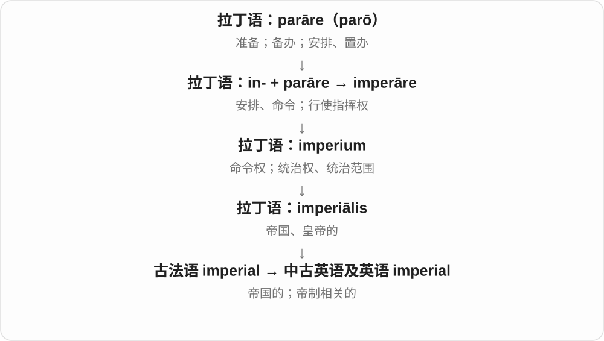
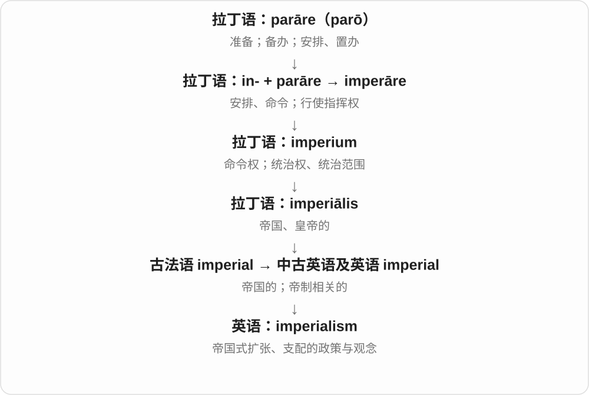
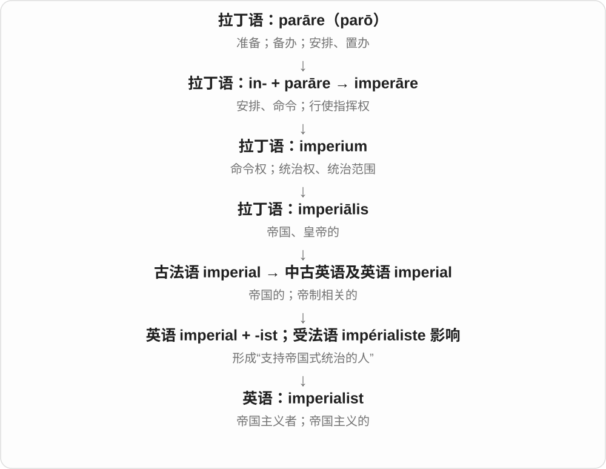

# 2346 · imperial — 帝国、帝权及扩张体系相关的性质、主张与人

[逐词精讲目录](../00_逐词精讲目录.md) · [总目录](../00_总目录_按常用程度.md)

## 核心词根与来源

皇室、帝国行政的 imperial，与主张或实行对外扩张的 imperialism 不应在所有语境里直接互换。

**IMPERIAL：先看帝国与帝权，再分派生词的角色**

imperial → imperialism、imperialist、imperialistic。

- **性质与体系**：imperial · imperialism
- **人与相关性质**：imperialist · imperialistic

## 词形与演化规律

拉丁 imperium 统治、权力 → imperialis → imperial；-ism 体系，-ist 人，-istic 相应性质。

## 单词速览（按词族由简到繁）

同一基础词的相关扩展放在一起，先读基础形式，再读扩展；各组之间优先读常用的。具体词源关系见各词讲解。

| 单词 | 音标 | 核心意思 |
|---|---|---|
| [imperial](#w-1) | 英 /ɪmˈpɪəriəl/；美 /ɪmˈpɪriəl/ | 帝国的；皇帝的；英制的 |
| [imperialism](#w-2) | 英 /ɪmˈpɪəriəlɪzəm/；美 /ɪmˈpɪriəˌlɪzəm/ | 帝国主义；扩张支配的政策或做法 |
| [imperialist](#w-3) | 英 /ɪmˈpɪəriəlɪst/；美 /ɪmˈpɪriəlɪst/ | 帝国主义者；帝国主义的 |
| [imperialistic](#w-4) | 英 /ɪmˌpɪəriəˈlɪstɪk/；美 /ɪmˌpɪriəˈlɪstɪk/ | 帝国主义的；奉行扩张、支配政策的 |

## 逐词讲解

### 1. imperial — 帝国的；皇帝的；英制的

**音标**：英 /ɪmˈpɪəriəl/；美 /ɪmˈpɪriəl/

**先抓住这个画面**

imperial 把事物放进“皇帝、帝国”这个范围：宫廷、统治制度、扩张；在计量里则指英制单位体系。

**怎么拆**

经古法语 imperial 进入英语，来自拉丁 imperiālis，由 imperium“统治权、帝国”派生。不要把词首 im- 当否定。

**怎么变成今天的意思**

imperial palace 是皇宫；imperial units 是英制单位。计量义来自英国的制度名称，不等于某个皇帝亲自发明了这些单位。

**常见搭配与例句**

an imperial palace；imperial rule；imperial units。

> The former imperial palace is now a museum.

昔日的皇宫现在是一座博物馆。

> The chart lists both metric and imperial measurements.

这张表同时列出公制和英制的测量值。

**别混淆**

imperial 表示帝国相关；imperious 描写人的态度专横。英国英制与美国常用单位也并非处处数值相同。

### 2. imperialism — 帝国主义；扩张支配的政策或做法

**音标**：英 /ɪmˈpɪəriəlɪzəm/；美 /ɪmˈpɪriəˌlɪzəm/

**先抓住这个画面**

imperialism 的画面是把本国的控制伸到别国：可以直接占领，也可以通过政治、经济等力量取得支配地位。

**怎么拆**

imperial + -ism，从“帝国的”形成指思想、政策或做法的名词。

**怎么变成今天的意思**

历史上有拥护帝国统治的用法；今天更常用来讨论对外扩张和支配。cultural imperialism 则谈强势文化向外压过其他文化的现象或批评。

**常见搭配与例句**

economic imperialism；cultural imperialism；the history of imperialism。

> The course examines the economic motives behind imperialism.

这门课考察帝国主义背后的经济动机。

> The essay asks whether global entertainment can become a form of cultural imperialism.

文章探讨全球娱乐业是否可能成为一种文化帝国主义。

**别混淆**

colonialism 更集中于殖民地及殖民控制；imperialism 的范围可更广，不一定依靠正式殖民地。

### 3. imperialist — 帝国主义者；帝国主义的

**音标**：英 /ɪmˈpɪəriəlɪst/；美 /ɪmˈpɪriəlɪst/

**先抓住这个画面**

imperialist 把 imperialism 的政策或观念落到人和行动上：谁支持扩张支配，哪种做法体现这种方向。

**怎么拆**

imperial + -ist，受法语 impérialiste 的影响形成；作名词指支持者，作形容词修饰政策等。

**怎么变成今天的意思**

它是有明确政治历史含义的词。描述某人、某政策时，需要看作者用的是当时的自我认同，还是后来的批评性分类。

**常见搭配与例句**

an imperialist politician；imperialist expansion；an outspoken imperialist。

> The historian describes him as an imperialist who supported overseas expansion.

历史学者把他描述为支持海外扩张的帝国主义者。

> The article criticizes the imperialist ambitions of the government.

文章批评了该政府扩张支配他国的野心。

**别混淆**

imperialist 侧重立场和扩张政策；imperial 可以只是中性的“皇帝或帝国相关”。

### 4. imperialistic — 帝国主义的；奉行扩张、支配政策的

**音标**：英 /ɪmˌpɪəriəˈlɪstɪk/；美 /ɪmˌpɪriəˈlɪstɪk/

**先抓住这个画面**

不仅是与帝国有关，而是强调把权力、控制伸向别国或地区的帝国主义立场、做法。常带批评意味。

**怎么拆**

imperialist + -ic，或 imperial + -istic，联系 imperialism。imperial 接拉丁 imperium 命令、统治、政权一系，现代新增词尾让重点落到思想、政策性质。

**怎么变成今天的意思**

**拉丁 imperium → imperial**  
统治、帝国相关

↓

**imperialism／imperialist → imperialistic**  
与帝国主义、扩张支配政策有关的

imperialistic policies 帝国主义政策，an imperialistic attitude 扩张支配的态度。历史、政治评论中较常见，要看文本在评价何种政策。

**常见搭配与例句**

imperialistic policies；an imperialistic attitude。

> The historian examines imperialistic policies of the period.

历史学家研究那个时期的帝国主义政策。

> The essay criticizes the movement’s imperialistic ambitions.

文章批评了这场运动的扩张支配野心。

**别混淆**

imperial 只是帝国的也可以中性，如 imperial administration；imperialistic 更聚焦帝国主义性质，不与所有皇室装饰、帝制物品同义。

## 这一组要分清什么

imperial 可中性描述历史帝国机构；imperialistic 常评价扩张、支配倾向。

## 串起来练习

The chapter contrasts imperial administration with imperialism.

这一章比较帝国行政与帝国主义。
