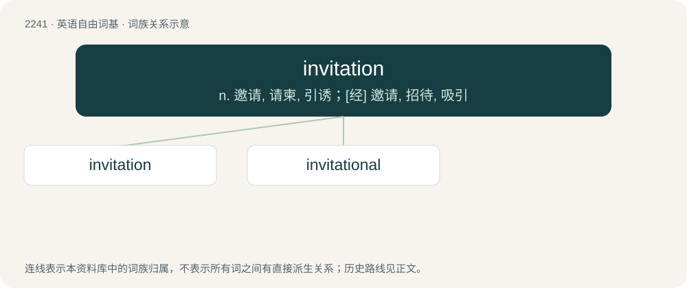

# 2347 · invitation — n. 邀请, 请柬, 引诱；\[经\] 邀请, 招待, 吸引

[总目录](../00_总目录_按常用程度.md)

**类型**：英语自由词基　｜　**来源语言**：见词源记录

## 核心含义与来源

- 核心含义：n. 邀请, 请柬, 引诱；\[经\] 邀请, 招待, 吸引
- 英文含义：The act of inviting; solicitation; the requesting of a person's company.
- 词形：invitation

**来源记录 1**（名词；The act of inviting; solicitation; the requesting of a person's company.）

From Middle English invitacioun, ynvytacioun, from Latin invītātio, reinforced by Middle French invitation. By surface analysis, invite + -ation. Displaced native Middle English lathinge from Old English laþung (see dialectal English lathing).

## 词族图

## 单词速览（常用到不常用）

| 单词 | 音标 | 释义 |
|---|---|---|
| [invitation](#w-1) | /ɪnvɪˈteɪʃən/ | n. 邀请, 请柬, 引诱；\[经\] 邀请, 招待, 吸引 |
| [invitational](#w-2) | /,inviˈteiʃənəl/ | a. (限于被)邀请的,怂恿 |

## 逐词详解

### 1. invitation

**词性**：名词　｜　**音标**：/ɪnvɪˈteɪʃən/

**中文释义**：n. 邀请, 请柬, 引诱；\[经\] 邀请, 招待, 吸引

**英文义项**：The act of inviting; solicitation; the requesting of a person's company. / A document or verbal message conveying an invitation.

**词源与演化**：

From Middle English invitacioun, ynvytacioun, from Latin invītātio, reinforced by Middle French invitation. By surface analysis, invite + -ation. Displaced native Middle English lathinge from Old English laþung (see dialectal English lathing).

**例句**：

> We need to print off fifty invitations for the party.

该用例对应义项：A document or verbal message conveying an invitation.

### 2. invitational

**词性**：形容词　｜　**音标**：/,inviˈteiʃənəl/

**中文释义**：a. (限于被)邀请的,怂恿

**英文义项**：Serving as an invitation; inviting. / Restricted to participants who have been invited.

**构词拆分**：From invitation + -al.

**词源与演化**：

From invitation + -al.
