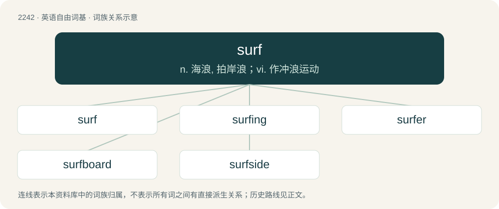

# 2348 · surf — n. 海浪, 拍岸浪；vi. 作冲浪运动

[总目录](../00_总目录_按常用程度.md)

**类型**：英语自由词基　｜　**来源语言**：见词源记录

## 核心含义与来源

- 核心含义：n. 海浪, 拍岸浪；vi. 作冲浪运动
- 英文含义：Waves that break on an ocean shoreline.
- 词形：surf

**来源记录 1**（名词；Waves that break on an ocean shoreline.）

Probably from earlier suff, suffe (“the inrush of the sea towards the shore”), possibly from Middle English suffe. Compare sough, surf (“a gutter, drain, sewer, trench”) and sough (“a soothing, gentle, murmuring sound of wind or water”). Alternatively, possibly of Indo-Aryan origin, as the word was formerly a reference to the coast of India, though this is doubtful as no positive etymon can be identified. The verb is from 1917. The verb referring to "browsing the Internet" was popularized by Jean Armour Polly.

## 词族图

## 单词速览（常用到不常用）

| 单词 | 音标 | 释义 |
|---|---|---|
| [surf](#w-1) | 英 /sɜːf/；美 /sɝf/ | n. 海浪, 拍岸浪；vi. 作冲浪运动 |
| [surfing](#w-2) | 美 /ˈsɝfɪŋ/ | n. 冲浪运动 |
| [surfer](#w-3) | /ˈsɜː(ɹ)fə(ɹ)/ | n. 冲浪运动员 |
| [surfboard](#w-4) | 英 /ˈsɜːfˌbɔːd/；美 /ˈsɝfˌbɔɹd/ | n. 冲浪板, 用冲浪板滑水 |
| [surfside](#w-5) |  | \[地名\] \[美国\] 瑟夫赛德 |

## 逐词详解

### 1. surf

**词性**：名词　｜　**音标**：英 /sɜːf/；美 /sɝf/

**中文释义**：n. 海浪, 拍岸浪；vi. 作冲浪运动

**英文义项**：Waves that break on an ocean shoreline. / An instance or session of riding a surfboard in the surf.

**词源与演化**：

Probably from earlier suff, suffe (“the inrush of the sea towards the shore”), possibly from Middle English suffe. Compare sough, surf (“a gutter, drain, sewer, trench”) and sough (“a soothing, gentle, murmuring sound of wind or water”). Alternatively, possibly of Indo-Aryan origin, as the word was formerly a reference to the coast of India, though this is doubtful as no positive etymon can be identified. The verb is from 1917. The verb referring to "browsing the Internet" was popularized by Jean Armour Polly.

**例句**：

> We went for a surf this morning.

该用例对应义项：An instance or session of riding a surfboard in the surf.

### 2. surfing

**词性**：名词　｜　**音标**：美 /ˈsɝfɪŋ/

**中文释义**：n. 冲浪运动

**英文义项**：The pastime or sport of riding surf on a surfboard. / The activity of browsing the Internet.

**构词拆分**：surf + -ing

**词源与演化**：

From surf + -ing.

**例句**：

> How about going surfing at Hayama next Sunday if it is fine?

### 3. surfer

**词性**：名词　｜　**音标**：/ˈsɜː(ɹ)fə(ɹ)/

**中文释义**：n. 冲浪运动员

**英文义项**：A person who rides a surfboard. / A person who surfs the Internet.

**构词拆分**：surf + -er

**词源与演化**：

From surf + -er.

**例句**：

> The surfer tried to ride the crest of the wave.

### 4. surfboard

**词性**：名词　｜　**音标**：英 /ˈsɜːfˌbɔːd/；美 /ˈsɝfˌbɔɹd/

**中文释义**：n. 冲浪板, 用冲浪板滑水

**英文义项**：A shaped waterproof plank, usually made of wood or foam and reinforced plastic, used to surf on waves.

**构词拆分**：surf + board

**词源与演化**：

From surf + board.

**例句**：

> One shark attacked the surfboard.

该用例对应义项：A shaped waterproof plank, usually made of wood or foam and reinforced plastic, used to surf on waves.

### 5. surfside

**词性**：形容词

**中文释义**：\[地名\] \[美国\] 瑟夫赛德

**英文义项**：Beside the sea.

**构词拆分**：surf + -side

**词源与演化**：

From surf + -side.

**例句**：

> The 12-story condominium building in Surfside, Florida, north of Miami, partially collapsed without warning early on June 24.
