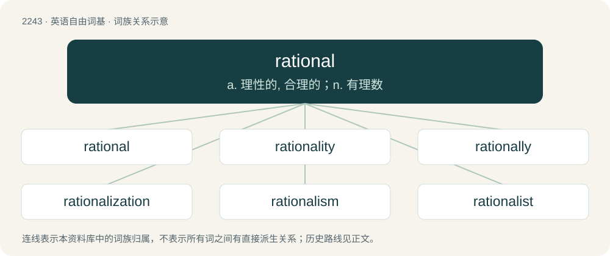

# 2349 · rational — a. 理性的, 合理的；n. 有理数

[总目录](../00_总目录_按常用程度.md)

**类型**：英语自由词基　｜　**来源语言**：见词源记录

## 核心含义与来源

- 核心含义：a. 理性的, 合理的；n. 有理数
- 英文含义：Capable of reasoning.
- 词形：rational

**来源记录 1**（形容词；Capable of reasoning.）

From Old French rationel, rational, from Latin rationalis (“of or belonging to reason, rational, reasonable; having a ratio”), from ratio (“reason; calculation”).

## 词族图

## 单词速览（常用到不常用）

| 单词 | 音标 | 释义 |
|---|---|---|
| [rational](#w-1) | /ˈɹæʃ(ə)nəl/ | a. 理性的, 合理的；n. 有理数 |
| [rationality](#w-2) | /ˌraʃəˈnalɪti/ | n. 合理性, 纯理性 |
| [rationally](#w-3) |  | adv. 理性地；讲道理地 |
| [rationalization](#w-4) | 英 /ˌræʃ(ə)n(ə)laɪˈzeɪʃn̩/；美 /ˌræʃənəlaɪˈzeɪʃən/ | n. 合理化；\[计\] 有理化 |
| [rationalism](#w-5) | 英 /ˈɹæʃ(ə)nəlɪzəm/ | n. 合理主义, 理性论, 纯理论 |
| [rationalist](#w-6) | /ˈræʃənəlist/ | n. 理性论者, 纯理论者, 理性主义者 |

## 逐词详解

### 1. rational

**词性**：形容词　｜　**音标**：/ˈɹæʃ(ə)nəl/

**中文释义**：a. 理性的, 合理的；n. 有理数

**英文义项**：Capable of reasoning. / Behaving according to some partial order of preferences.

**词源与演化**：

From Old French rationel, rational, from Latin rationalis (“of or belonging to reason, rational, reasonable; having a ratio”), from ratio (“reason; calculation”).

**例句**：

> His statements were quite rational.

该用例对应义项：Logically sound; not self-contradictory or otherwise absurd.

### 2. rationality

**词性**：名词　｜　**音标**：/ˌraʃəˈnalɪti/

**中文释义**：n. 合理性, 纯理性

**英文义项**：The quality or state of being rational; due exercise of reason; reasonableness. / Objective consideration.

**构词拆分**：rational + -ity

**词源与演化**：

From rational + -ity, from French rationalité, from Late Latin rationalitas (“rationality, reasonableness”), from Latin rationalis (“reasonable”).

**例句**：

> Such a discussion deserves rationality, not emotional gut reactions.

该用例对应义项：Objective consideration.

### 3. rationally

**词性**：副词

**中文释义**：adv. 理性地；讲道理地

**英文义项**：In a rational manner

**构词拆分**：rational + -ly

**词源与演化**：

From rational + -ly.

**例句**：

> We must act rationally.

该用例对应义项：in a rational manner

### 4. rationalization

**词性**：名词　｜　**音标**：英 /ˌræʃ(ə)n(ə)laɪˈzeɪʃn̩/；美 /ˌræʃənəlaɪˈzeɪʃən/

**中文释义**：n. 合理化；\[计\] 有理化

**英文义项**：A statement of one's motives, or of the causes of some event. / The reorganization of a company or organization in order to improve its efficiency through the reallocation of resources and changes in its workforce.

**构词拆分**：rational + -ization；rationalize + -ation

**词源与演化**：

First attested in 1831. From French rationalisation, equivalent to rational + -ization or rationalize + -ation.

**例句**：

> It began with the familiar political motives of civil service rationalization and downsizing.

该用例对应义项：The reorganization of a company or organization in order to improve its efficiency through the reallocation of resources and changes in its workforce.

### 5. rationalism

**词性**：名词　｜　**音标**：英 /ˈɹæʃ(ə)nəlɪzəm/

**中文释义**：n. 合理主义, 理性论, 纯理论

**英文义项**：The theory that reason is a source of knowledge independent of and superior to sense perception. / The theory that knowledge may be derived by deductions from a priori concepts (such as axioms, postulates or earlier deductions).

**构词拆分**：rational + -ism

**词源与演化**：

From rational + -ism.

### 6. rationalist

**词性**：名词　｜　**音标**：/ˈræʃənəlist/

**中文释义**：n. 理性论者, 纯理论者, 理性主义者

**英文义项**：A person who follows the philosophy of rationalism. / A member of the rationalist community.

**构词拆分**：rational + -ist

**词源与演化**：

From Middle French rationaliste; rational + -ist.
