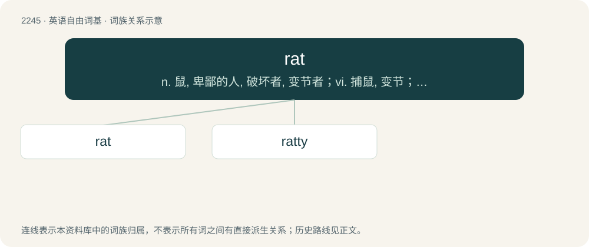

# 2350 · rat — n. 鼠, 卑鄙的人, 破坏者, 变节者；vi. 捕鼠, 变节；vt. 弄蓬松

[总目录](../00_总目录_按常用程度.md)

**类型**：英语自由词基　｜　**来源语言**：见词源记录

## 核心含义与来源

- 核心含义：n. 鼠, 卑鄙的人, 破坏者, 变节者；vi. 捕鼠, 变节；vt. 弄蓬松
- 英文含义：Any of the numerous members of several rodent families that usually have short limbs, a pointy snout, a long, hairless tail, and a body length greater than about 12 cm, or 5 inches.
- 词形：rat

**多个词源／构词路径**：同一拼写可能有不同来源；以下按词性和含义分别列出。

**来源记录 1**（名词；Any of the numerous members of several rodent families that usually have short limbs, a pointy snout, a long, hairless tail, and a body length greater than about 12 cm, or 5 inches.）

From Middle English raat, rat, ratt, ratte, rotte, from Old English ræt, rætt, from Proto-West Germanic \*ratt, from Proto-Germanic \*rattaz, \*rattō (“rat”), of uncertain origin, possibly from Proto-Indo-European \*Hreh₃d- (“to gnaw, scrape, scratch”). However, the rat may have been unknown in Northern Europe in antiquity, and the Proto-Germanic word may have referred to a different animal; see \*rattaz for more. Attestation of this family of words begins in the 12th century. Cognates Cognate with North Frisian root (“rat”), Saterland Frisian Rotte (“rat”), West Frisian rôt (“rat”), Dutch rat, rot (“rat”), German Ratte (“rat”), Luxembourgish Rat (“rat”), Vilamovian rot, rott (“rat”), Yiddish ראַץ (rats, “rat”), Danish and Norwegian Bokmål rotte (“rat”), Faroese and Icelandic rotta (“rat”), Norwegian Nynorsk rotta, rotte, røtte (“rat”), Swedish råtta (“rat”), Latin rattus, ratus (“rat”) (whence Asturian ratu (“mouse”), Catalan rata (“rat”), French rat (“rat”), Italian ratto (“rat”), Portuguese rato (“rat”), Spanish rata (“rat”), rato (“male rat”)); also Latin rōdō (“to bite, gnaw, nibble; to backbite, disparage, slander”), Sanskrit रदति (radati, “to scrape, scratch; to cut path, pave; to lead river into a channel; to bestow, convey”). Some of the Germanic cognates show considerable consonant variation, e.g. Middle Low German ratte, radde; Middle High German rate, ratte, ratze. The irregularity may be symptomatic of a late dispersal of the word, although Kroonen accounts for it with a Proto-Germanic stem \*raþō nom., \*ruttaz gen., showing both ablaut and a Kluge's law alternation, with the variation arising from varying remodellings in the descendants. Kroonen states that this requires a Proto-Indo-European etymon in final \*t and is incompatible with the usual derivation from Proto-Indo-European \*Hreh₃d- (“to scrape, scratch, gnaw”).

**来源记录 2**（名词；A scratch or a score.）

From Middle English ratten, further etymology unknown. Compare Middle Low German retten (“to tear, tear up”), Middle High German ratzen (“to scratch; rasp; tear”). Could be related to write. See also rit.

**来源记录 3**（动词；To hack someone with a remote-access Trojan.）

From remote-access Trojan.

## 词族图

## 单词速览（常用到不常用）

| 单词 | 音标 | 释义 |
|---|---|---|
| [rat](#w-1) | 英 /ɹæt/ | n. 鼠, 卑鄙的人, 破坏者, 变节者；vi. 捕鼠, 变节；vt. 弄蓬松 |
| [ratty](#w-2) | 英 /ˈɹæti/；美 /ˈɹæti/ | a. 像老鼠的, 鼠臭的, 破烂的, 易怒的 |

## 逐词详解

### 1. rat

**词性**：名词　｜　**音标**：英 /ɹæt/

**中文释义**：n. 鼠, 卑鄙的人, 破坏者, 变节者；vi. 捕鼠, 变节；vt. 弄蓬松

**英文义项**：Any of the numerous members of several rodent families that usually have short limbs, a pointy snout, a long, hairless tail, and a body length greater than about 12 cm, or 5 inches. / A medium-sized rodent belonging to the genus Rattus.

**词源与演化**：

From Middle English raat, rat, ratt, ratte, rotte, from Old English ræt, rætt, from Proto-West Germanic \*ratt, from Proto-Germanic \*rattaz, \*rattō (“rat”), of uncertain origin, possibly from Proto-Indo-European \*Hreh₃d- (“to gnaw, scrape, scratch”). However, the rat may have been unknown in Northern Europe in antiquity, and the Proto-Germanic word may have referred to a different animal; see \*rattaz for more. Attestation of this family of words begins in the 12th century. Cognates Cognate with North Frisian root (“rat”), Saterland Frisian Rotte (“rat”), West Frisian rôt (“rat”), Dutch rat, rot (“rat”), German Ratte (“rat”), Luxembourgish Rat (“rat”), Vilamovian rot, rott (“rat”), Yiddish ראַץ (rats, “rat”), Danish and Norwegian Bokmål rotte (“rat”), Faroese and Icelandic rotta (“rat”), Norwegian Nynorsk rotta, rotte, røtte (“rat”), Swedish råtta (“rat”), Latin rattus, ratus (“rat”) (whence Asturian ratu (“mouse”), Catalan rata (“rat”), French rat (“rat”), Italian ratto (“rat”), Portuguese rato (“rat”), Spanish rata (“rat”), rato (“male rat”)); also Latin rōdō (“to bite, gnaw, nibble; to backbite, disparage, slander”), Sanskrit रदति (radati, “to scrape, scratch; to cut path, pave; to lead river into a channel; to bestow, convey”). Some of the Germanic cognates show considerable consonant variation, e.g. Middle Low German ratte, radde; Middle High German rate, ratte, ratze. The irregularity may be symptomatic of a late dispersal of the word, although Kroonen accounts for it with a Proto-Germanic stem \*raþō nom., \*ruttaz gen., showing both ablaut and a Kluge's law alternation, with the variation arising from varying remodellings in the descendants. Kroonen states that this requires a Proto-Indo-European etymon in final \*t and is incompatible with the usual derivation from Proto-Indo-European \*Hreh₃d- (“to scrape, scratch, gnaw”).

**例句**：

> He loved hockey and was a devoted rink rat.

该用例对应义项：A person who routinely spends time at a particular location.

### 2. ratty

**词性**：形容词　｜　**音标**：英 /ˈɹæti/；美 /ˈɹæti/

**中文释义**：a. 像老鼠的, 鼠臭的, 破烂的, 易怒的

**英文义项**：Resembling or characteristic of a rat; ratlike. / Infested with rats.

**构词拆分**：rat + -y (suffix meaning ‘having the quality of’ forming adjective)

**词源与演化**：

From rat + -y (suffix meaning ‘having the quality of’ forming adjective).

**例句**：

> I felt out of place with my ratty pants and wrinkled shirt.
