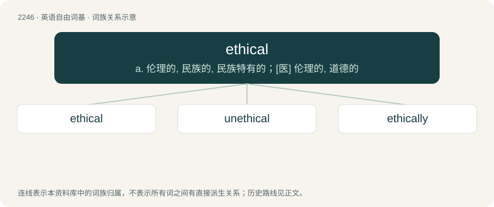

# 2351 · ethical — a. 伦理的, 民族的, 民族特有的；\[医\] 伦理的, 道德的

[总目录](../00_总目录_按常用程度.md)

**类型**：英语自由词基　｜　**来源语言**：见词源记录

## 核心含义与来源

- 核心含义：a. 伦理的, 民族的, 民族特有的；\[医\] 伦理的, 道德的
- 英文含义：Of or relating to the study of ethics.
- 词形：ethical

**来源记录 1**（形容词；Of or relating to the study of ethics.）

From ethic + -al, from Late Latin ethicus (“moral, ethical”), from Ancient Greek ἠθικός (ēthikós, “of or for morals, moral, expressing character”), from ἦθος (êthos, “character, moral nature”).

## 词族图

## 单词速览（常用到不常用）

| 单词 | 音标 | 释义 |
|---|---|---|
| [ethical](#w-1) | /ˈɛθɪkəl/ | a. 伦理的, 民族的, 民族特有的；\[医\] 伦理的, 道德的 |
| [unethical](#w-2) | /ʌnˈɛθɪkəl/ | a. 不道德的 |
| [ethically](#w-3) | 英 /ˈɛθɪkəli/ | adv. 伦理上 |

## 逐词详解

### 1. ethical

**词性**：形容词　｜　**音标**：/ˈɛθɪkəl/

**中文释义**：a. 伦理的, 民族的, 民族特有的；\[医\] 伦理的, 道德的

**英文义项**：Of or relating to the study of ethics. / Of or relating to the accepted principles of right and wrong, especially those of some organization or profession.

**构词拆分**：ethic + -al

**词源与演化**：

From ethic + -al, from Late Latin ethicus (“moral, ethical”), from Ancient Greek ἠθικός (ēthikós, “of or for morals, moral, expressing character”), from ἦθος (êthos, “character, moral nature”).

**例句**：

> We are trying to decide what the most ethical course of action would be.

该用例对应义项：Morally approvable; good.

### 2. unethical

**词性**：形容词　｜　**音标**：/ʌnˈɛθɪkəl/

**中文释义**：a. 不道德的

**英文义项**：Breaching the established standards of conduct or behavior within a particular organization or profession. / Immoral, morally wrong.

**构词拆分**：un- + ethical

**词源与演化**：

From un- + ethical.

**例句**：

> He was sacked for unethical conduct.

该用例对应义项：Breaching the established standards of conduct or behavior within a particular organization or profession.

### 3. ethically

**词性**：副词　｜　**音标**：英 /ˈɛθɪkəli/

**中文释义**：adv. 伦理上

**英文义项**：In an ethical manner. / Concerning ethics.

**构词拆分**：ethical + -ly

**词源与演化**：

From ethical + -ly.

**例句**：

> This is ethically unacceptable.

该用例对应义项：in an ethical manner; from an ethical point of view; according to ethics
