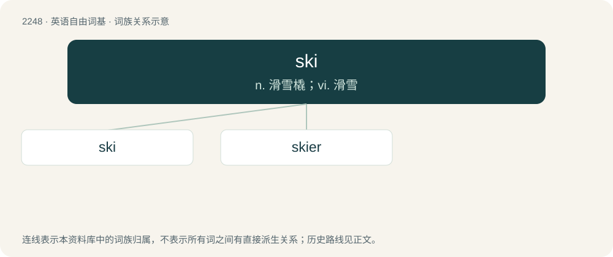

# 2353 · ski — n. 滑雪橇；vi. 滑雪

[总目录](../00_总目录_按常用程度.md)

**类型**：英语自由词基　｜　**来源语言**：见词源记录

## 核心含义与来源

- 核心含义：n. 滑雪橇；vi. 滑雪
- 英文含义：One of a pair of long flat runners designed for gliding over snow or water.
- 词形：ski

**来源记录 1**（名词；One of a pair of long flat runners designed for gliding over snow or water.）

From Norwegian ski, from Old Norse skíð (“stick of wood, snowshoe”), from Proto-Germanic \*skīdą (“stick”), from Proto-Indo-European \*skey- (“to cut, split”) (see also shed). Cognate with Old English sċīd (“stick of wood”) (modern shide), Old High German skit (Modern German Scheit (“log”)).

## 词族图

## 单词速览（常用到不常用）

| 单词 | 音标 | 释义 |
|---|---|---|
| [ski](#w-1) | 英 /ʃiː/；/skiː/ | n. 滑雪橇；vi. 滑雪 |
| [skier](#w-2) | /ˈskiːə(ɹ)/ | n. 滑雪的人 |

## 逐词详解

### 1. ski

**词性**：名词　｜　**音标**：英 /ʃiː/；/skiː/

**中文释义**：n. 滑雪橇；vi. 滑雪

**英文义项**：One of a pair of long flat runners designed for gliding over snow or water. / One of a pair of long flat runners under some flying machines, used for landing.

**词源与演化**：

From Norwegian ski, from Old Norse skíð (“stick of wood, snowshoe”), from Proto-Germanic \*skīdą (“stick”), from Proto-Indo-European \*skey- (“to cut, split”) (see also shed). Cognate with Old English sċīd (“stick of wood”) (modern shide), Old High German skit (Modern German Scheit (“log”)).

**用法示例／搭配（非完整句）**：

> to go for a ski

该用例对应义项：A trip made by skiing.

### 2. skier

**词性**：名词　｜　**音标**：/ˈskiːə(ɹ)/

**中文释义**：n. 滑雪的人

**英文义项**：One who skis.

**构词拆分**：ski + -er

**词源与演化**：

From ski + -er.

**用法示例／搭配（非完整句）**：

> a professional skier

该用例对应义项：One who skis.
