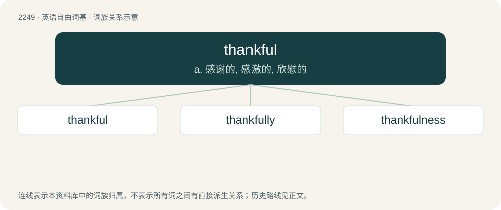

# 2354 · thankful — a. 感谢的, 感激的, 欣慰的

[总目录](../00_总目录_按常用程度.md)

**类型**：英语自由词基　｜　**来源语言**：见词源记录

## 核心含义与来源

- 核心含义：a. 感谢的, 感激的, 欣慰的
- 英文含义：Showing appreciation or gratitude.
- 词形：thankful

**来源记录 1**（形容词；Showing appreciation or gratitude.）

From Middle English thankful, from Old English þancful, þancfull (“thoughtful, pleasing, agreeable, pleasant, thankful, grateful”), equivalent to thank + -ful. Compare Old High German undankfol (“unthankful, ungrateful”).

## 词族图

## 单词速览（常用到不常用）

| 单词 | 音标 | 释义 |
|---|---|---|
| [thankful](#w-1) | /ˈθæŋkfəl/ | a. 感谢的, 感激的, 欣慰的 |
| [thankfully](#w-2) | /ˈθæŋkfulli/ | adv. 感激地；感谢地 |
| [thankfulness](#w-3) |  | n. 感激 |

## 逐词详解

### 1. thankful

**词性**：形容词　｜　**音标**：/ˈθæŋkfəl/

**中文释义**：a. 感谢的, 感激的, 欣慰的

**英文义项**：Showing appreciation or gratitude.

**构词拆分**：thank + -ful

**词源与演化**：

From Middle English thankful, from Old English þancful, þancfull (“thoughtful, pleasing, agreeable, pleasant, thankful, grateful”), equivalent to thank + -ful. Compare Old High German undankfol (“unthankful, ungrateful”).

**例句**：

> I'm thankful that you helped me out today. How can I ever repay you?

该用例对应义项：Showing appreciation or gratitude.

### 2. thankfully

**词性**：副词　｜　**音标**：/ˈθæŋkfulli/

**中文释义**：adv. 感激地；感谢地

**英文义项**：In a thankful manner; giving thanks. / fortunately, gratefully.

**构词拆分**：thankful + -ly

**词源与演化**：

From Middle English thankfully, thankefully, þonkfulliche, from Old English þancfullīċe, equivalent to thankful + -ly.

**例句**：

> I was almost late for work, but thankfully there wasn't much traffic on the roads.

该用例对应义项：fortunately, gratefully.

### 3. thankfulness

**词性**：名词

**中文释义**：n. 感激

**英文义项**：The state of being thankful.

**构词拆分**：thankful + -ness

**词源与演化**：

From thankful + -ness.

**例句**：

> O Lord, who lends me life, lend me a heart replete with thankfulness.
