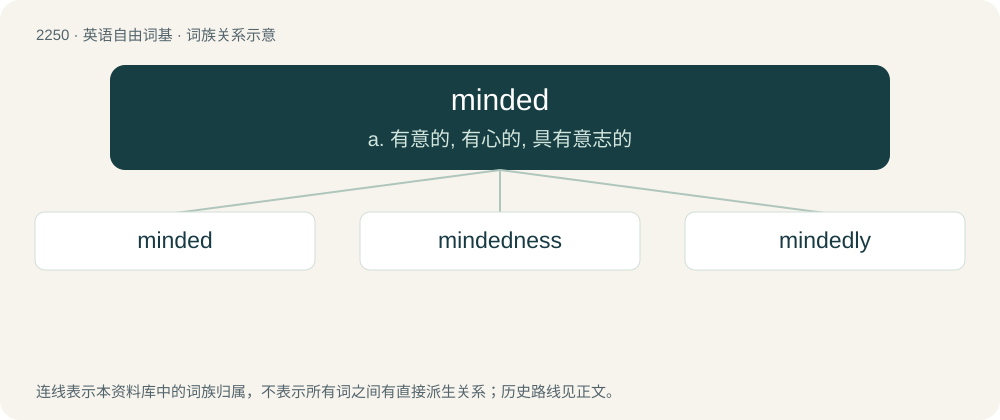

# 2355 · minded — a. 有意的, 有心的, 具有意志的

[总目录](../00_总目录_按常用程度.md)

**类型**：英语自由词基　｜　**来源语言**：见词源记录

## 核心含义与来源

- 核心含义：a. 有意的, 有心的, 具有意志的
- 英文含义：Having or exemplifying a mind of the stated type, nature or inclination.
- 词形：minded

**来源记录 1**（形容词；Having or exemplifying a mind of the stated type, nature or inclination.）

From mind + -ed. Compare Old English -mōd (“minded”), Old English ġehyġd (“minded; disposed”).

## 词族图

## 单词速览（常用到不常用）

| 单词 | 音标 | 释义 |
|---|---|---|
| [minded](#w-1) | /ˈmaɪndɪd/ | a. 有意的, 有心的, 具有意志的 |
| [mindedness](#w-2) | /ˈmaɪndɪdnɪs/ | n. 心思; 思想 |
| [mindedly](#w-3) | /ˈmaɪn.dɪdˌli/ | 【英文】In the specified minded manner |

## 逐词详解

### 1. minded

**词性**：形容词　｜　**音标**：/ˈmaɪndɪd/

**中文释义**：a. 有意的, 有心的, 具有意志的

**英文义项**：Having or exemplifying a mind of the stated type, nature or inclination. / Having a preference for doing something; having a likelihood, or disposition to carry out an act.

**构词拆分**：mind + -ed

**词源与演化**：

From mind + -ed. Compare Old English -mōd (“minded”), Old English ġehyġd (“minded; disposed”).

**例句**：

> a fair-minded decision by a traditionally minded Pope.

该用例对应义项：Having or exemplifying a mind of the stated type, nature or inclination.

### 2. mindedness

**词性**：名词　｜　**音标**：/ˈmaɪndɪdnɪs/

**中文释义**：n. 心思; 思想

**英文义项**：The state of being minded in a particular way (as in narrow-mindedness, absent-mindedness).

**构词拆分**：minded + -ness

**词源与演化**：

From minded + -ness.

### 3. mindedly

**词性**：副词　｜　**音标**：/ˈmaɪn.dɪdˌli/

**英文义项**：In the specified minded manner

**构词拆分**：minded + -ly

**词源与演化**：

From minded + -ly.
