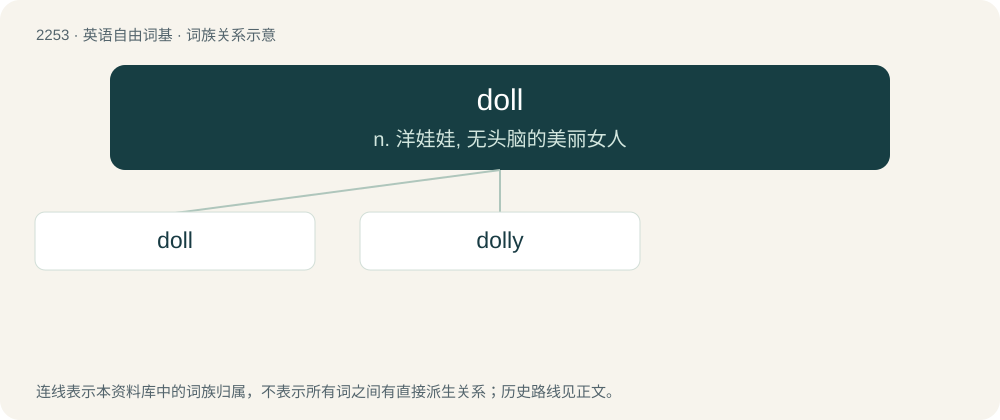

# 2357 · doll — n. 洋娃娃, 无头脑的美丽女人

[总目录](../00_总目录_按常用程度.md)

**类型**：英语自由词基　｜　**来源语言**：见词源记录

## 核心含义与来源

- 核心含义：n. 洋娃娃, 无头脑的美丽女人
- 英文含义：A small figure resembling a human being that is used as a toy.
- 词形：doll

**多个词源／构词路径**：同一拼写可能有不同来源；以下按词性和含义分别列出。

**来源记录 1**（名词；A small figure resembling a human being that is used as a toy.）

From Doll, pet form of the given name Dorothy. Etymology 1, noun sense 7 was coined and popularized by American writer Jacqueline Susann in 1966 through her book Valley of the Dolls (1966) and the film adaptation Valley of the Dolls (1967).

**来源记录 2**（名词；A temporary barrier used in horse racing.）

Probably variant of archaic dool (“boundary marker”).

## 词族图

## 单词速览（常用到不常用）

| 单词 | 音标 | 释义 |
|---|---|---|
| [doll](#w-1) | 英 /dɒl/；美 /dɑl/ | n. 洋娃娃, 无头脑的美丽女人 |
| [dolly](#w-2) | 英 /ˈdɒli/；美 /ˈdɑli/ | n. 洋娃娃, (洗衣用)捣棒；vi. 移动车；vt. 用移动车移动 |

## 逐词详解

### 1. doll

**词性**：名词　｜　**音标**：英 /dɒl/；美 /dɑl/

**中文释义**：n. 洋娃娃, 无头脑的美丽女人

**英文义项**：A small figure resembling a human being that is used as a toy. / An attractive young woman.

**词源与演化**：

From Doll, pet form of the given name Dorothy. Etymology 1, noun sense 7 was coined and popularized by American writer Jacqueline Susann in 1966 through her book Valley of the Dolls (1966) and the film adaptation Valley of the Dolls (1967).

**例句**：

> Won't you be a doll and fetch me a glass of water?

该用例对应义项：A good-natured, cooperative or helpful person.

### 2. dolly

**词性**：名词　｜　**音标**：英 /ˈdɒli/；美 /ˈdɑli/

**中文释义**：n. 洋娃娃, (洗衣用)捣棒；vi. 移动车；vt. 用移动车移动

**英文义项**：A doll. / A roughly cylindrical wooden object used as a base when molding pie crust.

**构词拆分**：doll + -y

**词源与演化**：

From doll + -y, from the given name Dorothy, originally applied either to a woman or female pet or to a children's toy, and expanded to refer to various types of contrivances or devices. The Online Etymology Dictionary, while considering the reason for applying it to such devices unobvious, compares how the names jack, jenny and jimmy are also applied to devices.
